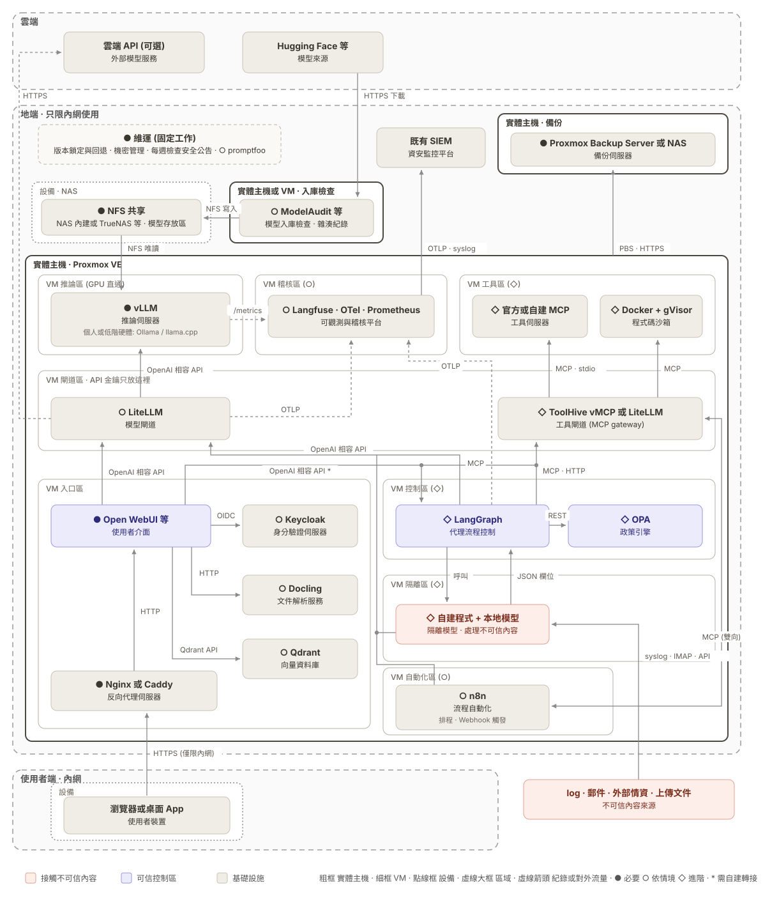

# 地端 LAN-AI 自建手冊

**結論**: 本手冊以下方的架構圖為終點, 帶 IT 與資安人員從底層原理開始, 一次組裝一個模組, 把地端 AI 系統架起來, 最後用範例說明它能解決哪些個人與企業的日常問題. 立場中立, 不預設地端優於雲端.

網站: https://githubuser03.github.io/docs-handbook-poc/

## 怎麼讀

| 部 | 內容 | 讀完能做到 |
|---|---|---|
| [架構地圖](https://githubuser03.github.io/docs-handbook-poc/start/map) | 最終要組出的系統, 每一塊由哪個模組組裝 | 知道自己需要哪幾塊 |
| 第一部 底層知識 (K1 至 K6) | 模型, 量化, 硬體, 授權, 工具呼叫, 安全 | 看懂圖上每個方塊在做什麼 |
| 第二部 模組化組裝 (M0 至 M9) | 由下往上, 每章組裝一個模組, 附驗收測試 | 一步一步把系統架起來 |
| 第三部 應用範例 (P1 至 P3, E1 至 E4) | 個人與企業的常見用途 | 知道組好的系統怎麼用 |
| 第四部 維運 (O1 至 O3) | 備份, 版本鎖定, 安全公告 | 讓系統長期安全運作 |

學習路線: 個人讀者走 K1 至 K3, M0 至 M2 (需要時加 M4), 再看範例 P1 至 P3; 企業讀者走 K1 至 K6, M0 至 M6, 有人每週維運時再加 M7 至 M9, 再看範例 E1 至 E4. 決策者先讀[一頁決策摘要](https://githubuser03.github.io/docs-handbook-poc/decide/summary)與[該不該自架決策樹](https://githubuser03.github.io/docs-handbook-poc/decide/should-self-host).

## 最終目標架構

下圖是手冊涵蓋的完整部署架構, 也就是第二部組完 M0 至 M9 的樣子. 多數讀者只會組到其中一部分: 單人組到 M2 (里程碑 1), 小團隊組到 M6 (里程碑 2), 只有多人共用且有人每週維運時才組完整張圖 (里程碑 3).

**讀圖方式**

- **由下往上**: 使用者只從內網連入反向代理, 經介面呼叫模型閘道, 再到推論伺服器. 公網沒有任何連接埠轉發.
- **三種底色**: 珊瑚色接觸不可信內容, 紫色是可信控制區, 米色是基礎設施.
- **框線**: 粗框是實體主機, 細框是 VM, 點線框是設備, 虛線大框是區域.
- **方塊寫法**: 上方是要安裝的軟體, 下方是角色; 「等」表示可換成同類產品.

**圖上各元件的關鍵設定**

| 元件 | 角色 | 關鍵設定 |
|---|---|---|
| Nginx 或 Caddy | 反向代理伺服器 | 只接受內網連線; Nginx 內建速率限制, Caddy 須另裝外掛 |
| Keycloak | 身分驗證伺服器 | 以 OIDC 提供單一登入, 可串接公司既有帳號 |
| LiteLLM | 模型閘道 | 每位使用者或每個應用各一把虛擬金鑰, 設配額; 上游金鑰只放在閘道區 |
| vLLM | 推論伺服器 | 只接受閘道連線 (`--api-key` 擋不住所有端點); 個人或低階硬體改用 Ollama 或 llama.cpp |
| LangGraph | 代理流程控制 | 寫入與刪除需人工核准; 斷路器與單次工具配額 |
| OPA | 政策引擎 | 預設拒絕; 關鍵資產清單; 對外連線白名單 |
| 自建程式 + 本地模型 | 隔離模型 | 只讀不可信內容, 沒有任何工具, 只輸出固定欄位的 JSON |
| ToolHive vMCP 或 LiteLLM | 工具閘道 (MCP gateway) | 工具白名單與第二次政策判定; ToolHive 與 MCP 伺服器容器放在工具區 |
| Docker + gVisor | 程式碼沙箱 | 無網路, 唯讀, 非 root, 資源上限, 每次執行後刪除 |
| n8n | 流程自動化 | 只經 MCP gateway 呼叫工具, 本身不保管外部系統金鑰 |
| ModelAudit 等, NFS 共享 | 模型入庫檢查與存放 | 模型來源採白名單, 入庫前掃描並記錄雜湊值; 推論伺服器以唯讀方式掛載 |
| Langfuse, OTel, Prometheus | 可觀測與稽核平台 | 保存完整提示與回應; 開源版沒有保存期限設定, 須以刪除 API 加排程控管; 紀錄轉送既有 SIEM |

**補充說明**

- Open WebUI 內建的程式碼執行 (Jupyter 引擎) 與外掛 (Tools, Functions) 都在伺服器端執行, 不能取代程式碼沙箱. 建議關閉 Jupyter 引擎, 外掛只限管理者匯入; 若啟用 Open Terminal, 部署在 VM 工具區.
- 圖中「*」的連線 (介面呼叫 LangGraph) 沒有現成接法, 須自建轉接.
- 圖中的產品為舉例, 版本與替代方案見[參考資料](https://githubuser03.github.io/docs-handbook-poc/ref/versions). 圖由 `scripts/gen-architecture.py` 產生, 修改圖面請改腳本後執行 `npm run diagram`.

## 目前狀態 (資料基準日 2026-10-26)

| 範圍 | 現況 |
|---|---|
| 可閱讀 | 使用說明, 架構地圖, K1 至 K6, 組裝總覽, M0 至 M9, 7 個應用範例, O1 至 O3, 決策參考 6 頁 |
| 僅有大綱 | 延伸主題 T1 至 T3 (訓練微調) |
| 指令 | 依官方文件整理, 尚未實機驗證 |
| 數字 | 皆附來源; 超出事實的判斷標示信心水準 (高, 中, 低) |
| 待核對資料 | 版本號與 CVE 多為二手來源, 各頁已逐筆標示; 引用前請先確認 |

## 適用範圍

- **適合**: 評估或建置地端 AI 的 IT 與資安人員, 其主管與顧問.
- **不適合**: 直接當作採購規格, 或正式環境的唯一依據.
- **不涵蓋**: 法規解讀 (請洽法律顧問), 雲端方案的完整比較, 特定廠商背書.

## 回報與維護

- 發現錯誤或過期資料, 請開 Issue, 並附上來源網址.
- 修改流程與寫作規範見[維護指南](MAINTAINING.md)與[寫作規範](STYLE.md).
- 授權: 尚未指定.
