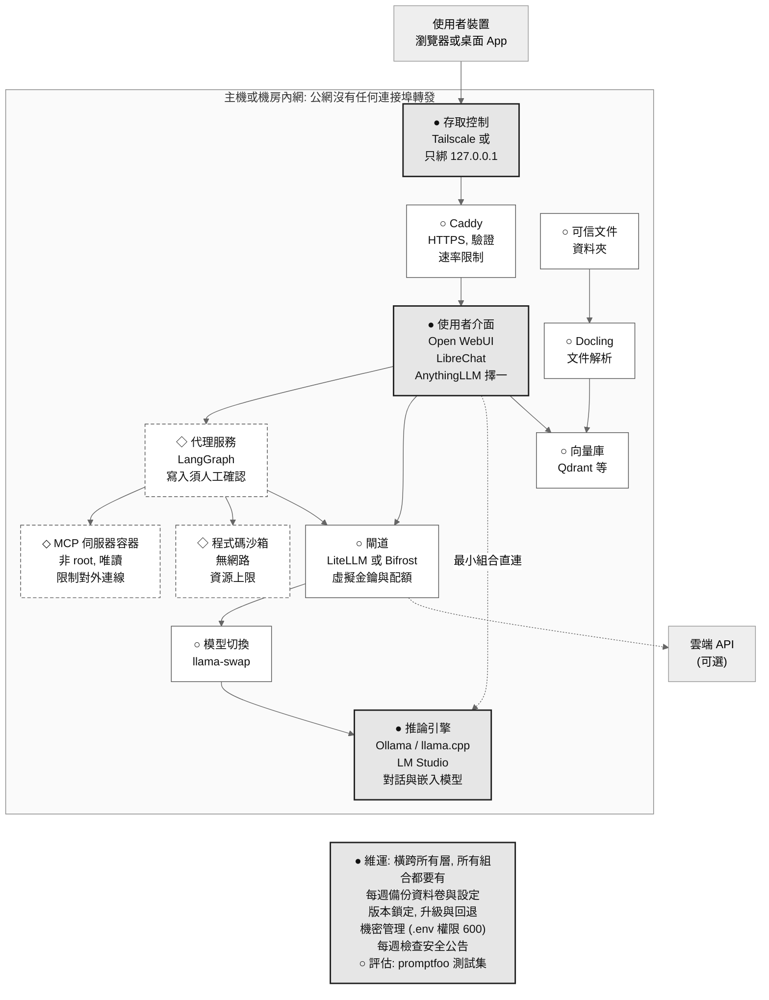

# 地端 AI 手冊

**結論**: 本手冊協助 IT 與資安人員判斷該不該在自己的環境執行 AI 模型, 並說明如何以開源元件架設與維運. 立場中立, 不預設地端優於雲端.

網站: https://githubuser03.github.io/docs-handbook-poc/

## 先讀這裡

評估階段先讀下列三頁:

1. [一頁決策摘要](https://githubuser03.github.io/docs-handbook-poc/decide/summary): 三項判斷前提與建議的下一步.
2. [該不該自架決策樹](https://githubuser03.github.io/docs-handbook-poc/decide/should-self-host): 依資料, 用量與維運能力得到初步方向.
3. [成本試算表](https://githubuser03.github.io/docs-handbook-poc/decide/tco): 填入自己的數字, 比較自架與雲端 API.

決定要試做時, 接著讀[30 天 PoC 計畫](https://githubuser03.github.io/docs-handbook-poc/decide/poc-30days).

## 最終目標架構

下圖是手冊涵蓋的完整架構. 多數讀者只會用到其中一部分: 最小組合只需要 ● 標示的元件加上維運, 其餘依需求逐層加入 (第 3 章, 第 9 章).

| 標示 | 意義 |
|---|---|
| ● 灰底粗框 | 必要, 所有組合都需要 |
| ○ 白底實線 | 依情境才加, 條件見各章章首 |
| ◇ 白底虛線 | 進階, 須有人每週維運 |
| 虛線箭頭 | 選用路徑: 最小組合由介面直連推論引擎; 雲端 API 只經閘道連出 |

圖中的元件名稱為舉例, 版本與替代方案見[參考資料](https://githubuser03.github.io/docs-handbook-poc/ref/versions). 各層的選擇條件見第 3 章與第 9 章.

## 目前狀態 (資料基準日 2026-10-26)

| 項目 | 現況 |
|---|---|
| 可閱讀 | 第 1, 3, 5, 7 至 14, 18 至 20 章, 以及決策參考 6 頁 |
| 僅有大綱 | 第 2, 4, 6, 15, 16, 17 章 |
| 指令 | 依官方文件整理, 尚未實機驗證 |
| 數字 | 皆附來源; 超出事實的判斷標示信心水準 (高, 中, 低) |
| 待核對資料 | 版本號與 CVE 多為二手來源, 各頁已逐筆標示; 引用前請先確認 |

## 適用範圍

- **適合**: 評估或建置地端 AI 的 IT 與資安人員, 其主管與顧問.
- **不適合**: 直接當作採購規格, 或正式環境的唯一依據.
- **不涵蓋**: 法規解讀 (請洽法律顧問), 雲端方案的完整比較, 特定廠商背書.

## 內容地圖

| 群組 | 章 | 重點 |
|---|---|---|
| 決策參考 | 決策摘要, 決策樹, 成本試算, 風險自評, 授權紅旗, 30 天 PoC | 該不該自架, 要花多少, 風險在哪 |
| 一、入門概念 | 使用說明, 基本概念, 分層與預設組合 | 先分清必要與依情境才加的層 |
| 二、評估選擇 | 授權, 量化與記憶體, 工具呼叫, 硬體 | 模型跑不跑得動, 該買什麼 |
| 三、架設部署 | 第一次執行, 三種參考架構, 閘道, 安全 | 從單機到小團隊的做法 |
| 四、應用擴充 | 檢索增強生成, 工作流程與 MCP, 評估測試 | 要問自己的文件時才讀 |
| 五、訓練微調 | 是否需要, 微調, 預訓練 | 多數需求不需要 |
| 六、維運更新 | 備份, 版本鎖定與升級, 安全公告 | 長期維運的必要工作 |
| 參考資料 | 版本與 CVE, 授權速查, 硬體價格, 基準分數, 模型建議, 術語 | 變動快的資料集中於此 |

## 回報與維護

- 發現錯誤或過期資料, 請開 Issue, 並附上來源網址.
- 修改流程與寫作規範見[維護指南](MAINTAINING.md)與[寫作規範](STYLE.md).
- 授權: 尚未指定.
