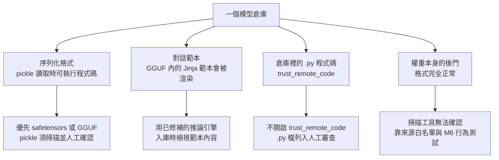
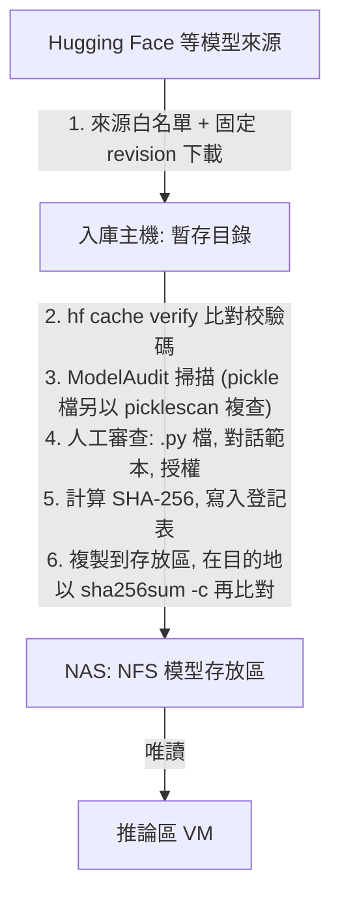
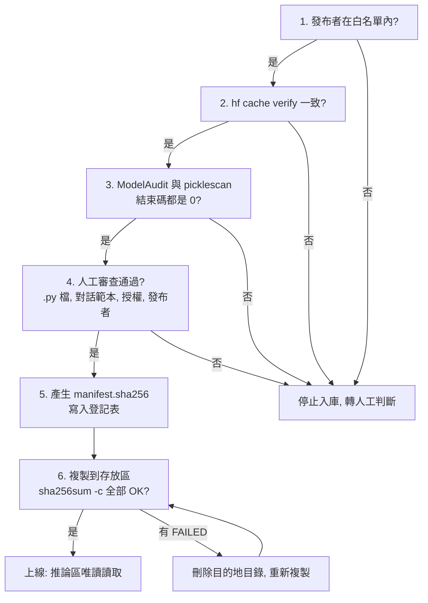
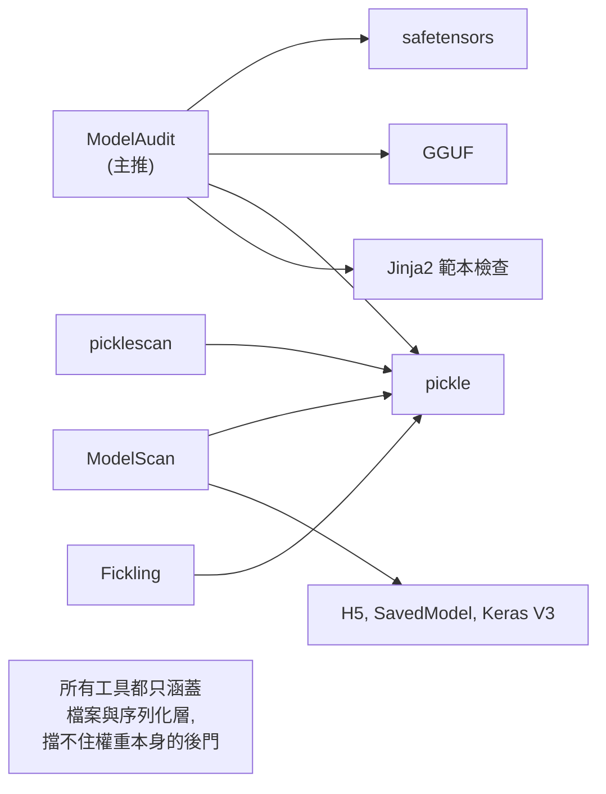
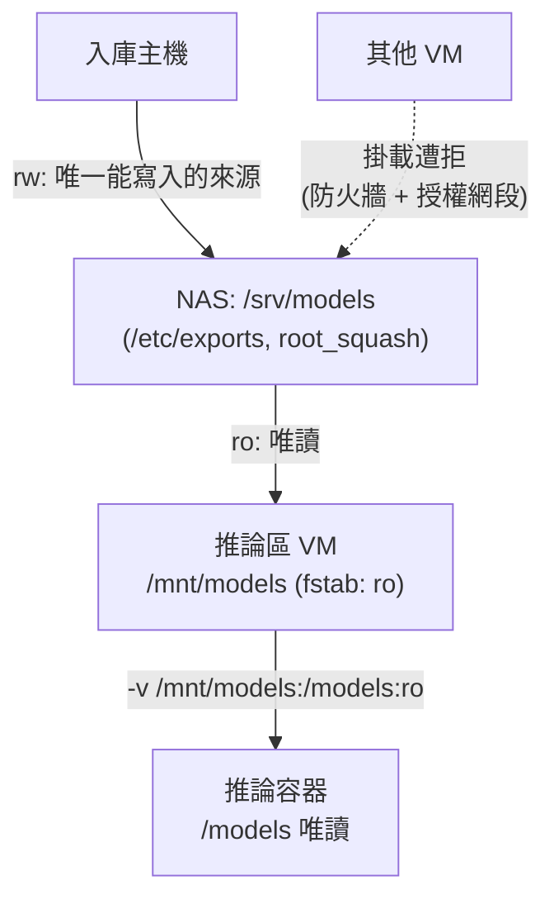
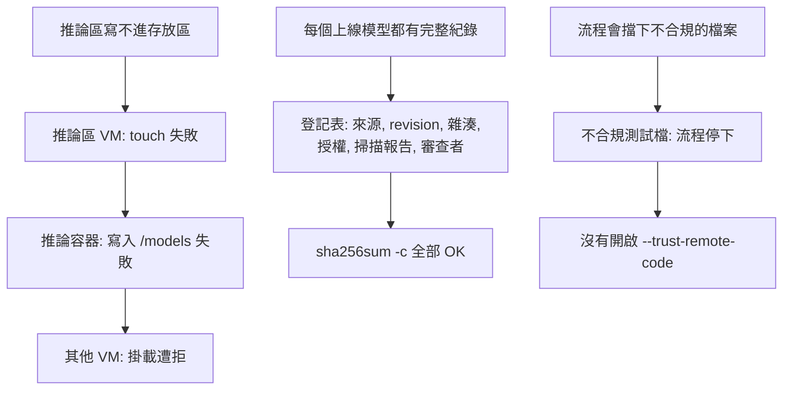

# M3 模型入庫與存放

::: info 本章屬性
- 等級: ○ 依情境, 模型多於一兩個或多人共用時
- 狀態: 可閱讀
- 資料基準日: 2026-10-27
- 實機驗證: 未進行 (本章指令與設定檔依官方文件整理, 尚未在實機執行; 需實機確認: TrueNAS 上推論區唯讀與入庫主機可寫兩種權限的實際設定方式)
:::

**結論**: 模型檔是推論伺服器會載入並執行的供應鏈輸入. 下載後先檢查, 記錄雜湊值, 再放進唯讀的模型存放區; 推論伺服器只從存放區讀取, 不直接從網路下載. 掃描工具本手冊主推 ModelAudit, 但任何掃描工具都只涵蓋檔案與序列化層, 擋不住權重本身的後門, 所以來源白名單與行為測試仍不可少.

**這一塊在圖上的位置**: 雲端的 Hugging Face 等模型來源, 入庫檢查主機 (ModelAudit 等掃描模型檔的工具; 架構圖標示為 ModelScan, 選擇理由見 M3.2 節), 以及 NAS 上的 NFS 共享. **前置模組**: M0. **完成後的狀態**: 每個上線的模型都有來源, 版本與雜湊紀錄, 推論伺服器無法改動模型檔.

這一章處理「模型檔從哪裡來, 怎麼確認沒問題, 放在哪裡」. 可以想成餐廳的進貨流程: 食材只向登記過的供應商進貨, 到貨先在收貨區檢查與登記, 合格後才上架; 廚房只能從架上拿, 不能自己改動架上的貨. 只用一兩個知名模型的個人讀者, 照 M1.5 節的下載驗證即可; 模型變多或多人共用時, 才需要本章完整的流程.

::: tip 本章常見名詞
| 詞 | 意思 |
|---|---|
| 入庫 | 模型檔經檢查與登記後, 放進正式存放區的流程 |
| 序列化格式 | 把模型的數字存成檔案的方式, 例如 pickle, safetensors, GGUF |
| pickle | Python 的存檔格式, 讀取時可能執行檔案裡夾帶的程式碼 |
| 對話範本 (chat template) | 把對話排成模型看得懂格式的小程式, 會在推論伺服器上執行 |
| 雜湊值 (hash) 與 SHA-256 | 由檔案內容算出的固定長度字元; SHA-256 是常用的計算方法 |
| 白名單 | 事先核准, 允許下載模型的發布者清單 |
| NAS 與 NFS | NAS 是放在網路上的儲存設備; NFS 是讓其他電腦把 NAS 上的資料夾當成本機資料夾使用的協定 |
| 唯讀 (read-only) 掛載 | 只能讀, 不能寫入或刪除 |
:::

## M3.1 模型檔的風險: 格式, 對話範本與遠端程式碼

模型檔看起來只是一大包數字, 但有些格式在讀取時會執行程式碼, 有些檔案附帶會被執行的範本或程式. 因此下載來源不明的模型檔, 風險和執行來源不明的程式相近.

模型檔的風險來自三個層次: 序列化格式本身, 檔案內附帶的對話範本, 以及倉庫裡的程式碼. 三者的檢查方式不同.

下圖把三個層次, 加上權重本身的後門, 與各自的因應方向對應起來:



| 風險來源 | 說明 | 因應方向 |
|---|---|---|
| pickle 格式 (`.bin`, `.pt`, `.pth`, `.pkl` 等) | Python 官方文件指出 pickle 不安全, 可以構造在反序列化時執行任意程式碼的資料 (來源: Python 文件 pickle) | 優先選 safetensors 或 GGUF; 必須用 pickle 時, 入庫前掃描並人工確認 |
| safetensors | Hugging Face 將它定位為「相對於 pickle, 能安全儲存張量」的格式 (來源: Hugging Face 文件 Safetensors) | 首選格式; 仍要檢查同一倉庫的其他檔案 |
| GGUF 的對話範本 | GGUF 除了張量, 還包含一組標準化的中繼資料 (來源: Hugging Face 文件 GGUF); 其中 `tokenizer.chat_template` 是 Jinja 範本 (Jinja 是 Python 常用的文字範本語言; 來源: GGUF 規格) | 範本會在推論伺服器上渲染, 入庫時要檢視內容, 並與模型一起鎖定版本 |
| `trust_remote_code` | Transformers (Hugging Face 用來載入與執行模型的 Python 程式庫) 的 `trust_remote_code` 預設為 False; 設為 True 會在本機執行 Hub 上的程式碼, 官方建議只對信任且讀過程式碼的倉庫開啟 (來源: Transformers 文件 Auto Classes) | 不開啟; 倉庫含 `.py` 檔時列為人工審查事項 |
| 權重本身的後門 | 惡意行為藏在權重數值中, 檔案格式完全正常 | 檔案掃描工具無法確認; 靠來源白名單與 M6 的行為測試 (推論, 信心: 中) |

**對話範本已有實際漏洞**: llama-cpp-python (讓 Python 程式呼叫 llama.cpp 推論引擎的套件) 的 CVE-2024-34359 (GHSA-56xg-wfcc-g829) 中, 套件從 GGUF 中繼資料讀出對話範本, 再以未啟用沙箱的 Jinja2 環境渲染, 精心構造的範本即可遠端執行程式碼. 受影響與修補版本見[版本頁](/ref/versions) (來源: GitHub Security Advisory GHSA-56xg-wfcc-g829). 這個案例說明「格式安全」不等於「整個檔案安全」: GGUF 不是 pickle, 但其中的範本仍是推論引擎會執行的程式邏輯. 因應方式是使用已修補的推論引擎, 並在入庫時檢視範本內容.

**`trust_remote_code=False` 也不是萬全**: 推論伺服器 vLLM (見 M1) 在 2026-08 公告的 GHSA-3c86-2m5g-59q7 指出, 未修補的版本 (修補版本見[版本頁](/ref/versions)) 載入 LlavaOnevision2 架構的處理器時, 會忽略 `trust_remote_code=False`, 執行惡意模型倉庫中的處理器程式碼 (來源: vLLM GitHub Security Advisory GHSA-3c86-2m5g-59q7). 入庫時把倉庫內的 `.py` 檔一律列入人工審查, 可以補上這類推論引擎本身的缺陷 (推論, 信心: 中). 推論引擎的版本追蹤見 M1.10 節與 [O3](/ops/advisories).

## M3.2 入庫流程: 白名單, 固定版本, 掃描, 登記

入庫流程把「下載」和「上線」分開: 先下載到暫存區, 檢查通過才搬進存放區. 入庫在一台獨立的入庫主機上執行. 只有這台主機能連 Hugging Face, 也只有它能寫入模型存放區 (推論, 信心: 中). 下圖是入庫的五個步驟:



每一步都是一道關卡, 任一步沒有通過就停下. 下圖是各步沒有通過時的處理:



### 第 1, 2 步: 來源白名單, 固定版本下載與校驗

- 白名單只列模型原始發布者的官方組織帳號, 以及團隊已審查過的少數知名轉檔者. 白名單本身納入版本控制, 增刪都留紀錄 (推論, 信心: 中).
- 下載時一律指定 revision (commit hash), 不使用會變動的 main. 指令與 M1.5 節相同, 差別是改存到暫存目錄 (來源: Hugging Face 文件 CLI guide; 未實機驗證). `hf` 是 Hugging Face 官方的命令列工具, 負責下載與驗證模型檔. 第一行下載指定版本, 第二行比對校驗碼:

```bash
hf download <組織/模型庫> --revision <commit hash> --local-dir <暫存目錄>

# 驗證本機目錄的檔案與 Hub 上的校驗碼一致; 缺檔或多檔也視為錯誤
hf cache verify <組織/模型庫> --local-dir <暫存目錄> --fail-on-missing-files --fail-on-extra-files
```

`hf cache verify` 可以驗證快取, 也可以驗證一般的本機目錄; 有不符時會列出清單並以非零狀態碼結束 (來源同上). 官方文件未說明 `--revision` 能否與 `--local-dir` 並用, 因此下載時就要指定 revision. 校驗碼一致只證明檔案和 Hub 上相同, 不證明發布者可信 (見 M1.5 節).

只要 safetensors 檔時, 可用 `--include "*.safetensors"` 篩選 (來源同上). 但對話範本與設定檔也要一起下載, 才能完成第 4 步的審查.

### 第 3 步: 掃描工具的選擇

掃描工具會打開模型檔, 檢查裡面有沒有可疑的程式碼或寫法, 作用類似防毒軟體, 但專門針對模型檔. 四個常見工具的現況如下. 涵蓋範圍為各專案自述, 未經第三方評測; 最近發布日取自 PyPI (Python 套件的官方發布平台) 專案資料 (2026-10-26 查詢).

| 工具 | 維護者與授權 | 涵蓋範圍 (依各自官方說明) | 最近發布 |
|---|---|---|---|
| ModelAudit | promptfoo, MIT | 30 種以上格式的掃描器, 含 PyTorch, safetensors, GGUF/GGML, ONNX, Keras, pickle, TensorFlow SavedModel; 列有 Jinja2 範本掃描器與 template injection 檢查, 以及授權檢查; 輸出 text, JSON, SARIF | 2026-10 |
| ModelScan | Protect AI, Apache-2.0 | H5, pickle (含 PyTorch, joblib, dill 等衍生格式), SavedModel 與 Keras V3; README 未列 safetensors 與 GGUF; 同頁推廣商用版 Guardian | 2026-02 |
| picklescan | 個人維護, MIT | pickle, PyTorch `.bin`, NumPy `.npy`; 可掃本機路徑, URL 與 Hugging Face 倉庫 | 2026-07 |
| Fickling | Trail of Bits, LGPL-3.0 | pickle 的反編譯, 靜態分析與改寫; 以符號執行取代實際反序列化; 提供 ML 函式庫匯入的允許清單 | 2026-06 |

下圖對照各工具涵蓋的格式 (依各專案自述, 未經第三方評測):



**主推 ModelAudit, 理由有三** (推論, 信心: 中):

1. 它是四者中唯一同時涵蓋 safetensors, GGUF 與 pickle 的工具, 與 M1.5 節「優先 safetensors 或 GGUF」的建議一致.
2. 它列有 Jinja2 範本的檢查, 對應 M3.1 節的對話範本風險. 官方文件未明寫是否檢查 GGUF 內嵌的範本 (2026-10-27 查詢), 但 0.2.54 版的套件原始碼中, GGUF 掃描器會讀出 `tokenizer.chat_template` 中繼資料並送進範本檢查 (來源: PyPI modelaudit 0.2.54 套件原始碼 scanners/gguf_scanner.py). 掃描只能找出已知的可疑寫法, 第 4 步的人工審查仍不能省.
3. 它可輸出 SARIF (資安掃描結果的標準交換格式) 與 JSON, 結束碼可直接當作入庫關卡.

架構圖上標的 ModelScan 仍可使用, 適合以 pickle, H5 與 SavedModel 為主的環境. pickle 檔建議再以 picklescan 或 Fickling 複查一次, 兩個工具的判斷方式不同, 可互相補足 (推論, 信心: 中).

**所有掃描工具都只涵蓋檔案與序列化層**. ModelAudit 官方 README 自述為不載入, 不執行模型的靜態掃描, 對權重只回報「可能的後門跡象」(potential backdoor indicators); 這是統計上的提示, 不代表能確認權重沒有後門 (來源: ModelAudit GitHub README). 權重層的風險, 靠來源白名單與 M6 的回歸測試集處理.

**掃描指令** (依各工具官方文件整理, 未實機驗證). `pip install` 是安裝 Python 套件的指令; `echo $?` 顯示上一個指令的結束碼, 結束碼是程式結束時回報的數字, 用來判斷結果:

```bash
# ModelAudit: 掃描整個暫存目錄, 輸出 JSON 報告
pip install "modelaudit[all]"
modelaudit scan <暫存目錄> --format json > <報告目錄>/modelaudit.json
echo $?   # 0: 未發現問題; 1: 發現問題; 2: 執行錯誤或無法判定

# picklescan: 複查 pickle 檔
pip install picklescan
picklescan --path <暫存目錄>
echo $?   # 0: 未發現; 1: 發現惡意內容; 2: 掃描失敗
```

ModelAudit 的結束碼依 promptfoo 文件 ModelAudit; picklescan 的結束碼依其 GitHub README. 入庫規則建議為: 任一工具結束碼不是 0, 就停止入庫並轉人工判斷. promptfoo 文件提到, 結束碼 1 代表「應審查的發現」, 不一定要阻擋部署; 本手冊對入庫採較嚴格的做法 (推論, 信心: 中).

套件本身也要固定版本 (見 O2), 入庫主機不要與推論區共用.

### 第 4 步: 人工審查

掃描工具只能找出已知的可疑寫法, 有些事項仍要由人判斷. 掃描通過後, 由一位審查者確認下列事項:

- [ ] 倉庫內有沒有 `.py` 檔. 有的話, 先讀過程式碼; 無法確認時不入庫 (對應 `trust_remote_code` 與 GHSA-3c86-2m5g-59q7)
- [ ] 對話範本的內容是否只做訊息排版, 沒有呼叫屬性或函式的可疑寫法. GGUF 的中繼資料可在 Hugging Face 的 GGUF 檢視器查看 (來源: Hugging Face 文件 GGUF); safetensors 格式的倉庫, 對話範本放在根目錄的 `chat_template.jinja` (Transformers 目前預設的存法), 較早的倉庫則放在 `tokenizer_config.json` 的 `chat_template` 欄位, 兩者都有時以 `.jinja` 檔為準 (來源: Hugging Face Transformers 文件 Writing a chat template)
- [ ] 授權是否允許預定用途 (見 [K4](/know/k4-licenses) 與[授權速查](/ref/licenses))
- [ ] 模型卡上的發布者與白名單一致

### 第 5 步: 雜湊值與登記表

雜湊值像檔案的指紋: 檔案只要被改動一點, 指紋就會不同. 以 SHA-256 為每個檔案產生清單, 和模型檔一起存放; 推論區之後可以用同一份清單重新比對 (`sha256sum` 為 GNU coreutils 通用指令, coreutils 是 Linux 內建的基本指令集; 未實機驗證):

```bash
cd <暫存目錄>
find . -type f ! -name manifest.sha256 -exec sha256sum {} + > manifest.sha256
```

### 第 6 步: 搬到 NAS 存放區並再比對一次

前五步都在入庫主機的暫存目錄進行. 最後由入庫主機 (M3.3 節中唯一能寫入存放區的來源) 把整個暫存目錄, 連同 `manifest.sha256`, 複製到 NAS 存放區中含 revision 的路徑, 再到目的地重新比對一次雜湊值, 確認複製過程沒有改動檔案. 下列指令以入庫主機掛載存放區於 `/srv/models` 為例 (`cp` 與 `sha256sum -c` 為 GNU coreutils 通用指令, 未實機驗證):

```bash
mkdir -p /srv/models/<組織>/<模型>/<revision>
cp -a <暫存目錄>/. /srv/models/<組織>/<模型>/<revision>/
cd /srv/models/<組織>/<模型>/<revision>
sha256sum -c manifest.sha256
```

`sha256sum -c` 每個檔案都顯示 OK 才算完成; 有任何 FAILED, 刪除目的地目錄後重新複製. 完成後, 推論區就能以 M1.10 節的 `--model /models/<組織>/<模型>/<revision>` 讀到這個版本.

登記表沿用 M1.5 節的欄位, 再加四欄:

| 欄位 | 說明 |
|---|---|
| 對應白名單 | 對應白名單中的哪一個發布者 |
| 掃描報告 | ModelAudit 與 picklescan 報告的存放位置與結果 |
| 審查者與日期 | 誰完成第 4 步的人工審查, 何時完成 |
| 存放路徑 | 例如 `<組織>/<模型>/<revision>/`, 路徑含 revision, 新舊版本可以並存 |

## M3.3 模型存放區: NFS 唯讀匯出

模型檔放在 NAS 上集中管理, 推論區透過 NFS 讀取. 權限設計的重點是: 推論伺服器只能讀, 不能改; 能寫入的只有入庫主機. 萬一推論伺服器被入侵, 攻擊者也無法替換模型檔.

**原則**: NAS 以 NFS 提供兩種權限. 推論區只能唯讀掛載; 入庫主機是唯一能寫入的來源. 這兩件事都在 NAS 端設定, 不依賴推論區 VM 自律.

下圖是存放區的權限關係: 只有入庫主機能寫入, 推論區唯讀掛載, 再以唯讀方式掛進容器 (依本節設定繪製, 未實機驗證):



### Linux NFS 伺服器 (`/etc/exports`)

`exports(5)` 說明了下列行為 (來源: Linux man page exports(5)):

- 預設拒絕任何會改變檔案系統的請求, 也就是 `ro` 是預設值; 要寫入須明確寫 `rw`.
- `root_squash` 是預設值, 會把客戶端 uid 0 的請求對應到匿名使用者.
- `sec=` 的預設是 `sys`, 不提供密碼學層級的保護; 需要時可改用 `krb5`, `krb5i` 或 `krb5p`, 也就是以 Kerberos (集中式網路身分驗證協定) 驗證的選項.
- 修改 `/etc/exports` 後執行 `exportfs -ra` 套用.

範例 (未實機驗證; 網段為佔位符). 這一行設定把 `/srv/models` 分享出去: 推論區網段唯讀, 入庫主機可寫:

```
# /etc/exports
/srv/models  <推論區網段>(ro,sync,root_squash)  <入庫主機位址>(rw,sync,root_squash)
```

`sec=sys` 不驗證客戶端身分, 因此 NFS 要放在只有推論區與入庫主機能到達的 VLAN, 並由 M0.2 節的防火牆規則限制來源 (推論, 信心: 中).

### TrueNAS

TrueNAS 是常見的 NAS 作業系統, 以網頁介面設定共享. TrueNAS 的 NFS 共享設定中, Advanced Options 的 Read-Only 會禁止寫入; Authorized Networks 與 Authorized Hosts 可把存取限定在指定網段或主機, 留空則允許所有網路 (來源: TrueNAS 25.10 穩定版文件 Adding NFS Shares). 推論區使用的共享請勾選 Read-Only, 並只授權推論區網段. 入庫主機需要寫入權限; TrueNAS 文件未說明同一個資料集能否以兩個 NFS 共享分別設定唯讀與可寫 (2026-10-27 查詢), 設定時先在測試資料集上確認, 不行時改以只授權入庫主機的另一個共享寫入, 再由推論區唯讀讀取同一份檔案 (推論, 信心: 中).

### 推論區的掛載方式

推論區 VM 端也以唯讀掛載, 再以唯讀方式掛進容器, 形成兩層保護 (依 nfs(5) 與 Docker 文件 Bind mounts 整理, 未實機驗證). `/etc/fstab` 是 Linux 開機時自動掛載的清單:

```
# 推論區 VM 的 /etc/fstab
<NAS 位址>:/srv/models  /mnt/models  nfs  ro  0 0
```

```bash
# 容器內同樣唯讀
docker run ... -v /mnt/models:/models:ro ...
```

`nfs(5)` 指出一般掛載選項 (如 `ro`) 依 `mount(8)` 的說明; 未指定 `nfsvers` 時, 客戶端會先嘗試 NFS 4.2, 再向下協商 (來源: Linux man page nfs(5)). vLLM 的完整掛載範例見 M1.10 節.

### 備份

[O1](/ops/backup) 將模型檔列為「不必備份, 可重新下載」. 入庫流程加上去之後, 要備份的是能重建模型存放區的資料: 登記表, 白名單, SHA-256 清單, 掃描報告與審查紀錄, 每週納入 O1 的備份範圍. 若來源倉庫可能下架, 或環境無法連網, 已核准的模型檔本身也要另存一份到另一台裝置 (推論, 信心: 中).

## M3.4 驗收測試

驗收重點是兩件事: 推論區確實寫不進存放區, 以及每個上線模型都查得到完整紀錄. `touch` 是建立空白檔案的指令, 在唯讀的位置執行會失敗.

下圖把下列檢查項目分組:



- [ ] 在推論區 VM 執行 `touch /mnt/models/test`, 應出現唯讀錯誤
- [ ] 在推論容器內嘗試寫入 `/models`, 同樣失敗
- [ ] 從推論區與入庫主機以外的 VM 掛載 NFS, 應遭拒絕
- [ ] 任選一個上線模型, 在登記表查得到來源, revision, 雜湊值, 授權, 掃描報告與審查者
- [ ] 在推論區 VM 進入該模型目錄執行 `sha256sum -c manifest.sha256`, 全部顯示 OK
- [ ] 以一個刻意不合規的測試檔 (例如來源不在白名單, 或掃描結束碼不是 0) 跑一次入庫流程, 確認流程會停下
- [ ] 推論伺服器的設定中沒有開啟 `--trust-remote-code`, 也不會自行從網路下載模型 (見 M1.10 節)

## 參考來源

- [Python 文件: pickle](https://docs.python.org/3/library/pickle.html)
- [Hugging Face 文件: Pickle Scanning](https://huggingface.co/docs/hub/security-pickle)
- [Hugging Face 文件: Safetensors](https://huggingface.co/docs/safetensors/index)
- [Hugging Face 文件: GGUF](https://huggingface.co/docs/hub/gguf)
- [GGUF 規格 (ggml-org/ggml)](https://github.com/ggml-org/ggml/blob/master/docs/gguf.md)
- [Transformers 文件: Auto Classes](https://huggingface.co/docs/transformers/model_doc/auto)
- [Transformers 文件: Customizing models](https://huggingface.co/docs/transformers/models)
- [GitHub Security Advisory: GHSA-56xg-wfcc-g829 (llama-cpp-python, CVE-2024-34359)](https://github.com/abetlen/llama-cpp-python/security/advisories/GHSA-56xg-wfcc-g829)
- [vLLM GitHub Security Advisory: GHSA-3c86-2m5g-59q7](https://github.com/vllm-project/vllm/security/advisories/GHSA-3c86-2m5g-59q7)
- [Hugging Face 文件: CLI guide](https://huggingface.co/docs/huggingface_hub/guides/cli)
- [promptfoo 文件: ModelAudit](https://www.promptfoo.dev/docs/model-audit/)
- [ModelAudit GitHub](https://github.com/promptfoo/modelaudit)
- ModelAudit 0.2.54 版套件原始碼 (scanners/gguf_scanner.py 讀取 tokenizer.chat_template): 以 pip download modelaudit==0.2.54 取得後檢視 (2026-10-27)
- [Hugging Face Transformers 文件: Writing a chat template (chat_template.jinja 與 tokenizer_config.json)](https://huggingface.co/docs/transformers/main/en/chat_templating_writing)
- [ModelScan GitHub (Protect AI)](https://github.com/protectai/modelscan)
- [picklescan GitHub](https://github.com/mmaitre314/picklescan)
- [Fickling GitHub (Trail of Bits)](https://github.com/trailofbits/fickling)
- PyPI 專案頁 (發布日期): 於 pypi.org 搜尋 modelaudit, modelscan, picklescan, fickling
- [Linux man page: exports(5)](https://man7.org/linux/man-pages/man5/exports.5.html)
- [Linux man page: nfs(5)](https://man7.org/linux/man-pages/man5/nfs.5.html)
- [TrueNAS 25.10 文件: Adding NFS Shares](https://www.truenas.com/docs/scale/25.10/scaletutorials/shares/addingnfsshares/)
- [Docker 文件: Bind mounts](https://docs.docker.com/engine/storage/bind-mounts/)
- 文中的類比 (餐廳進貨流程, 防毒軟體, 檔案的指紋): 整理者所寫, 無外部來源, 不應當作技術定義引用.
