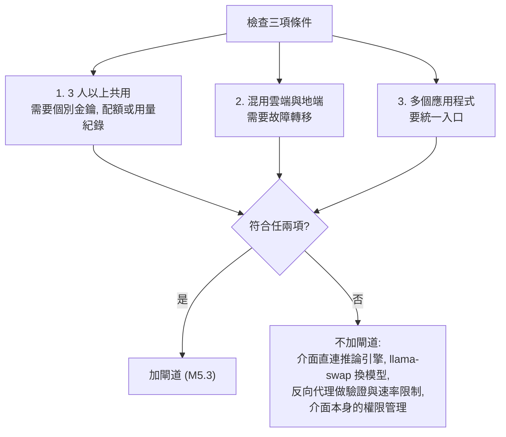
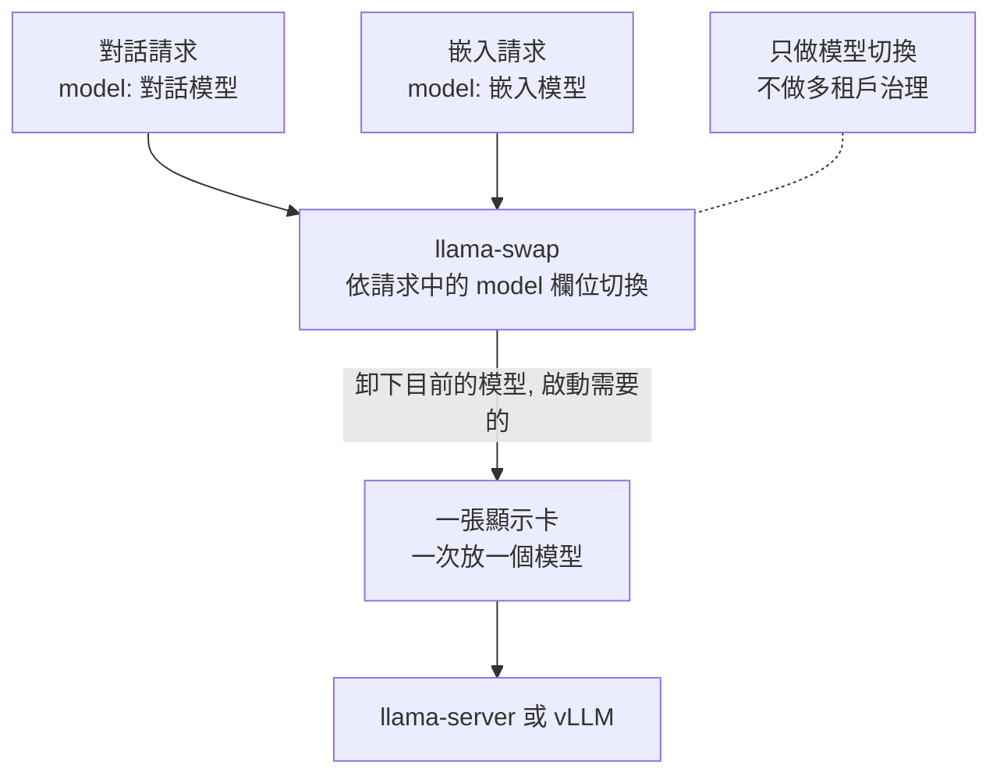
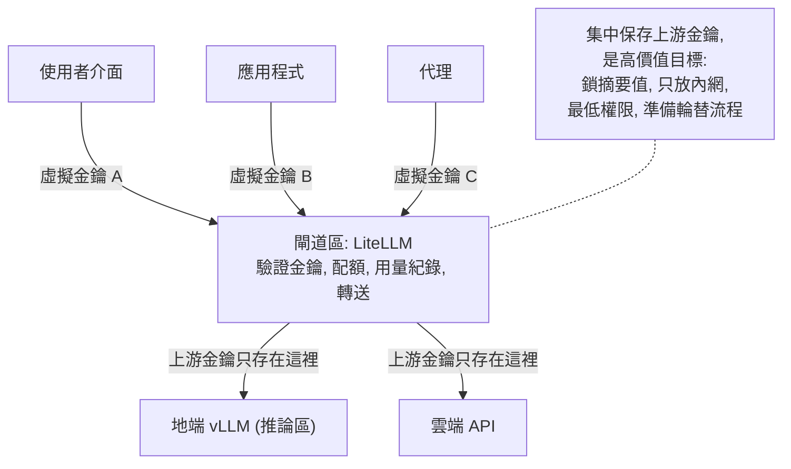
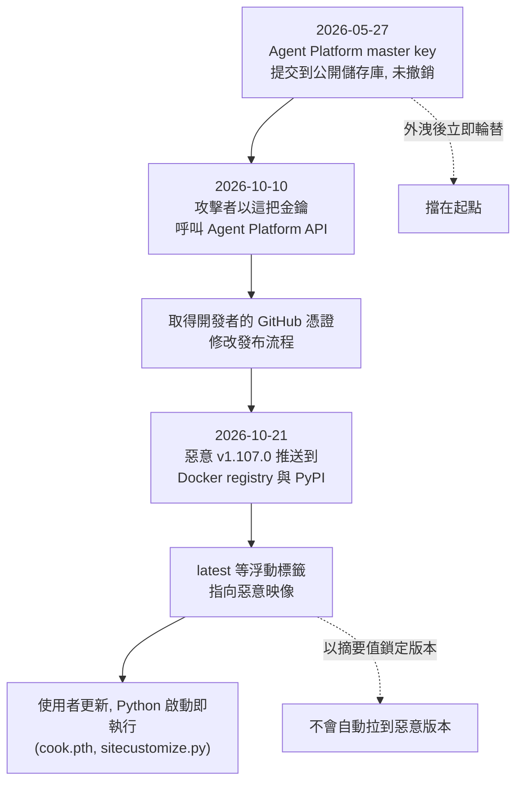
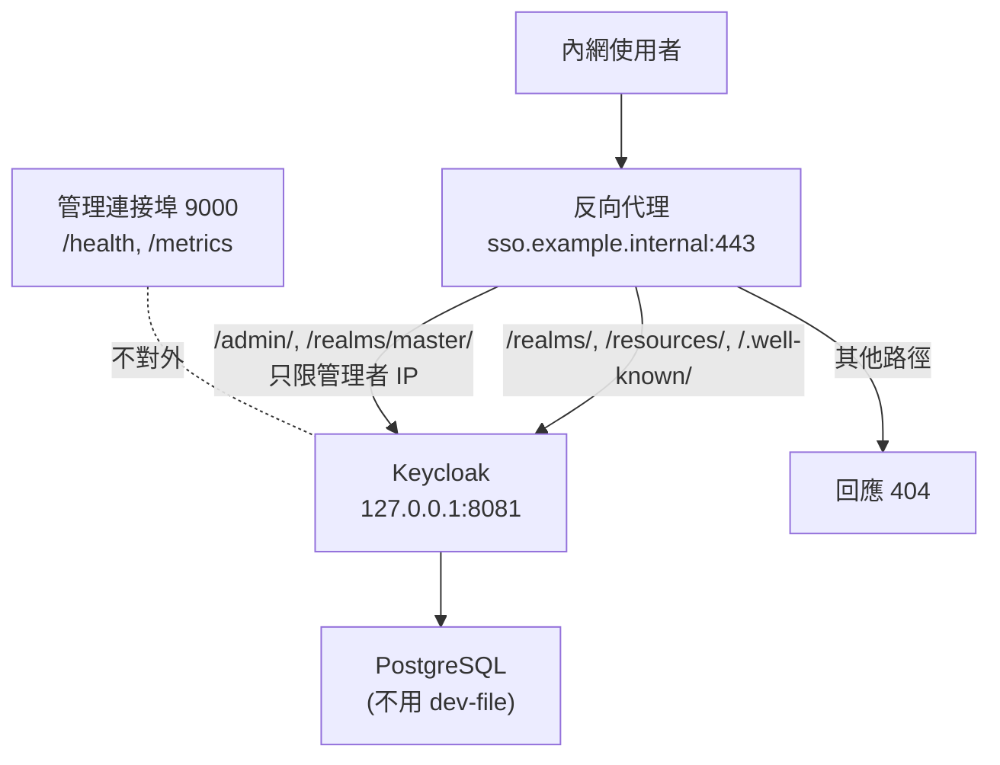
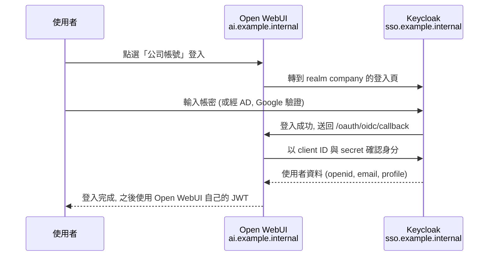
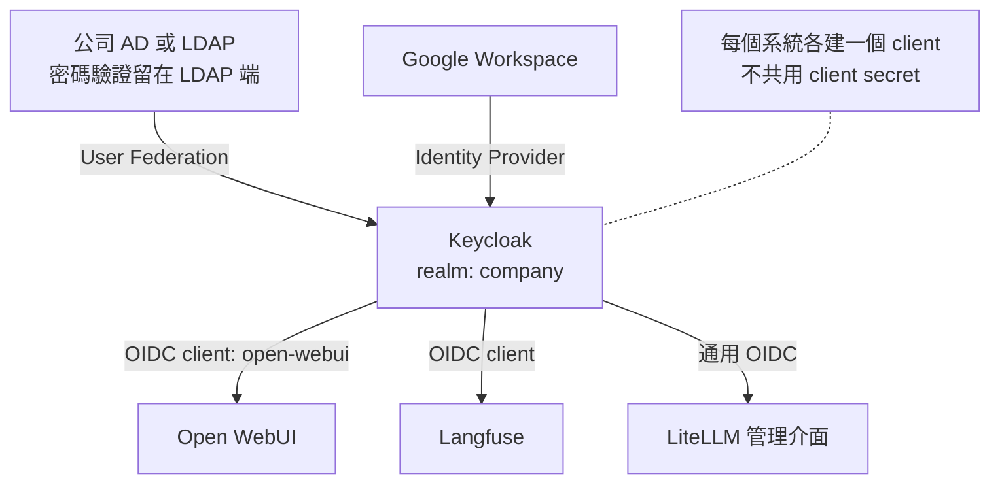
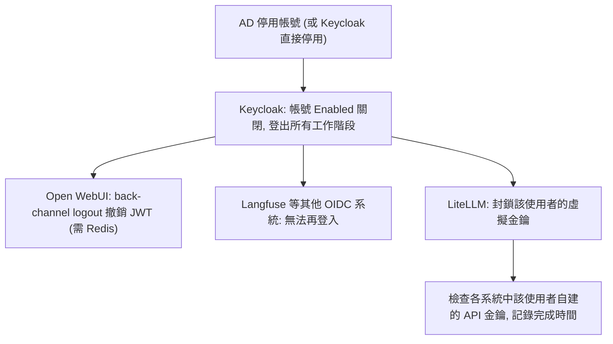
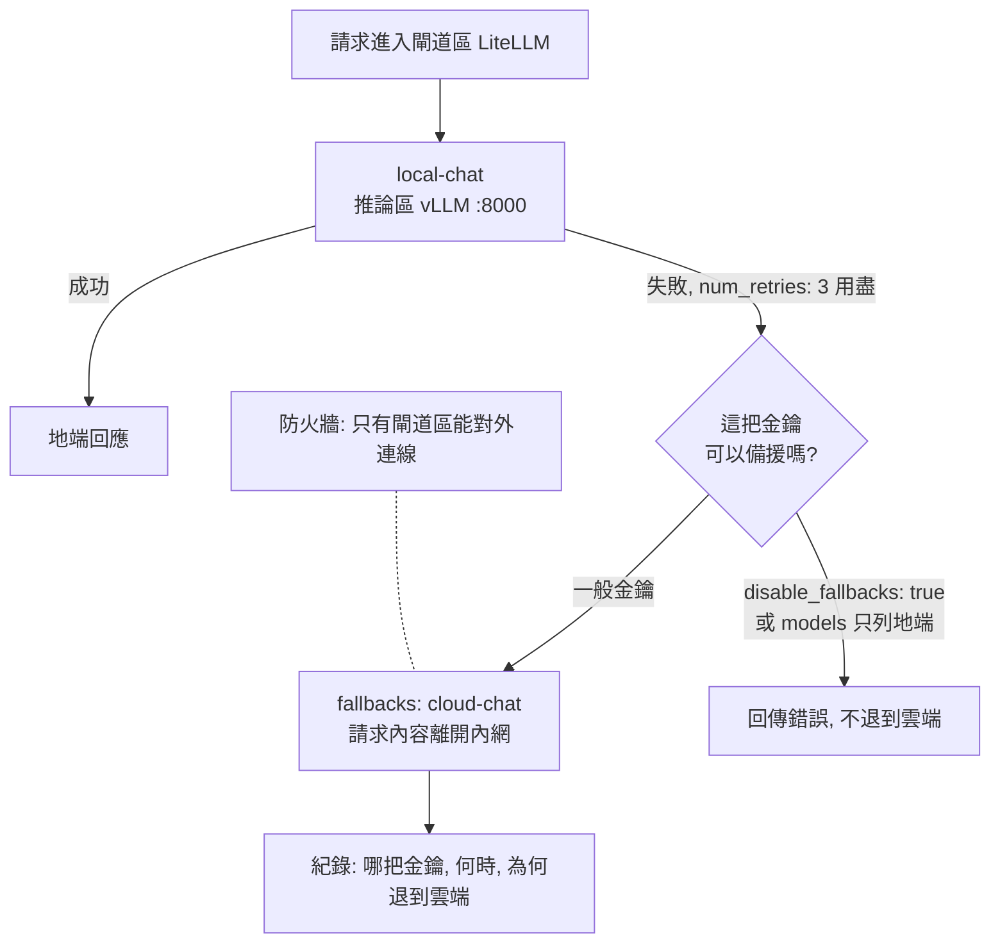
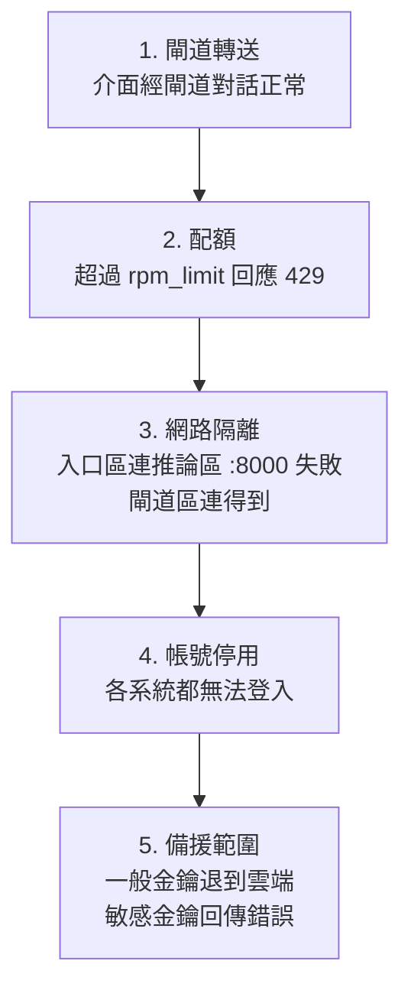

# M5 模型閘道與身分驗證

::: info 本章屬性
- 等級: ○ 依情境, 符合條件才讀
- 狀態: 可閱讀 (部分資料待核對)
- 資料基準日: 2026-10-27
- 待查證: LiteLLM 官方事故報告提到一個預定於 2026-10-27 公開的漏洞, 截至 2026-10-27 查詢尚未見對應的 GHSA 或 CVE, 須再查證; M5.4 與 M5.5 節的 Keycloak, Open WebUI, LiteLLM 設定與指令未實機驗證; Keycloak 的 Google Hosted Domain 欄位是否在登入時強制檢查網域, 須在測試環境驗證; Google 身分提供者的回呼網址格式來自社群論壇 (二手來源), 以主控台顯示為準; Open WebUI 的 `AIOHTTP_CLIENT_SSL_CERT_FILE` 是否涵蓋 OIDC 請求未確認; Langfuse `AUTH_KEYCLOAK_ISSUER` 的值為依 OIDC 慣例的推論; 文中的類比為整理者所寫, 不代表技術上完全等同
:::

**結論**: 單機單人不需要閘道. 只有多模型輪替而沒有多人治理需求時, 用 llama-swap 就夠. LiteLLM 有納入評估, 但不列為預設, 原因是一年內兩度成為供應鏈入侵的入口, 且集中保存上游金鑰 (信心: 高). 符合 M5.1 節的條件時, 閘道放在獨立的閘道區, 成為唯一保存 API 金鑰的地方; 帳號則交給身分驗證伺服器統一管理.

**這一塊在圖上的位置**: VM 閘道區的 LiteLLM 與 VM 入口區的 Keycloak. **前置模組**: M1, M2. **完成後的狀態**: 每位使用者或每個應用各有一把虛擬金鑰與配額, 同事用同一組帳號登入所有介面.

本章處理兩件事. 第一件是模型閘道: 所有程式要找模型時, 都先經過同一個入口, 由它決定誰能用, 能用多少, 送到哪個模型. 可以想成公司總機: 外線不直接打到每個分機, 而是由總機轉接並記錄. 第二件是身分驗證: 讓同事用一組帳號登入所有介面, 離職時只要停用一次. 可以想成一張員工證通行全公司的門禁, 不必每扇門各發一把鑰匙.

::: tip 本章常見名詞
| 詞 | 意思 |
|---|---|
| 閘道 (gateway) | 擋在模型前面的統一入口, 負責驗證金鑰, 計算配額與轉送請求 |
| API 金鑰 | 程式呼叫服務時出示的一串密碼; 虛擬金鑰是閘道自己發的金鑰, 背後對應真正的上游金鑰 |
| 配額 (quota) 與速率限制 (rate limit) | 限制每把金鑰在一段時間內能送多少請求或花多少錢 |
| 反向代理 (reverse proxy) | 站在服務前面接收連線, 再轉給後端的程式, 例如 Nginx, Caddy |
| 身分驗證伺服器 | 集中管理帳號與登入的服務, 本章以 Keycloak 為例 |
| SSO (單一登入) | 登入一次後, 其他串接的系統不必再輸入帳密 |
| OIDC (OpenID Connect) | 各系統向身分驗證伺服器確認「這個人是誰」的標準協定 |
| realm 與 client | Keycloak 的用語; realm 是一組獨立的帳號空間, client 是一個要串接登入的應用程式 |
| 供應鏈入侵 | 攻擊者不直接攻擊使用者, 而是在軟體發布流程中放入惡意程式, 使用者安裝更新時一併裝入 |
:::

## M5.1 何時不需要閘道

閘道多一層, 就多一台要維護與修補的服務, 也多一個集中存放金鑰的目標. 因此先判斷是否真的需要, 人少且只有一個介面時, 直接連推論引擎比較單純.

Ollama, llama-server 與 LM Studio 都已提供與 OpenAI 相容的 API, 介面可以直接連推論引擎 (信心: 高).

三項條件中符合任兩項, 才考慮加閘道 (信心: 中; 「架構地圖」與「組裝總覽」引用此條件):

1. 3 人以上共用, 需要個別金鑰, 配額或用量紀錄.
2. 同時混用雲端 API 與地端模型, 需要故障轉移.
3. 多個應用程式要統一入口.

沒有閘道時, 可用下列做法取代:

- 介面直連推論引擎
- 用 llama-swap 處理模型切換
- 在反向代理 (Nginx 或 Caddy) 上做基本驗證與速率限制. Nginx 的速率限制 (`limit_req`) 為標準模組; Caddy 標準版不內建, 須另裝 caddy-ratelimit 外掛並重新編譯 (見 M2.3 節; 來源: caddyserver.com 模組頁)
- 使用介面本身的使用者與權限管理 (Open WebUI, LibreChat)

下圖是同一個判斷 (信心: 中):



## M5.2 llama-swap: 多模型輪替

一張顯示卡的記憶體通常只夠放一個模型. 想輪流使用對話模型與嵌入模型時, 需要一個程式依請求自動卸下目前的模型, 換上需要的模型. 可以想成只有一個爐口的廚房, 由同一位廚師依點單換鍋.

llama-swap 是 Go 撰寫的單一執行檔, 以 YAML 設定, 依請求中的 model 欄位自動啟停 llama-server 或 vLLM. 它相容 OpenAI 與 Anthropic API, 並支援 API 金鑰. 專案自述為「在自己的機器上執行多個生成式 AI 模型, 並依需求即時切換」, 授權為 MIT (來源: llama-swap GitHub 儲存庫, 2026-10-27 核對). 2026 年持續發版, Go 模組在 2026-08-24 仍有更新 (來源: libraries.io 與多篇設定教學彙整, 二手來源).

適用情境是一張顯示卡要輪流載入對話模型與嵌入模型, 也就是硬體等級 B, D, E (信心: 中). 它只做模型切換, 不做多租戶治理, 因此風險等級低於完整閘道.

下圖是 llama-swap 依請求切換模型的方式:



## M5.3 LiteLLM 的使用條件與限制

LiteLLM 是常見的開源模型閘道, 能統一接地端與雲端模型, 並發放虛擬金鑰與設定配額. 功能完整, 但它集中保存所有上游金鑰, 一旦被入侵, 損失也集中, 所以本節先說明現況與事件, 再列出採用時要做的防護.

下圖是閘道在架構中的位置: 各介面與程式只拿到虛擬金鑰, 上游金鑰只存在閘道區:



### 現況

LiteLLM 程式庫採 MIT 授權, 但 `enterprise/` 目錄另有授權. 管理介面的 SSO 屬企業版功能: 官方文件寫明 SSO 需要企業版授權, 但自 v1.76.0 起, 5 位使用者以內可免費使用 (來源: LiteLLM 文件 Admin UI SSO, 2026-10-27 核對).

### 2026 年兩次供應鏈事件

下表兩起事件都不是 LiteLLM 程式本身的漏洞, 而是攻擊者進入發布流程, 讓使用者下載到遭竄改的版本.

| 日期 | 事件 | 來源 |
|---|---|---|
| 2026-03-24 | PyPI 上的 1.82.7 與 1.82.8 含竊取憑證的惡意程式, 上架約 40 分鐘後遭 PyPI 隔離; 官方研判入口很可能是 CI/CD 掃描流程中的 Trivy 相依套件, 攻擊者繞過官方 CI/CD 直接發布到 PyPI. Snyk 的分析指出, 攻擊者 (TeamPCP) 先入侵未鎖定版本的 Trivy, 再竊取 PyPI 發布權杖 | LiteLLM 官方部落格 (2026-03-24), Snyk |
| 2026-10-21 | 官方事故報告指出發布流程遭入侵, 攻擊者將惡意 v1.107.0 推送到 Docker registry 與 PyPI; 惡意 wheel 於 UTC 11:39 至 13:23 在 PyPI 上架; v1.107.0, latest, main-latest, main-stable 標籤都曾指向惡意映像; 惡意程式放在 Python 啟動檔 (cook.pth, sitecustomize.py), 只要 Python 啟動就會執行 | LiteLLM 官方事故報告 |

2026-03 事件的官方建議是把所有存在受影響系統上的憑證視為已外洩並輪替, 移除惡意的 `litellm_init.pth`, 並鎖定已知安全的版本 (例如 1.82.6 或更早); 官方之後以新的 CI/CD 流程發布乾淨的 1.83.0 (來源: LiteLLM 官方部落格 2026-03-24). 2026-10 事件的官方建議是鎖定 `litellm==1.106.2` 或更早發布的明確版本, 從頭重建映像與虛擬環境, 並輪替所有金鑰 (來源: LiteLLM 官方事故報告 2026-10-21).

2026-10 事件的入口, 官方在 2026-10-23 的攻擊鏈報告中說明: LiteLLM Agent Platform 的 master key 於 2026-05-27 被提交到公開儲存庫, 之後沒有撤銷; 攻擊者於 2026-10-10 用這把金鑰呼叫 Agent Platform 的 API, 再一路取得開發者的 GitHub 憑證並修改發布流程. 官方表示已完成對攻擊者行為的調查, 改善措施另行公布 (來源: LiteLLM 官方部落格 The attack chain behind the v1.107.0 LiteLLM release). 官方說明企業版私有發行未受影響. 這起事件的起點是一把沒有撤銷的金鑰, 說明 O3 的「外洩後立即輪替」比任何單一防護更關鍵 (推論, 信心: 中).

下圖依官方攻擊鏈報告與事故報告整理 2026-10 事件的經過, 以及兩項防護各自擋在哪一步 (防護的對應為推論, 信心: 中):



2026 年的 CVE 紀錄見[元件版本與安全公告頁](/ref/versions). 其中 3 個程式漏洞已列入 CISA KEV (美國網路安全暨基礎設施安全局的已知遭利用漏洞目錄): 未經身分驗證即可利用的 SQL 注入, 經 MCP 預覽端點的命令注入, 以及 MCP 驗證繞過; 受影響與修補版本見版本頁 (來源: CISA KEV 目錄, 版本頁所列 GitHub Security Advisories).

### 判斷

LiteLLM 集中保存所有上游金鑰, 是攻擊者的高價值目標; 2026 年除了兩次供應鏈事件, 也有 3 個程式漏洞列入 CISA KEV. 單機使用時, 它帶來的攻擊面大於效益. 多人環境則需要虛擬金鑰與配額, 此時須承擔其風險並落實下列措施 (信心: 中):

1. 以映像摘要值 (digest) 鎖定版本, 不使用 latest 或 main-stable 標籤.
2. 只放在內網, 並在反向代理層封鎖管理路徑 (`/health/test_connection`, MCP 路由). 其他區呼叫閘道時, 請求中帶有虛擬金鑰與完整提示; 跨 VM 連線建議經反向代理改走 HTTPS (憑證來源見 M2.3 節). 本章範例為了簡潔寫成 `http://`, 只適合各區已以 VLAN 與防火牆隔開, 且接受網段內明文傳輸風險的情況 (推論, 信心: 中).
3. 不需要時不開啟 MCP 功能; 由 LiteLLM 兼任工具閘道 (M7.2 節) 時, 版本須高於 MCP 相關公告的修補版 (見[版本頁](/ref/versions)).
4. 上游金鑰只給最低權限.
5. 訂閱 GitHub Security Advisories.
6. 事先準備好金鑰輪替流程 (見 O3).

### 替代方案

| 方案 | 授權 | 定位 | 評語 |
|---|---|---|---|
| llama-swap | MIT | 模型切換 | 地端多模型首選 |
| Bifrost (Maxim AI) | Apache 2.0 | Go 閘道, 含虛擬金鑰, MCP 閘道, 語意快取 | 效能數字皆為廠商自測; SSO 與叢集屬企業版; 安全紀錄較短, 資料不足 |
| Envoy AI Gateway, Kong AI Gateway, Apache APISIX | Apache 2.0 | 企業 API 管理延伸 | 須先會維運 Envoy 或 Kong, 對手冊讀者過重 |

閘道延遲的公開數字互相矛盾 (約 1 至 5ms, 約 8ms, 約 40ms), 且全部來自競品廠商, 無法交叉驗證. 本機推論的生成時間以秒計, 因此延遲對單機使用者不是重點 (信心: 中, 屬推論).

## M5.4 身分驗證伺服器 (Keycloak)

系統一多, 每個系統各自建帳號, 停用帳號時就容易漏掉. 身分驗證伺服器把帳號集中在一處, 其他系統登入時都來這裡確認身分. Keycloak 是常見的開源選擇, 支援 OIDC, 也能串接公司既有的 AD 或 Google 帳號.

本節設定依 Keycloak, Open WebUI, Langfuse 與 LiteLLM 官方文件整理, 未實機驗證. 主機名稱 (`sso.example.internal`, `ai.example.internal`) 與 realm 名稱為佔位值.

### 何時需要

符合下列任一情況時, 才值得多維運一台 Keycloak (推論, 信心: 中):

- 使用者約 10 人以上, 逐一在各系統建帳號與停用帳號的工作量明顯增加.
- 已有兩個以上自架服務 (例如 Open WebUI 與 Langfuse) 要共用同一組帳號.
- 公司已有 AD, LDAP 或 Google Workspace, 希望離職停用只做一次.

人數少且只有一個介面時, 使用介面內建的帳號與權限管理即可 (見 M5.1 節).

### 以 Docker 啟動 Keycloak 的正式模式要點

Keycloak 有兩種啟動方式. `start-dev` 是開發模式, 官方文件說明它的預設值不安全, 正式環境應嚴格避免 (來源: Keycloak 文件 Running Keycloak in a container). `start` 是正式模式, 啟動時要求已設定主機名稱與 HTTPS/TLS, 沒有設定時會直接報錯而不啟動 (來源: Keycloak 文件 Configuring Keycloak). 要點如下:

1. **資料庫**: 開發用的 `dev-file` 資料庫不適合正式環境, 部署前必須改用正式資料庫, 例如 PostgreSQL (來源: Keycloak 文件 Configuring the database).
2. **主機名稱**: 正式模式必須明確設定 `--hostname` (或 `--hostname-strict false`). 管理主控台可用 `--hostname-admin` 改到另一個主機名稱 (來源: Keycloak 文件 Configuring the hostname).
3. **TLS 在反向代理終止時**: 須開啟 `http-enabled`, 並以 `proxy-headers` 指定解析 `xforwarded` 或 `forwarded` 標頭 (來源: Keycloak 文件 Configuring a reverse proxy).
4. **對外路徑**: 官方建議只對外開放 `/realms/`, `/resources/` 與 `/.well-known/`; `/admin/` 與 `/realms/master/` 只限內部存取; `/metrics` 與 `/health` 不對外 (來源: 同上). 健康檢查與指標在管理連接埠 9000 (來源: Keycloak 文件 Running Keycloak in a container).
5. **初始管理者**: 以 `KC_BOOTSTRAP_ADMIN_USERNAME` 與 `KC_BOOTSTRAP_ADMIN_PASSWORD` 建立的管理者是暫時帳號. 官方說明它只應存在到取得永久管理權限為止, 之後要手動刪除 (來源: Keycloak 文件 Admin bootstrap and recovery).
6. **映像建置**: 官方建議以 `kc.sh build` 先建置最佳化映像, 再以 `start --optimized` 啟動. 直接以標準映像執行 `start` 也可以, 但官方指出這會明顯拉長啟動時間, 映像也變成可變動的狀態, 不是最佳做法 (來源: Keycloak 文件 Running Keycloak in a container).

下例以標準映像示意, 正式採用時建議改為官方的最佳化映像做法. 指令依官方文件的選項名稱整理, 未實機驗證:

密碼不寫在指令列, 改放在權限 600 的 `keycloak.env` 檔, 以免留在 shell 歷史紀錄與行程清單 (推論). Keycloak 的每個命令列選項都有對應的環境變數, 命名規則是加上 `KC_` 前綴, 轉成大寫並把 `-` 換成 `_`, 例如 `--db-password` 對應 `KC_DB_PASSWORD` (來源: Keycloak 文件 Configuring Keycloak). `keycloak.env` 的內容為:

```ini
KC_BOOTSTRAP_ADMIN_USERNAME=<暫時管理者帳號>
KC_BOOTSTRAP_ADMIN_PASSWORD=<暫時管理者密碼>
KC_DB_PASSWORD=<資料庫密碼>
```

```bash
# 反向代理與 Keycloak 在同一台主機時, 只發布在 127.0.0.1
docker run -d --name keycloak --restart always \
  -p 127.0.0.1:8081:8080 \
  --env-file ./keycloak.env \
  quay.io/keycloak/keycloak:<固定版本標籤> \
  start \
  --db postgres --db-url-host <PostgreSQL 主機> \
  --db-username keycloak \
  --hostname https://sso.example.internal \
  --http-enabled true \
  --proxy-headers xforwarded
``` 反向代理依第 4 點限制路徑. 以 Nginx 為例 (依 M2.3 節的寫法延伸, 未實機驗證):

```nginx
server {
    listen 192.168.10.5:443 ssl;
    server_name sso.example.internal;
    # ssl_certificate 等設定同 M2.3 節

    location /realms/       { proxy_pass http://127.0.0.1:8081; }
    location /resources/    { proxy_pass http://127.0.0.1:8081; }
    location /.well-known/  { proxy_pass http://127.0.0.1:8081; }

    # 管理路徑只限管理者位址
    location /realms/master/ { allow <管理者 IP>; deny all; proxy_pass http://127.0.0.1:8081; }
    location /admin/         { allow <管理者 IP>; deny all; proxy_pass http://127.0.0.1:8081; }

    location / { return 404; }
}
```

Nginx 的前綴比對採最長符合, 因此 `/realms/master/` 會優先於 `/realms/` (Nginx 一般行為, 此為訓練資料內資訊, 可能已過時). `proxy_set_header` 等標頭設定請沿用 M2.3 節.

下圖是第 4 點的路徑限制 (依官方對外路徑建議與上方範例繪製, 未實機驗證):



### 建立 realm 與 OIDC client

這一步在 Keycloak 裡開一個放員工帳號的空間 (realm), 再為每個要串接登入的系統登記一筆資料 (client). 登記後, Keycloak 才知道登入成功時要把使用者送回哪個網址.

使用者不要放在 `master` realm; `master` 只供管理用途, 並依上述建議只限內部存取 (推論, 依官方對外路徑建議). 步驟依 Keycloak 入門文件與 Open WebUI 的 Keycloak 文件整理:

1. 在管理主控台點選 **Manage realms**, 再點 **Create realm**, 輸入 realm 名稱 (例如 `company`) 後建立 (來源: Keycloak 文件 Getting started with Docker).
2. 在該 realm 的 **Clients** 建立 client: Client type 選 `OpenID Connect`, Client ID 填 `open-webui`.
3. 開啟 **Client authentication**. Open WebUI 文件指出, Keycloak 26.x 預設為不驗證 client, 須手動改為以 Client ID 與 secret 驗證 (來源: Open WebUI 文件 Keycloak).
4. **Valid redirect URIs** 填 `https://ai.example.internal/oauth/oidc/callback`. 這是 Open WebUI 預設的回呼路徑 `<open-webui>/oauth/oidc/callback` (來源: Open WebUI 文件 SSO).
5. **Web origins** 填 `https://ai.example.internal`.
6. 要讓 Keycloak 登出時通知 Open WebUI, 在 client 的登出設定關閉 **Front channel logout**, 並在 **Backchannel logout URL** 填 `https://ai.example.internal/oauth/backchannel-logout`. Keycloak 文件說明, 這個欄位只在前端通道登出關閉時適用 (來源: Keycloak Server Administration Guide). 這個路徑是 Open WebUI 開啟 `ENABLE_OAUTH_BACKCHANNEL_LOGOUT` 後提供的端點 (來源: Open WebUI 文件 Environment Variable Configuration).
7. 在 client 的憑證頁籤複製 secret, 供下一步使用.

### Open WebUI 的 OIDC 設定

Keycloak 端登記完成後, 換到 Open WebUI 這一端, 告訴它要去哪裡確認身分, 以及登記時拿到的 client ID 與 secret. 下列設定寫在 Open WebUI 的環境變數檔.

設定完成後, 登入的往返如下圖 (依 Open WebUI 與 Keycloak 文件整理, 未實機驗證):



依 Open WebUI 官方 SSO 與 Keycloak 文件整理的環境變數 (未實機驗證). 下列內容加進 M2.2 節建立的同一個 `.env`, 以 `docker run --env-file` 或 Docker Compose 的 `env_file` 載入; 環境變數只在容器建立時讀入, 改完 `.env` 要先移除容器 (`docker rm -f open-webui`), 再以 M2.2 節的同一個指令重建, 資料卷中的對話與設定會保留 (推論, 依 Docker 環境變數的一般行為). `OAUTH_SCOPES` 的值含空白, 不要用 shell 的 `. ./.env` 方式載入:

```ini
# .env (權限 600)
WEBUI_URL=https://ai.example.internal
ENABLE_OAUTH_SIGNUP=true
OAUTH_CLIENT_ID=open-webui
OAUTH_CLIENT_SECRET=<從 Keycloak 複製的 secret>
OPENID_PROVIDER_URL=https://sso.example.internal/realms/company/.well-known/openid-configuration
OAUTH_PROVIDER_NAME=公司帳號
OAUTH_SCOPES=openid email profile
# Keycloak 停用帳號或登出時, 通知 Open WebUI 撤銷登入狀態
ENABLE_OAUTH_BACKCHANNEL_LOGOUT=true
# 登入權杖效期, 預設 4w; 縮短可降低停用帳號後的殘留時間
JWT_EXPIRES_IN=8h
```

設定時的注意事項 (來源: Open WebUI 文件 SSO, Environment Variable Configuration):

- `OPENID_PROVIDER_URL` 為必填, 值是 OIDC 的 well-known 網址. `OAUTH_SCOPES` 預設即為 `openid email profile`.
- `ENABLE_OAUTH_SIGNUP` 預設為 `False`, 不開啟時, 第一次以 SSO 登入的使用者無法自動建立帳號.
- `WEBUI_URL` 必須在開始使用 OAuth 之前設定, 否則無法登入. 它屬於 ConfigVar: 值在第一次啟動後存進 Open WebUI 的資料庫, 之後改環境變數不會生效, 只能在管理面板 Settings 的 WebUI URL 修改, 或設定 `ENABLE_PERSISTENT_CONFIG=False` 讓 Open WebUI 每次都讀環境變數. 依 M2.2 節第一次啟動時就寫入 `WEBUI_URL`, 可以避開這個問題.
- `ENABLE_OAUTH_PERSISTENT_CONFIG` 預設為 `false`, 此時管理面板的 OAuth 區塊為唯讀, 修改要改環境變數並重新啟動.
- `OAUTH_MERGE_ACCOUNTS_BY_EMAIL` 預設為 `false`. 官方提醒, 身分提供者沒有驗證電子郵件時, 依電子郵件合併帳號可能不安全.
- 群組同步需要 `ENABLE_OAUTH_GROUP_MANAGEMENT=true`, 並在 Keycloak 的 client scope 加上群組 mapper; Keycloak 預設不會把群組資訊放進權杖.
- back-channel logout 要在設定 Redis 時, 才能撤銷已簽發的 JWT; 沒有 Redis 時, 已簽發的 JWT 仍有效到過期為止.
- `JWT_EXPIRES_IN` 預設 `4w`. 官方警告設為 `-1` (永不過期) 在正式環境極度危險.
- 確認 SSO 可用後, 可將 `ENABLE_LOGIN_FORM` 設為 `false` 隱藏帳密表單; 官方提醒要先設好 SSO 或 LDAP 再關閉, 否則沒有人能登入. 這個設定也屬於 ConfigVar, 已啟動的實例改在管理面板 Settings > Admin > Authentication 的 Login Form 調整, 立即生效. 管理者仍可經 `/auth?form=true` 進入本機登入表單.
- `ENABLE_PASSWORD_AUTH` 是另一個開關, 官方警告只有在已使用 `ENABLE_OAUTH_SIGNUP=true` 時才能設為 `False`, 沒有使用 SSO 時關閉會無法登入.
- Keycloak 使用公司內部 CA 的憑證時, Open WebUI 要能信任該 CA. Open WebUI 提供 `AIOHTTP_CLIENT_SSL_CERT_FILE` 指定自訂 CA 檔, 但它是否涵蓋 OIDC 探索與權杖請求, 本輪未確認, 須在測試環境驗證.

### 其他系統的串接

| 系統 | 串接方式 | 注意事項 |
|---|---|---|
| Langfuse | 環境變數 `AUTH_KEYCLOAK_CLIENT_ID`, `AUTH_KEYCLOAK_CLIENT_SECRET`, `AUTH_KEYCLOAK_ISSUER`; 回呼路徑 `/api/auth/callback/keycloak` (來源: Langfuse 文件 Authentication and SSO) | `AUTH_DISABLE_SIGNUP=true` 關閉自行註冊; `AUTH_DISABLE_USERNAME_PASSWORD=true` 關閉帳密登入 (同上). Issuer 的值一般為 `https://sso.example.internal/realms/company` (推論, 依 OIDC 慣例, 須實機確認) |
| LiteLLM 管理介面 | 以 `GENERIC_CLIENT_ID`, `GENERIC_CLIENT_SECRET`, `GENERIC_AUTHORIZATION_ENDPOINT`, `GENERIC_TOKEN_ENDPOINT`, `GENERIC_USERINFO_ENDPOINT` 串接通用 OIDC (來源: LiteLLM 文件 Admin UI SSO) | 官方說明 SSO 需要企業版授權; 自 v1.76.0 起 5 位使用者以內免費 (同上). 另設 `GENERIC_USER_ID_ATTRIBUTE=sub`: 未設定時 LiteLLM 以 `preferred_username` 識別使用者, 使用者若能自行修改這個值, 下次登入會被當成另一個人; `sub` 是 OIDC 中終生不變的帳號識別碼 (同上). 管理介面本身仍只限管理者 IP (見 M5.3 節) |

每個系統各建一個 client, 不要共用 client secret (推論, 信心: 中).

### 串接公司既有帳號

公司若已經有 AD, LDAP 或 Google Workspace, 可以讓 Keycloak 直接沿用這些帳號, 不必再建一份. 這樣人事異動只在原本的帳號系統處理一次.

下圖是帳號來源與各系統的關係:



**LDAP 或 AD (user federation)**: 在 realm 的 **User Federation** 點選 **Add LDAP providers** 設定 (來源: Keycloak Server Administration Guide). 官方文件的重點如下:

- Keycloak 從不匯入密碼, 密碼驗證一律在 LDAP 伺服器端完成.
- **Import Users** 開啟時, 使用者會匯入 Keycloak 的本地資料庫. 官方建議建立時先點 **Synchronize all users**, 之後再設定定期同步有變動的使用者.
- **Edit mode** 有 READ_ONLY, WRITABLE, UNSYNCED 三種, 建立 provider 時就要決定. 以 AD 為唯一帳號來源時, 選 READ_ONLY 較單純 (推論, 信心: 中).
- 使用 `ldaps://` 時, Keycloak 端要設定信任 LDAP 伺服器憑證的 truststore. 多台網域控制站以空白分隔填入 Connection URL, 不可用逗號.
- AD 專用的 **MSAD User Account Mapper** 會讀取 `userAccountControl`. 值為 514 (停用帳號) 時, Keycloak 使用者隨之停用. 這讓 AD 停用帳號可以直接帶到 Keycloak.

**Google 帳號 (identity provider)**: Keycloak 內建 Google 身分提供者 (來源: Keycloak Server Administration Guide). 步驟如下:

1. 在 Keycloak 的 **Identity Providers** 選擇 **Google**, 複製畫面上的 **Redirect URI**. 格式為 `https://sso.example.internal/realms/company/broker/google/endpoint` (二手來源: Keycloak 社群論壇; 以主控台顯示的值為準).
2. 在 Google Cloud Console 的 APIs & Services 建立 OAuth 同意畫面, 再到 **Credentials** 點 **CREATE CREDENTIALS**, 選 **OAuth Client ID**, 應用程式類型選 **Web application**, 把上一步的網址填入 **Authorized redirect URIs**. Keycloak 官方步驟中, 同意畫面的使用者類型寫為 External; Google Workspace 組織是否改選其他類型, 本輪未查證.
3. 把 Google 提供的 Client ID 與 Client secret 貼回 Keycloak.
4. Keycloak 文件說明, 要限制只有 Google Workspace 組織成員可登入時, 在 **Hosted Domain** 欄位填入公司網域. Keycloak 是否會在登入時驗證 Google 回傳的網域, 官方文件沒有寫明; 上線前須在測試環境以非公司帳號實際登入一次, 確認登入遭拒.

採用 Google 登入前, 有兩個網路條件要先確認:

- Google 對 redirect URI 有驗證規則: 必須使用 HTTPS, 主機不可為 IP 位址, 頂層網域必須在公共後綴清單 (Public Suffix List) 上 (來源: Google for Developers, Using OAuth 2.0 for Web Server Applications). 因此 `.internal` 或 `.lan` 這類內部網域無法使用. 常見做法是使用公司已註冊網域的子網域, 並以內部 DNS 解析 (推論, 信心: 中).
- Keycloak 要能主動連到 Google 交換權杖. 這與「只有閘道區能對外連線」的分區原則有衝突. 若採用 Google 登入, 須在防火牆為 Keycloak 開一條只到 Google 驗證端點的例外, 並記錄在變更紀錄 (推論, 信心: 中). 無法開例外時, 改用 LDAP 或 AD.

### 離職停用流程

目標是停用一次, 所有系統都無法再使用. 各系統的登入狀態彼此獨立, 只停用 Keycloak 帳號並不夠:



1. **停用帳號**: 以 AD 為來源時, 在 AD 停用帳號, 並確認同步或 MSAD User Account Mapper 已讓 Keycloak 帳號變成停用. 也可直接在 Keycloak 的 **Users** 選取使用者, 把 **Enabled** 切為關閉; 官方文件說明這會阻止新的登入 (來源: Keycloak Server Administration Guide).
2. **登出工作階段**: 在該使用者的 **Sessions** 點選 **Sign out all active sessions**. 官方文件說明, 登出不會撤銷已發出的 access token, 這些權杖要等自然過期 (來源: 同上). 因此 access token 效期不宜設太長 (推論).
3. **Open WebUI**: Open WebUI 登入後使用自己的 JWT, 預設效期 4 週. 有 Redis 且開啟 back-channel logout 時, Open WebUI 會撤銷該使用者已簽發的 JWT; 沒有 Redis 時, JWT 仍有效到過期 (來源: Open WebUI 文件 Environment Variable Configuration). 沒有 Redis 時, 應縮短 `JWT_EXPIRES_IN`, 並在 Open WebUI 管理面板直接停用或刪除該帳號 (推論).
4. **LiteLLM 虛擬金鑰**: 虛擬金鑰不隨 SSO 失效, 須以 `/key/block` 封鎖 (來源: LiteLLM 文件 Virtual Keys):

```bash
curl -X POST 'http://<閘道區主機>:4000/key/block' \
  -H 'Authorization: Bearer <LiteLLM master key>' \
  -H 'Content-Type: application/json' \
  -d '{"key": "<要封鎖的虛擬金鑰>"}'
```

5. **其他金鑰**: 該使用者在 Open WebUI 或 Langfuse 自行建立的 API 金鑰, 也不受 SSO 停用影響, 須逐一檢查與撤銷 (推論, 信心: 中).
6. **紀錄**: 記錄停用時間與各步驟完成時間, 並依 M5.6 節的第 4 項測試確認.

## M5.5 雲端與地端並用: 路由, 備援與資料外送控制

有些環境同時使用地端模型與雲端模型. 閘道可以決定每個請求送去哪裡 (路由), 地端故障時改送雲端 (備援). 方便之餘, 也要先決定哪些資料絕對不能離開內網.

**結論**: LiteLLM 可以在同一個入口同時接地端 vLLM 與雲端模型, 並在地端故障時自動退到雲端. 但「退到雲端」等於請求內容離開內網, 因此備援要有明確的範圍. LiteLLM 官方文件提供兩種金鑰層的控制: `disable_fallbacks` 讓特定金鑰「失敗就報錯, 不退到雲端」; 金鑰可用模型清單 (`models`) 只列地端模型時, 備援也不會改送雲端. 依請求標籤精確限制備援目的地的專門機制, 官方文件查無, 須自行實測 (信心: 中). 本手冊的架構中, 只有閘道區能對外連線, 所以即使設定錯誤, 地端各區也無法直接連到雲端; 控制點在閘道區的設定與防火牆.

下圖是本節設定下一個請求的路徑 (依 LiteLLM 文件 Reliability 整理, 未實機驗證):



### 設定範例

下列設定檔定義一個地端模型與一個雲端模型, 並指定地端失敗時改用雲端.

下列設定依 LiteLLM 官方文件的片段組合, 並非官方原樣, 模型名稱為示意, 未實機驗證. 官方文件對地端 OpenAI 相容服務有兩種寫法: `openai/` 前綴搭配 `api_base` (官方說明 `api_base` 須以 `/v1` 結尾), 以及 vLLM 專頁記載的 `hosted_vllm/` 前綴; 兩者皆為官方文件, 本手冊擇一使用 (來源: LiteLLM 文件 OpenAI-Compatible Endpoints 與 vLLM).

```yaml
model_list:
  - model_name: local-chat
    litellm_params:
      model: openai/google/gemma-4-31B-it
      api_base: http://<推論區位址>:8000/v1
      api_key: os.environ/VLLM_API_KEY
  - model_name: cloud-chat
    litellm_params:
      model: <雲端供應商的模型名稱>
      api_key: os.environ/CLOUD_API_KEY

litellm_settings:
  num_retries: 3
  request_timeout: 10
  # local-chat 重試用盡仍失敗時, 改送 cloud-chat
  fallbacks: [{"local-chat": ["cloud-chat"]}]
  cooldown_time: 30
```

`fallbacks`, `num_retries`, `request_timeout` 與 `cooldown_time` 都放在 `litellm_settings` 之下, 與 LiteLLM 文件 Reliability 的設定範例一致. 地端模型的 `api_key` 讀取環境變數 `VLLM_API_KEY`, 值與 M1.10 節 vLLM 啟動時設定的金鑰相同; 這把金鑰只放在閘道區的 `.env` (權限 600), 不放在其他區 (來源: LiteLLM 文件 OpenAI-Compatible Endpoints; 金鑰存放為整理者建議).

### 路由與備援的行為

| 項目 | 官方說明 (來源: LiteLLM 文件 Routing 與 Reliability) |
|---|---|
| 負載平衡 | 同一個 `model_name` 的多筆 deployment 自成一組, 請求在組內分配 |
| `routing_strategy` | 可選 `simple-shuffle` (預設, 官方建議正式環境使用), `least-busy`, `usage-based-routing-v2` (官方不建議正式環境使用, 原因是 Redis 負擔), `latency-based-routing`, `cost-based-routing` |
| `order` | 數值愈小優先; 同一個 `order` 內依路由策略挑選, 失敗才換下一個 `order`, 每層各自重試 |
| `fallbacks` | 重試用盡後才生效; 另有 `context_window_fallbacks`, `content_policy_fallbacks`, `default_fallbacks` |
| 已知的文件矛盾 | `allowed_fails` 的官方註解與預設值 3 互相矛盾 (註解稱超過每分鐘 1 次), 使用前須實測 |

### 控制資料是否離開內網

1. **敏感金鑰關閉備援**: 官方文件說明 `disable_fallbacks: true` 可設在單次請求或金鑰的 `metadata` (於 `/key/generate` 設定), 效果是該請求不啟用備援. 另一層是金鑰的可用模型清單: 官方文件說明, 呼叫者的金鑰沒有權限使用備援模型時, 備援會跳過, 直接回傳原模型的錯誤; 權限查詢本身失敗時也跳過備援. 處理敏感資料的代理或部門, 其金鑰的 `models` 只列地端模型, 並同時設定 `disable_fallbacks: true`, 地端失敗時回傳錯誤, 不退到雲端 (來源: LiteLLM 文件 Reliability).
2. **標籤路由只當輔助**: Tag routing 可在 deployment 設定 `tags`, 請求以 `tags` 或 `metadata.tags` 指定, 並須啟用 `enable_tag_filtering: True`; 標籤前加 `!` 可把對應 deployment 從候選池排除. 但官方文件未明載「請求標籤是否嚴格限制只能使用同標籤的 deployment」, 也未說明標籤與備援目標之間如何互動, 因此不要單獨依賴標籤作為外送防線 (來源: LiteLLM 文件 Tag Based Routing; 判斷屬整理者推論, 信心: 中).
3. **防火牆當最後防線**: 閘道區以外的各區本來就禁止對外連線 (見組裝總覽的分區表). 需要完全禁止某類資料外送時, 可為該類流量另設一個不含雲端 deployment 的 LiteLLM 實例, 或在防火牆只允許特定來源連到雲端供應商 (設計建議, 信心: 中).
4. **備援事件要看得到**: 每次備援都會讓請求改走雲端, 須在 Langfuse 或 LiteLLM 紀錄中能查出是哪把金鑰, 何時, 因何故障退到雲端 (設計建議).

LiteLLM 管理端的 `fallback_management` 頁面僅提供 `/fallback` 端點與預算備援, 須設定 `STORE_MODEL_IN_DB=True`, 未見依標籤限制; 上述備援前的權限檢查可用 `general_settings.enforce_fallback_model_access: false` 關閉, 關閉後所有設定的備援都會執行, 不論呼叫者有無權限; 官方提醒較早的版本即使呼叫者無權使用備援模型, 仍會執行備援, 因此本手冊建議維持預設, 不要關閉 (來源: LiteLLM 文件 Fallback Management 與 Reliability; 建議屬整理者判斷).

## M5.6 驗收測試

驗收的目的是確認每道關卡真的擋得住, 而不只是設定檔寫了. 以下五項測試分別檢查閘道轉送, 配額, 網路隔離, 帳號停用與備援範圍.

下圖是五項測試的順序與預期結果:



以下指令依各官方文件整理, `curl` 為通用工具, 未實機驗證. LiteLLM 位址以官方文件範例的 4000 連接埠為例.

**1. 介面經閘道連模型, 對話仍正常**

1. 在 LiteLLM 為 Open WebUI 產生一把虛擬金鑰 (`/key/generate`), 並在 Open WebUI 的連線設定改用 `http://<閘道區主機>:4000/v1` 與這把金鑰.
2. 在 Open WebUI 送出一則訊息, 確認回應正常.
3. 從閘道區以同一把金鑰直接呼叫一次, 確認閘道本身可用:

```bash
curl http://<閘道區主機>:4000/v1/chat/completions \
  -H 'Authorization: Bearer <虛擬金鑰>' \
  -H 'Content-Type: application/json' \
  -d '{"model": "<模型名稱>", "messages": [{"role": "user", "content": "ping"}]}'
```

**2. 超過配額時, 閘道拒絕請求**

建立一把每分鐘只允許 2 次請求的測試金鑰, 再連續送出 5 次請求. LiteLLM 文件說明, 超過速率限制的請求會收到 429 (來源: LiteLLM 文件 Budgets, Rate Limits):

```bash
curl -X POST 'http://<閘道區主機>:4000/key/generate' \
  -H 'Authorization: Bearer <LiteLLM master key>' \
  -H 'Content-Type: application/json' \
  -d '{"rpm_limit": 2, "key_alias": "quota-test"}'

for i in 1 2 3 4 5; do
  curl -s -o /dev/null -w "%{http_code}\n" http://<閘道區主機>:4000/v1/chat/completions \
    -H 'Authorization: Bearer <測試金鑰>' \
    -H 'Content-Type: application/json' \
    -d '{"model": "<模型名稱>", "messages": [{"role": "user", "content": "ping"}]}'
done
```

預期前 2 次為 200, 之後出現 429. 金額預算 (`max_budget`) 也可測試; 超過時官方範例回應 `ExceededTokenBudget` 錯誤. 不過地端模型若沒有設定單價, 花費可能不會累積, 因此以速率限制測試較直接 (推論, 信心: 中). 官方也說明, 預算與金鑰都需要資料庫; 沒有資料庫時預算不會生效 (來源: LiteLLM 文件 Budgets, Rate Limits). 測試完成後封鎖這把測試金鑰.

**3. 推論伺服器只接受閘道區連線**

vLLM 官方安全文件列出, 即使設定了 `--api-key`, 仍有多個端點不需金鑰, 包括 `/invocations` (與 `/v1` 相同的推論功能), `/pause` 與 `/metrics` (來源: vLLM 文件 Security). 因此真正的防線是網路隔離, 驗收時要從入口區確認完全連不上. 下列指令以 M1.10 節的預設 8000 連接埠為例, 若改過連接埠請一併修改. 里程碑 2 暫時允許入口區直連推論區的規則 (見 M0.2 節), 這時應已刪除:

```bash
# 在入口區 VM 執行, 預期連線逾時或遭拒
curl -sS -m 5 http://<推論區主機>:8000/v1/models
curl -sS -m 5 http://<推論區主機>:8000/health
# 在閘道區 VM 執行, 預期成功
curl -sS -m 5 -H 'Authorization: Bearer <vLLM API 金鑰>' http://<推論區主機>:8000/v1/models
```

測試時不要呼叫 `/pause` 這類會中斷服務的端點. 若 M6 的 Prometheus 要抓取 vLLM 指標, 只對稽核區的 Prometheus 主機開放例外 (見 M6.4 節).

**4. 停用帳號後, 各系統都無法登入**

1. 建立一個測試帳號, 以它登入 Open WebUI 與 Langfuse, 並發一把 LiteLLM 虛擬金鑰.
2. 另開一個瀏覽器保持 Open WebUI 的登入狀態.
3. 依 M5.4 節的離職停用流程停用帳號.
4. 確認以下結果, 並記錄每一項從停用到失效的時間:

| 檢查事項 | 預期結果 |
|---|---|
| 以測試帳號重新登入 Open WebUI 與 Langfuse | 在 Keycloak 登入頁失敗 |
| 原本保持登入的 Open WebUI 分頁重新整理 | 有 Redis 與 back-channel logout 時應已登出; 沒有時會維持到 JWT 過期, 須記錄並改以管理面板停用 |
| 以測試虛擬金鑰呼叫 LiteLLM | 請求遭拒 |
| AD 停用後 (若使用 LDAP 串接) | Keycloak 中該帳號顯示為停用 |

**5. 地端模型故障時, 一般金鑰退到雲端; 敏感金鑰不退**

1. 建立三把測試金鑰: 一把不加設定; 一把在 `metadata` 設 `disable_fallbacks: true`; 一把的可用模型 (`models`) 只列 `local-chat` (設定位置見 M5.5 節, 未實機驗證).
2. 停止地端的 vLLM 行程, 三把金鑰各送一次請求.
3. 一般金鑰應成功回應, 且 LiteLLM 紀錄顯示由雲端模型回應; 後兩把敏感金鑰都應回傳錯誤, 並且在雲端供應商的用量紀錄或閘道區的對外連線紀錄中, 看不到這次請求.
4. 恢復 vLLM 後, 三把金鑰都回到地端模型.

## 參考來源

- [Keycloak 文件: Running Keycloak in a container](https://www.keycloak.org/server/containers)
- [Keycloak 文件: Configuring Keycloak](https://www.keycloak.org/server/configuration)
- [Keycloak 文件: Configuring Keycloak for production](https://www.keycloak.org/server/configuration-production)
- [Keycloak 文件: Configuring the database](https://www.keycloak.org/server/db)
- [Keycloak 文件: Configuring the hostname](https://www.keycloak.org/server/hostname)
- [Keycloak 文件: Configuring a reverse proxy](https://www.keycloak.org/server/reverseproxy)
- [Keycloak 文件: Admin bootstrap and recovery](https://www.keycloak.org/server/bootstrap-admin-recovery)
- [Keycloak 文件: Getting started with Docker](https://www.keycloak.org/getting-started/getting-started-docker)
- [Keycloak Server Administration Guide](https://www.keycloak.org/docs/latest/server_admin/index.html)
- [Keycloak 社群論壇: Change Redirect URI of Identity Provider in Keycloak (二手來源)](https://forum.keycloak.org/t/change-redirect-uri-of-identity-provider-in-keycloak/23588)
- [Google for Developers: Using OAuth 2.0 for Web Server Applications](https://developers.google.com/identity/protocols/oauth2/web-server)
- [Open WebUI 文件: SSO (OAuth, OIDC, Trusted Header)](https://docs.openwebui.com/features/authentication-access/auth/sso)
- [Open WebUI 文件: Keycloak](https://docs.openwebui.com/features/authentication-access/auth/sso/keycloak)
- [Open WebUI 文件: Environment Variable Configuration](https://docs.openwebui.com/reference/env-configuration)
- [Langfuse 文件: Authentication and SSO](https://langfuse.com/self-hosting/security/authentication-and-sso)
- [LiteLLM 文件: Admin UI SSO](https://docs.litellm.ai/docs/proxy/admin_ui_sso)
- [LiteLLM 文件: Virtual Keys](https://docs.litellm.ai/docs/proxy/virtual_keys)
- [LiteLLM 文件: Budgets, Rate Limits](https://docs.litellm.ai/docs/proxy/users)
- [vLLM 文件: Security](https://docs.vllm.ai/en/latest/usage/security/)
- [LiteLLM 文件: OpenAI-Compatible Endpoints](https://docs.litellm.ai/docs/providers/openai_compatible)
- [LiteLLM 文件: vLLM](https://docs.litellm.ai/docs/providers/vllm)
- [LiteLLM 文件: Routing, Load Balancing, Fallbacks](https://docs.litellm.ai/docs/routing)
- [LiteLLM 文件: Reliability](https://docs.litellm.ai/docs/proxy/reliability.md)
- [LiteLLM 文件: Tag Based Routing](https://docs.litellm.ai/docs/proxy/tag_routing)
- [LiteLLM 文件: Fallback Management](https://docs.litellm.ai/docs/proxy/fallback_management.md)
- [LiteLLM 文件: Admin UI SSO (企業版授權, 5 位使用者以內免費)](https://docs.litellm.ai/docs/proxy/admin_ui_sso)
- [LiteLLM 官方部落格: Security Update, Suspected Supply Chain Incident (2026-03-24)](https://docs.litellm.ai/blog/security-update-march-2026)
- [LiteLLM 官方部落格: Contained, Oct 21 2026 LiteLLM release v1.107.0 Compromised](https://docs.litellm.ai/blog/security-incident-oct-21-2026)
- [LiteLLM 官方部落格: The attack chain behind the v1.107.0 LiteLLM release (2026-10-23)](https://docs.litellm.ai/blog/security-incident-oct-21-2026-attack-chain)
- [Snyk: Poisoned security scanner backdooring LiteLLM](https://snyk.io/blog/poisoned-security-scanner-backdooring-litellm/)
- [CISA: Known Exploited Vulnerabilities Catalog](https://www.cisa.gov/known-exploited-vulnerabilities-catalog)
- [llama-swap GitHub 儲存庫 (用途, MIT 授權)](https://github.com/mostlygeek/llama-swap)
- 文中的類比 (公司總機, 員工證門禁, 單一爐口的廚房): 整理者所寫, 無外部來源, 不應當作技術定義引用.
