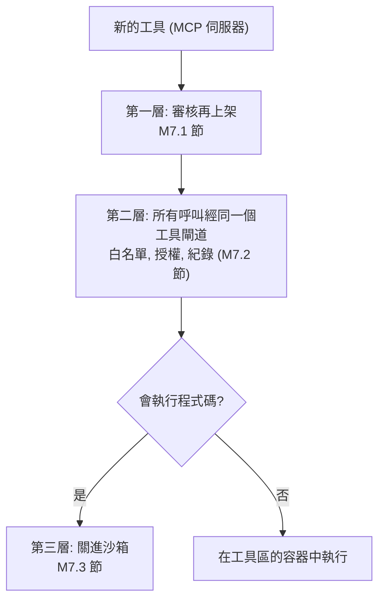
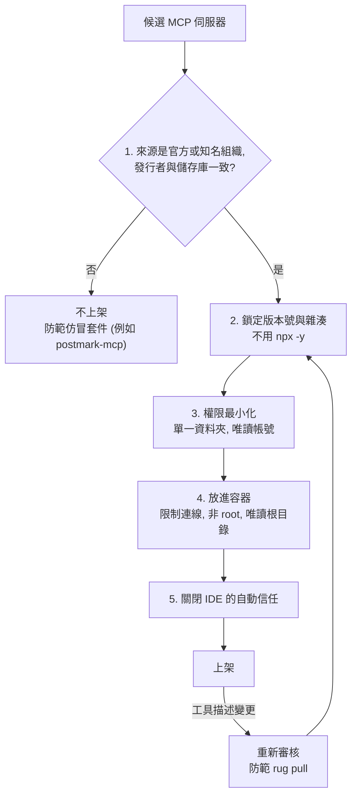
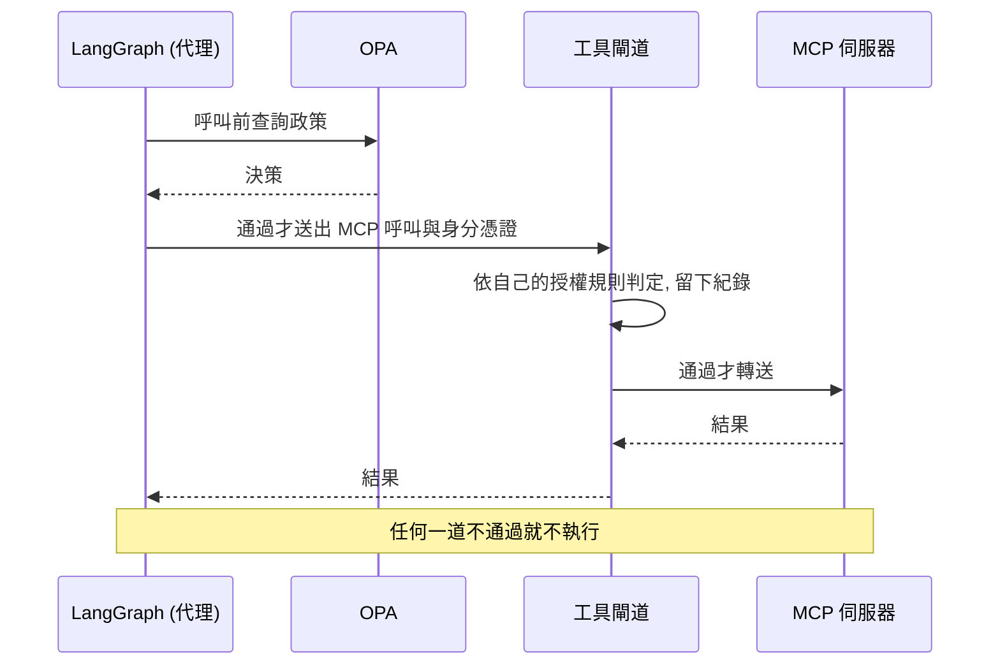
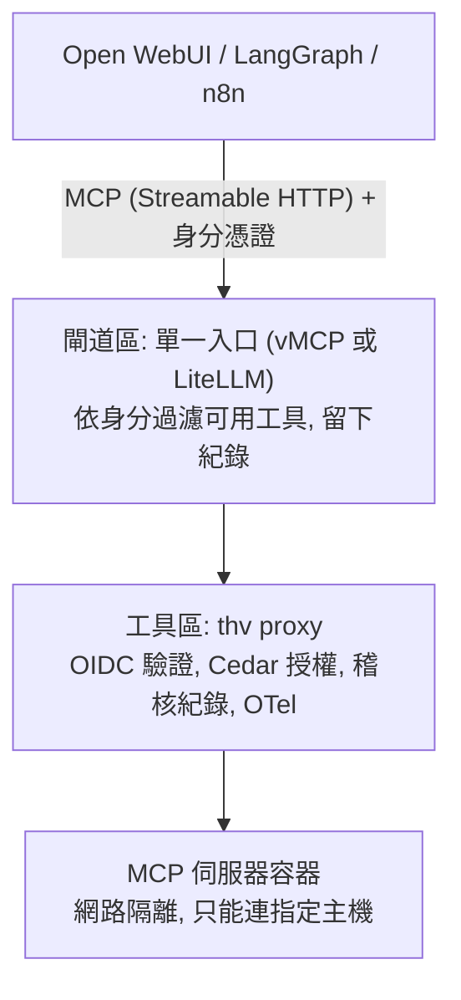
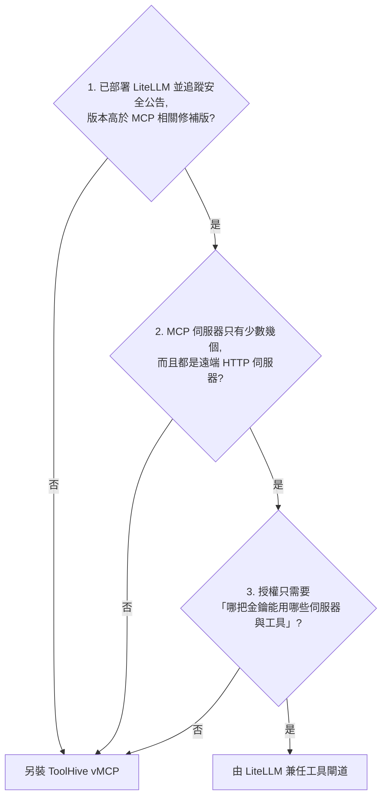
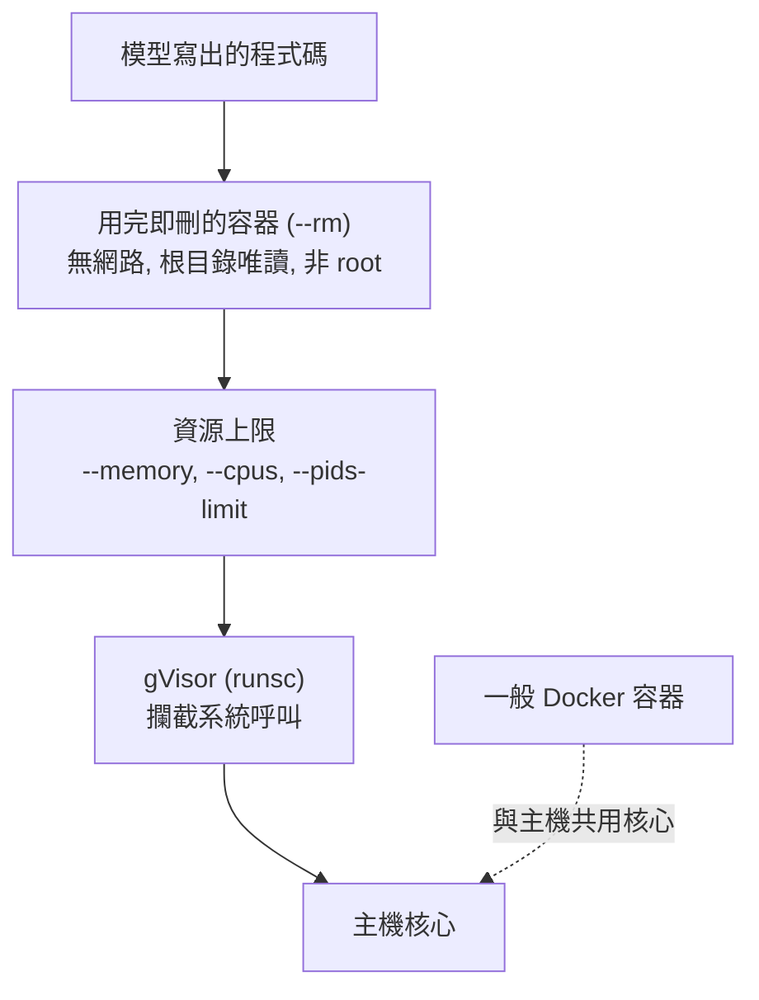
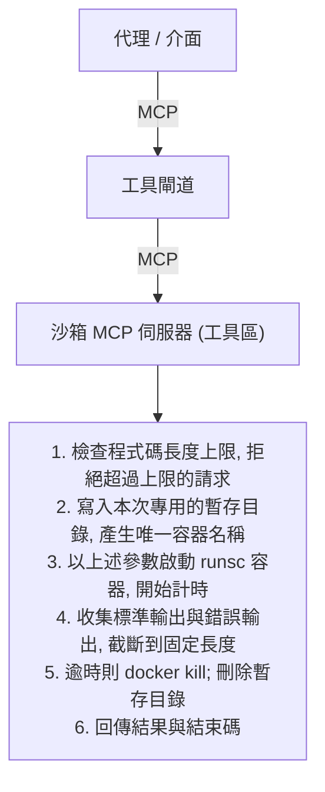
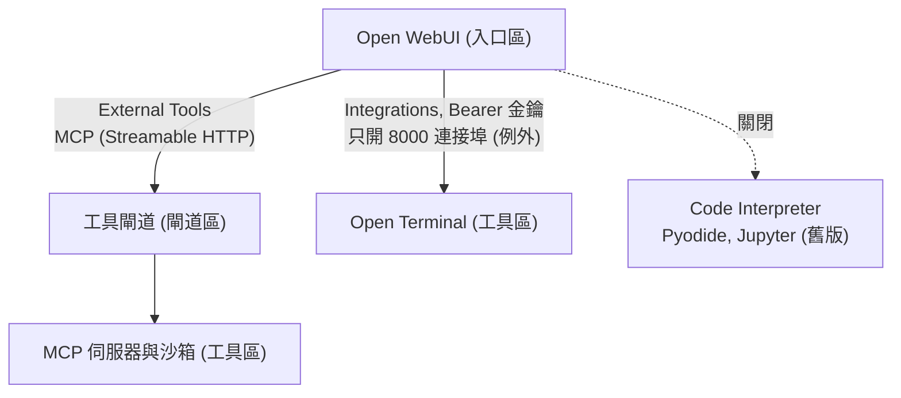
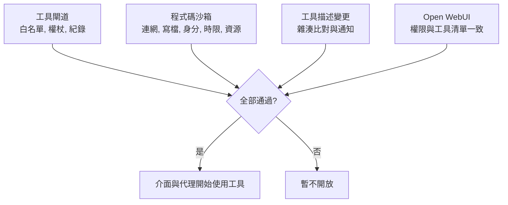

# M7 工具與沙箱

::: info 本章屬性
- 等級: ◇ 進階
- 狀態: 可閱讀 (指令未實機驗證)
- 資料基準日: 2026-10-26
- 待查證: 本章指令與設定檔依官方文件整理, 未實機執行; MCP 授權規範細節未逐條驗證; M7.1 節事件表的 postmark-mcp 一筆引自二手報導; ToolHive vMCP 的命令列操作步驟未核對; `thv run` 以摘要值指定映像的寫法未見官方示範; Open WebUI 連 LiteLLM 時能否設定 `x-litellm-api-key` 標頭未核對; Open Terminal 能否以 gVisor 執行未驗證; gVisor 效能額外負擔未實測; 文中的類比為整理者所寫, 不代表技術上完全等同
:::

**結論**: 工具讓模型能讀寫系統, 也是風險最集中的地方. 所有工具都放在獨立的 VM 工具區, 經同一個工具閘道 (MCP gateway) 呼叫; 會執行程式碼的工具一律放進沙箱. 唯一的例外是 Open WebUI 的 Open Terminal 整合, 官方只支援由介面直連 (見 M7.4 節). 工具只有幾個時, 可以由 LiteLLM (M5 的模型閘道) 兼任工具閘道.

**這一塊在圖上的位置**: VM 工具區 (MCP 伺服器, Docker + gVisor) 與閘道區的 MCP gateway. **前置模組**: M5, M6. **完成後的狀態**: 介面與代理都能透過同一個工具閘道呼叫已審核的工具, 每次呼叫都留下紀錄.

到前一章為止, 模型只會讀與寫文字. 接上工具之後, 模型可以查資料庫, 讀檔案, 甚至執行程式碼, 能做的事變多, 出錯時的影響也變大. 本章的做法是三層把關: 工具先審核再上架, 所有呼叫經同一個工具閘道檢查與記錄, 會執行程式碼的工具關進沙箱. 沙箱可以想成化學實驗室的密閉操作箱: 實驗在箱內進行, 就算出狀況, 也不會波及箱外.

下圖是本章的三層把關:



::: tip 本章常見名詞
| 詞 | 意思 |
|---|---|
| 工具 (tool) | 讓模型能呼叫的外部功能, 例如查工單, 讀檔案, 執行程式 |
| MCP (Model Context Protocol) | 模型與工具之間的共通連接規格; 提供工具的程式稱為 MCP 伺服器 |
| 工具閘道 (MCP gateway) | 所有工具呼叫的單一入口, 負責白名單, 授權與紀錄 |
| 工具投毒 (tool poisoning) | 在工具描述中藏入指令, 誘導模型做出原本不該做的事 |
| rug pull | 工具上架時正常, 之後改版偷換成惡意內容 |
| 容器 (container) | 把程式與執行環境包在一起, 和主機其他部分隔開執行; 本手冊以 Docker 執行 |
| 沙箱 (sandbox) | 隔離執行不可信程式碼的環境, 程式碼在裡面出錯或作惡, 都碰不到外面 |
| gVisor (`runsc`) | 在容器與主機核心之間再加一層攔截的隔離技術 |
| Cedar | ToolHive 用來寫授權規則的政策語言 |
| stdio 與 Streamable HTTP | MCP 的兩種連線方式; 前者是同一台機器上的程式直接對接, 後者經網路連線 |
:::

## M7.1 MCP 伺服器的審核與沙箱化

MCP 伺服器多半由第三方開發, 安裝一個 MCP 伺服器, 等於讓一段外部程式碼在自己的機器上執行, 並讓模型依它的描述行動. 因此上架前要像審核外包廠商一樣, 先確認來源, 版本與權限. 已公開的事件顯示風險真實存在:

| 日期 | 事件 | 來源 |
|---|---|---|
| 2025-04 | Invariant Labs 公開工具投毒 (tool poisoning) 攻擊: 在工具描述中藏入使用者看不到的指令, 示範讓模型讀取 `~/.ssh/id_rsa` 等檔案並送出 | Invariant Labs 部落格 |
| 2025-06 | 官方 MCP Inspector (開發者測試 MCP 伺服器用的除錯工具) 缺乏驗證, 可經惡意網頁執行程式碼 | GitHub Security Advisory (CVE 與修補版本見[版本頁](/ref/versions)) |
| 2025-07 | mcp-remote (讓只支援本機連線的客戶端連上遠端 MCP 伺服器的轉接套件) 連到惡意伺服器時, 可被注入作業系統命令 | NVD (CVE 與修補版本見[版本頁](/ref/versions)) |
| 2025-09 | npm (JavaScript 套件平台) 上仿冒的 postmark-mcp 套件在新版本加入後門, 把寄出的郵件副本轉寄給攻擊者; 發現者 Koi Security 稱這是首次在實際環境發現的惡意 MCP 伺服器 | The Hacker News (二手來源) |
| 2026-06 | Miasma 蠕蟲擴散到 73 個 Microsoft GitHub 儲存庫, 在 Claude Code, Cursor, VS Code 等 AI 開發工具的設定檔植入後門, 開發者開啟專案時自動執行 | Cloud Security Alliance 研究筆記 |

另有研究 "MCP at First Glance" (arXiv:2506.13538) 分析 1,899 個開源 MCP 伺服器, 摘要指出 7.2% 含一般漏洞, 5.5% 有 MCP 特有的工具投毒 (來源: 該論文摘要).

審核做法 (信心: 中):

1. **來源**: 只用官方或知名組織維護的伺服器, 確認套件發行者與儲存庫一致.
2. **鎖定版本**: 固定版本號與雜湊, 不用 `npx -y` (直接下載並執行 npm 套件的指令) 拉最新版; 工具描述變更時重新審核, 以防 rug pull.
3. **權限最小化**: 檔案系統伺服器只開放單一資料夾; 資料庫伺服器使用唯讀帳號.
4. **沙箱化**: stdio 伺服器放進容器 (無網路或限制對外連線, 非 root, 唯讀根檔案系統).
5. **不讓專案自動載入 MCP 設定**: 關閉 IDE 的自動信任.
6. **工具閘道 (MCP gateway)**: 對初階讀者過度, 且 LiteLLM 的 MCP 路由本身就出過多個 CVE (見[版本頁](/ref/versions)); 里程碑 3 才加入, 見 M7.2 節.

下圖把上述審核做法畫成上架流程, 並標出各步驟防範的事件類型 (信心: 中):




## M7.2 架設工具閘道 (MCP gateway)

工具一多, 如果每個介面與代理各自直接連工具, 權限與紀錄就會分散在各處. 工具閘道把所有呼叫集中到一個入口, 可以想成大樓的收發室: 每件包裹都要登記, 確認收件人有權收, 才轉送出去.

工具閘道負責三件事: 只放行白名單內的工具, 依呼叫者身分授權, 並為每次呼叫留下紀錄. 它也是代理的第二道政策判定點: 代理框架 LangGraph 在呼叫前已經查過一次政策引擎 OPA (見 M8.2 節), 工具閘道再依自己的授權規則判定一次, 任何一道不通過就不執行 (信心: 中, 屬縱深防禦的設計原則).

下圖是代理一次工具呼叫經過的兩道判定 (信心: 中):



### 擺放方式

ToolHive 是管理 MCP 伺服器的開源工具 (細節見下一小節). 它的命令列工具 `thv` 會在本機的容器執行環境 (Docker, Podman 或 Colima, 三者都能在本機執行容器) 為每個 MCP 伺服器啟動一個容器, 並在前面加一個 HTTP proxy (來源: ToolHive CLI quickstart). 因此本手冊把 `thv` 與 MCP 伺服器容器放在 VM 工具區; 閘道區保留單一入口, 由 ToolHive 的 Virtual MCP Server (vMCP, 將多個 MCP 伺服器匯整為一個端點) 或 LiteLLM 的 MCP gateway 擔任 (推論, 信心: 中). vMCP 的命令列用法官方另有指南, 本輪只核對了概念頁, 未核對操作步驟.

下圖最上方是呼叫工具的一方: 對話介面 Open WebUI, 代理框架 LangGraph 與流程自動化平台 n8n.



### ToolHive 的部署要點

ToolHive 是管理 MCP 伺服器的開源工具, 會把每個 MCP 伺服器包進獨立容器, 並在前面加上身分驗證, 授權與紀錄.

ToolHive 採 Apache 2.0 授權, 提供命令列工具, 桌面版, Kubernetes operator 與 registry server (來源: ToolHive GitHub). 下列要點依官方 `thv run` 參考文件整理.

| 要點 | 做法 | 依據 |
|---|---|---|
| 傳輸方式 | `--transport streamable-http`; 預設是 stdio | thv run 參考, Run MCP servers 指南 |
| 監聽位址 | `--host` 預設 `127.0.0.1`; 要讓閘道區連入, 才改成工具區的內網位址, 並以 `--proxy-port` 固定連接埠 | thv run 參考 |
| 身分驗證 | `--oidc-issuer` 設定即啟用權杖驗證; 加 `--oidc-audience` 限定只接受發給這個伺服器的權杖. OIDC 是單一登入常用的標準協定, Keycloak (集中管理帳號與登入的身分驗證伺服器) 可作為 OIDC 提供者 (見 M5.4 節). `--oidc-insecure-allow-http` 只限測試 | Authentication 指南, thv run 參考 |
| 授權 | `--authz-config` 指定 Cedar 政策檔; 沒有政策允許的請求一律拒絕, deny 規則優先於 permit, 拒絕時回應 403 | Authentication 指南, Cedar 概念頁 |
| 工具白名單 | Cedar 政策只 permit 指定工具; `tools/list` 的回應會依政策過濾, 使用者只看得到能呼叫的工具. 另可用 `--tools` 直接過濾伺服器提供的工具 | Cedar 概念頁, thv run 參考 |
| 網路隔離 | 預設啟用 (`--isolate-network`), 但內建的 `network` 設定檔允許所有對外 HTTP 與 HTTPS; 須以 `--permission-profile` 指定只允許特定主機與連接埠的設定檔. 隔離只涵蓋 HTTP 與 HTTPS | Network isolation 指南 |
| 稽核紀錄 | `--enable-audit` 以預設設定啟用; `--audit-config` 指定設定檔 | thv run 參考 |
| 可觀測 | `--otel-endpoint` 指向稽核區的 OTel Collector; 取樣率預設 0.1 | thv run 參考 |
| 機密 | `--secret` 從 ToolHive 的機密管理取值並設為環境變數, 不把金鑰寫在指令中 | thv run 參考 |

**範例** (依官方文件組合, 未實機驗證; `<...>` 為佔位符). 這段指令啟動一個 MCP 伺服器容器, 並一次套用驗證, 授權, 網路限制, 稽核與紀錄送出的設定:

```bash
thv run \
  --name <伺服器名稱> \
  --transport streamable-http \
  --host <工具區內網位址> \
  --proxy-port <連接埠> \
  --oidc-issuer <Keycloak realm 的 issuer 網址> \
  --oidc-audience <此伺服器的 audience> \
  --authz-config /etc/toolhive/<伺服器名稱>-authz.json \
  --permission-profile /etc/toolhive/<伺服器名稱>-network.json \
  --enable-audit \
  --otel-endpoint <OTel Collector 網址> \
  <映像名稱>@sha256:<摘要值>
```

映像以摘要值指定是本手冊的版本鎖定原則 (見 K6.2 節); `thv run` 參考文件說明參數接受映像參照, 但官方頁面沒有直接示範摘要值寫法, 須實機確認.

**Cedar 授權檔** (格式依官方 Authentication 指南的範例; 只允許呼叫 `search_tickets` 一個工具):

```json
{
  "version": "1.0",
  "type": "cedarv1",
  "cedar": {
    "policies": [
      "permit(principal, action == Action::\"call_tool\", resource == Tool::\"search_tickets\");"
    ],
    "entities_json": "[]",
    "group_claim_name": "",
    "role_claim_name": ""
  }
}
```

**網路設定檔** (格式依官方 Network isolation 指南; 只允許連到一台內部主機的 443 連接埠):

```json
{
  "network": {
    "outbound": {
      "insecure_allow_all": false,
      "allow_host": ["<內部系統主機名稱>"],
      "allow_port": [443]
    }
  }
}
```

ToolHive 的網路隔離靠注入 `HTTP_PROXY` 與 `HTTPS_PROXY` 環境變數, 把對外流量導向 egress proxy; 不讀這兩個變數的伺服器會連線失敗 (來源: Network isolation 指南). 因此 VM 工具區的防火牆仍須限制對外連線, 不能只靠 ToolHive (推論, 信心: 中).

### 以 LiteLLM 兼任的條件

已經部署 LiteLLM 的環境, 可以讓它順便擔任工具閘道, 少裝一套系統. 代價是權限控管較粗, 以下列出適用條件與必要設定.

LiteLLM 的 MCP gateway 提供單一端點, 支援 Streamable HTTP, SSE (由伺服器持續推送事件的 HTTP 連線方式) 與 stdio 三種傳輸, 並可依金鑰, 團隊或組織控管可用的 MCP 伺服器 (來源: LiteLLM MCP 文件). 符合下列條件時, 可由 LiteLLM 兼任圖上閘道區的 MCP gateway, 不另裝 vMCP (推論, 信心: 中):

1. 已經依 M5.3 節的判斷部署 LiteLLM, 並有人追蹤其安全公告. LiteLLM 的 MCP 路由本身出過多個 CVE, 其中兩個列入 CISA KEV; 版本須高於這些公告的修補版 (見[版本頁](/ref/versions)).
2. MCP 伺服器只有少數幾個, 而且都是遠端 HTTP 伺服器.
3. 授權需求停在「哪把金鑰能用哪些伺服器與工具」, 不需要依工具參數做細部判定.

下圖把上述三個條件畫成選擇單一入口的判斷 (推論, 信心: 中):



兼任時須注意下列設定 (來源: LiteLLM MCP 文件與 MCP 權限控管文件):

| 事項 | 官方行為 | 建議 |
|---|---|---|
| 預設開放範圍 | 金鑰, 團隊與組織都沒有設定伺服器清單時, 所有 MCP 伺服器都可連 | 在 `general_settings` 設 `require_key_mcp_access_defined: true`, 並為每把虛擬金鑰設定 `object_permission.mcp_servers` |
| 工具白名單 | 伺服器設定可用 `allowed_tools` (白名單) 與 `disallowed_tools` (黑名單); 兩者並存時白名單優先, 名稱區分大小寫 | 只用 `allowed_tools` |
| 細部權限 | `mcp_tool_permissions` 可依金鑰, 團隊或使用者限定每個伺服器的工具 | 代理與介面各用一把金鑰, 分別限定 |
| stdio 伺服器 | 預設停用, 須以 `LITELLM_ENABLE_MCP_STDIO=true` 啟動才可用 | 維持停用; stdio 伺服器改由工具區的 ToolHive 執行 |
| 所有金鑰共用 | 伺服器設 `allow_all_keys: true` 時, 所有金鑰都能使用 | 不使用 |

LiteLLM 只負責轉送與授權, 不會把 MCP 伺服器放進隔離容器; MCP 伺服器本身仍應依 M7.1 節的做法容器化並放在工具區 (推論, 信心: 高).

## M7.3 架設程式碼沙箱 (Docker + gVisor)

模型寫出的程式碼無法事先保證安全, 可能有錯誤, 也可能受提示注入影響而做出不該做的事. 因此程式碼一律在沙箱中執行, 每次用一個全新的容器, 跑完就丟. 一般 Docker 容器與主機共用核心, gVisor 在兩者之間多加一層攔截, 隔離更嚴.

讓模型執行程式碼時, 程式碼一律在 VM 工具區內, 以 gVisor 的 `runsc` 執行環境啟動用完即刪的容器. gVisor 提供系統呼叫層的隔離, 在 K6.3 節的沙箱分級中屬於進階層級.

下圖是沙箱的隔離層次: 程式碼在用完即刪, 受限的容器中執行, 系統呼叫經 gVisor 攔截後才碰到主機核心; 一般 Docker 容器則與主機共用核心:



### 安裝 gVisor

這一步在工具區的 VM 上安裝 gVisor 的執行程式 `runsc`, 並讓 Docker 能使用它.

官方提供 apt 套件庫 (apt 是 Debian 與 Ubuntu 的套件管理工具) 與直接下載兩種方式 (來源: gVisor 安裝文件). 以 apt 安裝時, 先匯入簽章金鑰與套件庫設定 (完整指令見官方頁面), 再執行:

```bash
sudo apt-get update && sudo apt-get install -y runsc
```

官方說明, 主機已安裝 Docker 時, apt 安裝會自動完成 Docker 設定. 以直接下載方式安裝時, 官方提供的指令會一併驗證 SHA-512 校驗碼:

```bash
(
  set -e
  ARCH=$(uname -m)
  URL=https://storage.googleapis.com/gvisor/releases/release/latest/${ARCH}
  wget ${URL}/gvisor.tar.zstd ${URL}/gvisor.tar.zstd.sha512
  sha512sum -c gvisor.tar.zstd.sha512
  sudo tar --zstd -xf gvisor.tar.zstd -C /usr/local/bin
  rm -f gvisor.tar.zstd gvisor.tar.zstd.sha512
)
```

以直接下載方式安裝後, 須把 `runsc` 登記為 Docker 的執行環境, 再重新啟動 Docker, 最後以測試映像確認 (來源: gVisor Docker quick start):

```bash
sudo runsc install
sudo systemctl restart docker
docker run --runtime=runsc --rm hello-world
```

`runsc install` 會在 Docker 設定 (通常是 `/etc/docker/daemon.json`) 加入名為 runsc 的執行環境; 官方 quick start 要求 Docker 17.09.0 以上. 官方也提醒, 以容器內 `dmesg` 輸出判斷是否在 gVisor 中執行的方法容易偽造, 不適合當作安全驗證 (來源: 同上). 上線前改以 M7.5 節的行為測試驗證.

上述 `latest` 網址會下載最新版; 正式環境應改下載固定版本, 並把版本記入版本紀錄 (見 O2) (推論, 信心: 中).

### 啟動參數

啟動參數決定沙箱的牆有多厚: 能不能連網, 能不能寫檔, 能用多少記憶體與 CPU. 每次執行都用新容器, 結束即刪除. 下列參數的說明取自 Docker 官方 `docker container run` 參考與 none 網路驅動文件:

| 參數 | 官方說明 | 用途 |
|---|---|---|
| `--runtime=runsc` | 指定容器使用的執行環境 | 以 gVisor 執行 |
| `--rm` | 容器結束時自動移除容器與其匿名資料卷 | 每次用新容器 |
| `--network none` | 完全隔離容器的網路堆疊, 容器內只有 loopback 介面 | 程式碼無法連線 |
| `--read-only` | 以唯讀方式掛載根檔案系統 | 程式無法修改映像內容 |
| `--tmpfs` | 掛載 tmpfs 目錄 | 提供暫存寫入空間, 容器結束即消失 |
| `--user` | 指定使用者名稱或 UID | 以非 root 執行 |
| `--cap-drop` | 移除 Linux capabilities | 設為 `ALL` |
| `--memory` | 記憶體上限 | 防止耗盡主機記憶體 |
| `--cpus` | CPU 數量 | 限制 CPU 用量 |
| `--pids-limit` | 調整容器的行程數上限 | 防止 fork 炸彈 |

**範例** (未實機驗證; 數值為示意, 依工作負載調整). 這段指令以 gVisor 啟動一個不能連網, 根目錄唯讀, 非 root 身分且有資源上限的容器, 執行 `/work/main.py` 後自動刪除:

```bash
docker run --rm \
  --runtime=runsc \
  --name sandbox-<執行編號> \
  --network none \
  --read-only \
  --tmpfs /tmp \
  --user 65534:65534 \
  --cap-drop ALL \
  --memory 512m \
  --cpus 1 \
  --pids-limit 128 \
  -v <本次程式碼目錄>:/work:ro \
  <沙箱映像>@sha256:<摘要值> \
  python /work/main.py
```

**執行逾時**: Docker 官方的 run 參數中, `--stop-timeout` 是「停止容器時的等待秒數」, 不是執行時間上限 (來源: Docker run 參考). 執行時間上限須由呼叫端程式控制: 啟動時記下容器名稱, 超過時限即執行 `docker kill <容器名稱>`, 再由 `--rm` 清除 (推論, 信心: 中).

gVisor 官方文件說明, 可經 nvproxy 支援部分 NVIDIA GPU (來源: gVisor GPU 文件). 本手冊的沙箱只執行一般程式碼, 不需要 GPU, 因此不啟用 nvproxy; 推論區的 vLLM 也不放進 gVisor. gVisor 的效能額外負擔依工作負載而異, 本輪未實測.

### 以小型 MCP 伺服器包裝沙箱

模型不應該直接操作 Docker, 否則等於握有整台主機的控制權. 做法是在中間放一支只會「執行程式碼」的小程式, 由它負責啟動沙箱, 計時與收回結果.

模型不直接呼叫 Docker, 而是呼叫一支小型 MCP 伺服器 (例如提供 `run_python` 一個工具). 流程如下 (推論, 信心: 中):



這支伺服器需要呼叫 Docker, 等同擁有主機的高權限. Open WebUI 官方文件也提醒, 掛載 `/var/run/docker.sock` 等於讓容器完全控制主機的 Docker (來源: Open Terminal 安全文件). 因此沙箱 MCP 伺服器只接受工具閘道的連線, 本身不接觸其他系統的憑證, 而且只開放「執行程式碼」這一個工具 (推論, 信心: 中).

## M7.4 讓 Open WebUI 使用同一組工具

Open WebUI 本身也有工具與程式碼執行功能. 若讓它另走一套, 前面建立的閘道與沙箱就形同虛設, 所以本節把它接到同一個工具閘道, 並關掉內建的舊式執行引擎.

下圖是 Open WebUI 的三條路徑: 工具走工具閘道, Open Terminal 是唯一直連的例外, 內建的舊式執行引擎關閉:



**連接工具閘道**: Open WebUI 從 v0.6.31 起原生支援 MCP, 但只支援 Streamable HTTP; stdio 與 SSE 伺服器須經 mcpo (Open WebUI 提供的轉接工具) 轉成 OpenAPI 端點 (以 OpenAPI 標準描述的一般 HTTP API) (來源: Open WebUI MCP 文件). 設定路徑為 Admin Settings → External Tools → 「+ (Add Server)」, Type 選 MCP (Streamable HTTP), 填入閘道區的工具閘道網址與驗證資訊後儲存. 官方頁面提及需要時可用 OAuth 2.1; 以 LiteLLM 兼任時, 需要的 `x-litellm-api-key` 標頭能否在此畫面設定, 本輪未核對. 官方頁面也提醒, 瀏覽器端的多人部署會增加攻擊面 (CORS, CSRF, 使用者隔離), 對外開放前須檢視驗證, 代理與速率限制政策.

**關閉舊版程式碼執行引擎**: Open WebUI 的程式碼執行有 Pyodide (瀏覽器端) 與 Jupyter (伺服器端) 兩種引擎, 官方文件將兩者都標為舊版 (legacy), 並建議多人或組織部署不要使用 Jupyter; Jupyter 預設沒有沙箱 (來源: Open WebUI Code Execution 文件). 建議做法:

- 以環境變數 `ENABLE_CODE_INTERPRETER=false` 關閉 Code Interpreter (官方預設為 `true`), 或在 Settings → Admin → Code Execution 關閉.
- 不設定 Jupyter 連線. `CODE_INTERPRETER_ENGINE` 預設為 `pyodide`.
- 官方說明 `CODE_INTERPRETER_BLOCKED_MODULES` 只擋最上層的直接 import, 不是安全邊界, 不要依賴它.

(來源: Open WebUI Python Code Execution 文件.) 需要執行程式碼時, 改走 M7.3 節的沙箱 MCP 伺服器.

**外掛只限管理者**: Tools, Functions, Pipes, Filters 與 Pipelines 是 Open WebUI 的各類外掛, 用來擴充工具, 模型行為與訊息處理; 它們依設計會在伺服器上執行任意 Python. Functions 只有管理者能設定; Tools 在使用者獲得權限時可由使用者加入. 官方建議只讓可信的管理者建立, 匯入或修改 Tools 與 Functions, 一般使用者除非必要不給 Workspace 權限, 並保護資料目錄 (Docker 中為 `/app/backend/data`) (來源: Open WebUI 外掛文件). 因此本手冊建議: 不開放一般使用者的 Workspace 工具權限; 管理者匯入前先讀原始碼; 定期檢查已安裝的 Tools 與 Functions.

**Open Terminal 部署在工具區**: Open Terminal 是在 Docker 容器內遠端執行 shell 指令的輕量 API, 官方稱它是執行程式碼的建議後端 (來源: Open WebUI Code Execution 文件). 它可以放在另一台主機, 以網址加 API 金鑰連接 (來源: Open Terminal 連線文件), 因此本手冊把它放在 VM 工具區, 不與 Open WebUI 同機. 官方安裝文件的 Docker 指令以 `-p 8000:8000` 對所有位址開放, 金鑰也直接寫在指令列上. 下列寫法依 M0.3 節的共同設定改寫: 連接埠只綁工具區的內網位址, 金鑰放在權限 600 的 `.env` 檔 (內容為 `OPEN_TERMINAL_API_KEY=<高強度金鑰>`), 映像以摘要值鎖定, 並限制記憶體與 CPU (來源: Open Terminal 安裝文件, Docker 文件 docker container run; 改寫部分未實機驗證):

```bash
docker run -d \
  --name open-terminal \
  --restart unless-stopped \
  -p <工具區內網位址>:8000:8000 \
  -v open-terminal:/home/user \
  --env-file ./.env \
  --memory 2g --cpus 2 \
  ghcr.io/open-webui/open-terminal@sha256:<摘要值>
```

部署要點 (來源: Open Terminal 連線文件與安全文件):

- 以管理者身分在 Settings → Admin → Integrations 的 Open Terminal 區段加入, URL 填工具區主機位址與 8000 連接埠, Auth Type 維持 Bearer. 管理者連線會把 API 金鑰留在伺服器端; 個人設定中的連線會把金鑰送到瀏覽器, 只適合測試.
- 不要加在 External Tools 或 Tool Servers 底下.
- 使用高強度 API 金鑰, 不要寫在指令列上 (上例改用 `.env` 檔, 見 K6.3 節).
- 設定記憶體與 CPU 上限; 不掛載 `/var/run/docker.sock`.
- 以 `OPEN_TERMINAL_ALLOWED_DOMAINS` 限制對外網域; 這項過濾需要 `NET_ADMIN` capability. 不需要對外時, 以工具區防火牆完全封鎖.
- 內建多人模式 (`OPEN_TERMINAL_MULTI_USER=true`) 的使用者共用核心, 行程與網路, 只適合信任程度相同的使用者; 需要互相隔離時, 每位使用者各用一個容器.
- 可用存取控制限定只有特定群組能使用.
- Code Interpreter 與 Open Terminal 的切換開關不能同時啟用.

Open Terminal 是本手冊「所有工具經同一個工具閘道」原則的例外: 官方文件只說明由 Open WebUI 伺服器以網址加 API 金鑰直接連線, 並要求加在 Integrations, 不要加在 Tool Servers, 因此無法放在工具閘道之後. 工具區防火牆因此另外允許入口區連到 Open Terminal 的連接埠, 只開這一個連接埠 (見 M0.2 節的對照表; 推論, 信心: 中). Open Terminal 容器能否改以 `--runtime=runsc` 執行, 官方文件未說明, 本輪未驗證.

## M7.5 驗收測試

驗收的重點是故意做不該做的事, 確認每一道牆都擋得住.

下列測試全部通過後, 才讓介面與代理使用工具 (測試清單為整理者建議, 未實機驗證).

下圖是四組驗收的範圍, 全部通過才開放使用:



**工具閘道**

- [ ] 以未授權的身分呼叫白名單外的工具, 得到拒絕 (ToolHive 為 403), 並在稽核紀錄中查得到這次拒絕.
- [ ] 以一般使用者身分執行 `tools/list`, 只看到 Cedar 政策允許的工具.
- [ ] 不帶權杖或帶過期權杖的請求, 閘道一律拒絕.
- [ ] 以 LiteLLM 兼任時, 沒有設定 `object_permission.mcp_servers` 的金鑰無法使用任何 MCP 伺服器.
- [ ] MCP 伺服器容器嘗試連線網路設定檔以外的主機, 連線失敗.
- [ ] 每次工具呼叫都能在稽核區 (OTel Collector 或 SIEM) 查到呼叫者, 工具名稱與時間.

**程式碼沙箱**

- [ ] 沙箱內執行對外連線 (例如 HTTP 請求或 DNS 查詢), 連線失敗.
- [ ] 寫入 `/` 或 `/work` 失敗; 寫入 `/tmp` 成功, 容器結束後檔案消失.
- [ ] 程式以 root 身分檢查 (例如 `id`), 顯示非 root.
- [ ] 無窮迴圈到達時限即終止, 容器隨即刪除.
- [ ] `--pids-limit` 能擋下大量 fork, `--memory` 能擋下大量配置記憶體, 主機不受影響.
- [ ] `docker ps -a` 在執行結束後看不到殘留的沙箱容器.

**工具描述變更**

- [ ] 每個 MCP 伺服器的 `tools/list` 回應 (工具名稱, 描述與參數結構) 存成基準檔並計算雜湊值; 排程比對, 雜湊值改變時通知管理者並暫停該工具, 重新審核後才恢復 (推論, 信心: 中). 測試方式: 在測試環境修改一個工具描述, 確認比對流程能發出通知.

**Open WebUI**

- [ ] 一般使用者看不到 Workspace 的 Tools 建立與匯入功能.
- [ ] Code Interpreter 已關閉, 對話中無法觸發 Pyodide 或 Jupyter 執行.
- [ ] Open WebUI 經工具閘道列出的工具, 與閘道對該使用者授權的工具一致.

## 參考來源

M7.1 節事件與研究:

- [Invariant Labs: MCP Security Notification: Tool Poisoning Attacks (2025-04-01)](https://invariantlabs.ai/blog/mcp-security-notification)
- [GitHub Security Advisory GHSA-7f8r-222p-6f5g (MCP Inspector)](https://github.com/modelcontextprotocol/inspector/security/advisories/GHSA-7f8r-222p-6f5g)
- [NVD: CVE-2025-6514 (mcp-remote)](https://services.nvd.nist.gov/rest/json/cves/2.0?cveId=CVE-2025-6514)
- [The Hacker News: First Malicious MCP Server Found (2025-09-29, 二手來源)](https://thehackernews.com/2025/09/first-malicious-mcp-server-found.html)
- [Cloud Security Alliance: Miasma and IronWorm 研究筆記 (2026-06-09)](https://labs.cloudsecurityalliance.org/research/csa-research-note-miasma-ironworm-ai-coding-supply-chain-202/)
- [arXiv 2506.13538: Model Context Protocol (MCP) at First Glance](https://arxiv.org/abs/2506.13538)

工具閘道與沙箱:

- [ToolHive (GitHub, stacklok/toolhive)](https://github.com/stacklok/toolhive)
- [ToolHive 文件: CLI quickstart](https://docs.stacklok.com/toolhive/guides-cli/quickstart)
- [ToolHive 文件: thv run 參考](https://docs.stacklok.com/toolhive/reference/cli/thv_run)
- [ToolHive 文件: Run MCP servers](https://docs.stacklok.com/toolhive/guides-cli/run-mcp-servers)
- [ToolHive 文件: Authentication and authorization (CLI)](https://docs.stacklok.com/toolhive/guides-cli/auth)
- [ToolHive 文件: Cedar policies](https://docs.stacklok.com/toolhive/concepts/cedar-policies)
- [ToolHive 文件: Network isolation](https://docs.stacklok.com/toolhive/guides-cli/network-isolation)
- [ToolHive 文件: Virtual MCP Server 概念](https://docs.stacklok.com/toolhive/concepts/vmcp)
- [LiteLLM 文件: MCP gateway](https://docs.litellm.ai/docs/mcp)
- [LiteLLM 文件: MCP 權限控管](https://docs.litellm.ai/docs/mcp_control)
- [gVisor 文件: Installation](https://gvisor.dev/docs/user_guide/install/)
- [gVisor 文件: Docker quick start](https://gvisor.dev/docs/user_guide/quick_start/docker/)
- [gVisor 文件: GPU support](https://gvisor.dev/docs/user_guide/gpu)
- [Docker 文件: docker container run](https://docs.docker.com/reference/cli/docker/container/run/)
- [Docker 文件: None network driver](https://docs.docker.com/engine/network/drivers/none/)
- [Open WebUI 文件: MCP](https://docs.openwebui.com/features/mcp)
- [Open WebUI 文件: Code Execution](https://docs.openwebui.com/features/chat-conversations/chat-features/code-execution/)
- [Open WebUI 文件: Python Code Execution](https://docs.openwebui.com/features/chat-conversations/chat-features/code-execution/python)
- [Open WebUI 文件: Plugin (Tools 與 Functions)](https://docs.openwebui.com/features/extensibility/plugin)
- [Open WebUI 文件: Open Terminal 安裝](https://docs.openwebui.com/features/open-terminal/setup/installation)
- [Open WebUI 文件: 連接 Open Terminal](https://docs.openwebui.com/features/open-terminal/setup/connecting)
- [Open WebUI 文件: Open Terminal 安全建議](https://docs.openwebui.com/features/open-terminal/advanced/security.md)
- 文中的類比 (化學實驗室的密閉操作箱, 大樓收發室, 審核外包廠商): 整理者所寫, 無外部來源, 不應當作技術定義引用.
