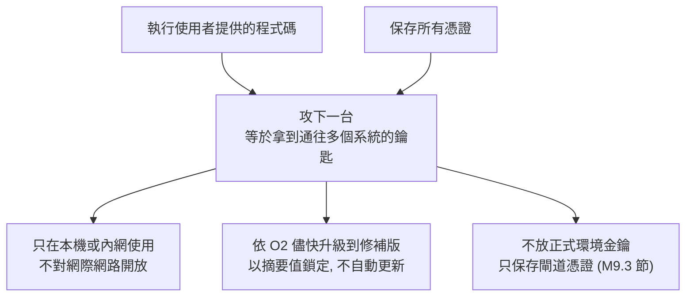
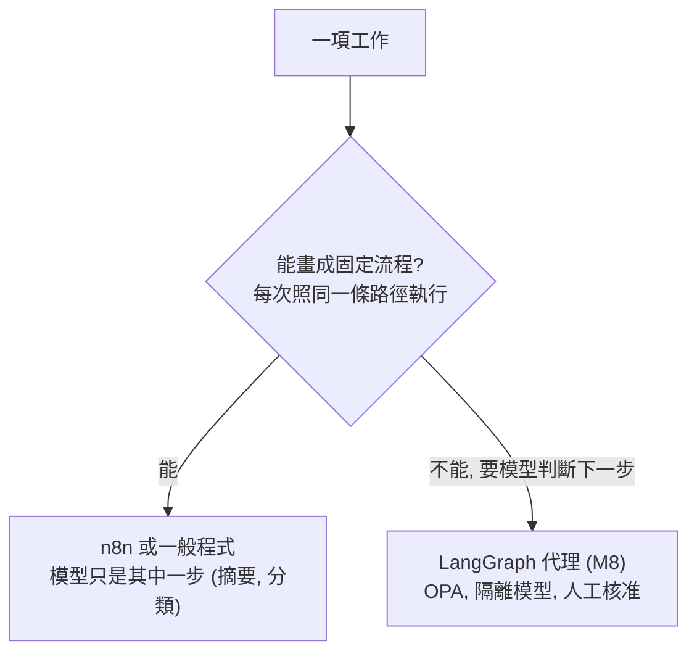
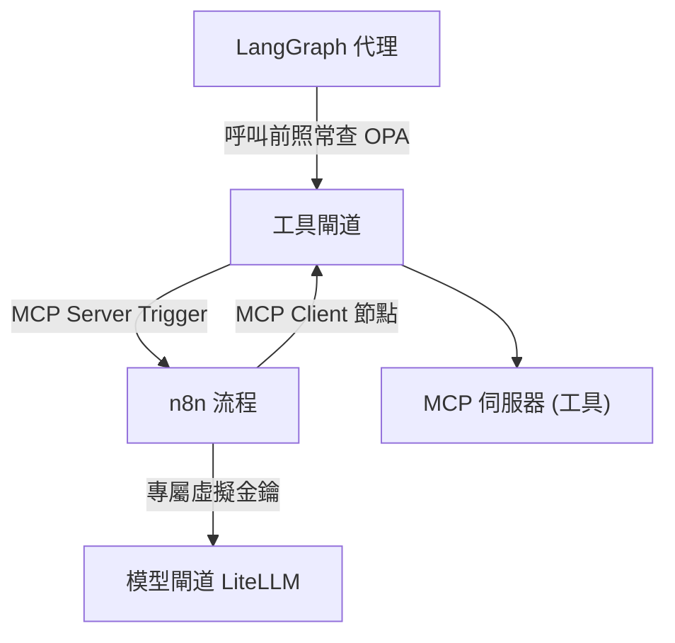
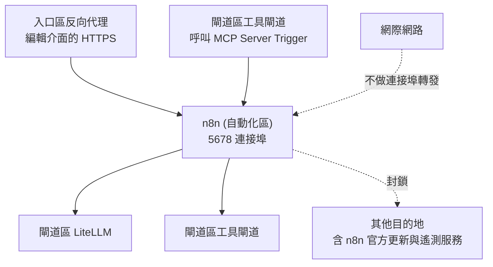
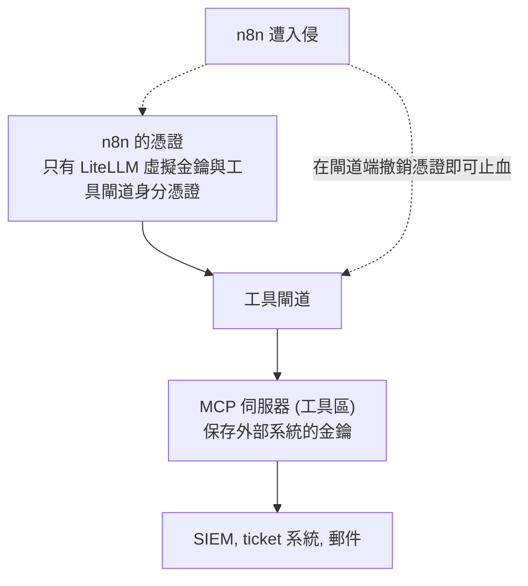
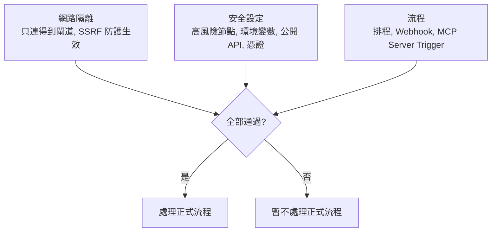

# M9 流程自動化

::: info 本章屬性
- 等級: ○ 依情境
- 實機驗證: 未進行 (M9.3 節的 docker run 與環境變數組合依官方文件整理; 需實機確認: SSRF 防護在只允許閘道區網段時, 流程仍能正常呼叫閘道)
:::

**結論**: 規則固定的工作 (排程彙整, 告警轉 ticket) 交給 n8n 這類流程自動化平台, 不需要模型自己判斷. 這類平台設計上會執行使用者提供的程式碼, 又保存憑證, 是 2026 年漏洞最集中的元件之一. 因此 n8n 放在獨立 VM, 只經模型閘道與工具閘道對外, 本身不保存外部系統的金鑰.

**這一塊在圖上的位置**: VM 自動化區的 n8n. **前置模組**: M5, M7. **完成後的狀態**: 固定流程能自動執行, 也能以工具形式讓介面與代理呼叫.

很多日常工作不需要模型臨場判斷, 只需要每次照同樣的步驟做, 例如每天早上彙整告警, 收到告警就開一張 ticket. 流程自動化平台讓這類工作用拖拉方塊的方式畫成流程圖, 再交給系統定時執行. 可以想成設定好的洗衣機程式: 洗, 沖, 脫水的順序固定, 按下開始就照表執行, 不會中途自己改程序.

::: tip 本章常見名詞
| 詞 | 意思 |
|---|---|
| 流程自動化平台 | 把多個步驟串成固定流程並自動執行的工具, 本章以 n8n 為例 |
| 低程式碼 (low-code) | 主要以拖拉介面組流程, 只在必要時寫少量程式 |
| 節點 (node) | 流程中的一個步驟, 例如排程觸發, 呼叫 API, 寄信 |
| 憑證 (credentials) | n8n 保存的帳號, 密碼或金鑰, 供節點連到其他系統 |
| Webhook | 一個網址, 外部系統對它送出請求時就觸發流程 |
| SSRF | 誘使伺服器替攻擊者連到內部其他系統的攻擊手法 |
| KEV | CISA 公布的「已知遭實際利用的漏洞」清單 |
:::

## M9.1 低程式碼平台的風險

流程自動化平台為了串接各種系統, 會保存大量帳號與金鑰, 也允許在流程中執行程式碼. 這讓它成為攻擊者眼中的高價值目標: 攻下一台, 等於拿到通往多個系統的鑰匙.

Langflow, Flowise 與 Dify 是以拖拉方式組合模型, 知識庫與工具的 AI 應用開發平台; n8n 以一般流程自動化為主, 也能在流程中接上模型. Langflow, n8n, Flowise 這類平台設計上就會執行使用者提供的程式碼, 預設以高權限執行, 又保存所有憑證, 因此 2026 年已有實際利用紀錄的漏洞最多.

| 平台 | 授權 | 2026 年重大紀錄 (來源) |
|---|---|---|
| Langflow | MIT | 未經身分驗證即可遠端執行程式碼的漏洞列入 CISA KEV (已知遭利用漏洞目錄); 資安廠商 Sysdig 觀測到公告約 20 小時後即出現利用 (CISA KEV, Cloud Security Alliance 研究筆記) |
| n8n | Sustainable Use License, 官方文件明言非 OSI 開源 | 2026-03 有漏洞列入 CISA KEV (CISA KEV) |
| Flowise | Apache 2.0 (企業目錄另有授權) | 2.2.4 及以前版本有未經身分驗證即可上傳任意檔案的漏洞, 2026-06-25 公開; CVE 紀錄把受影響範圍標為 2.2.4 及以前, 沒有寫明修補版本, 使用時至少升到 2.2.4 以後的版本, 並以 Flowise 官方發行說明確認 (CVE.org 紀錄, CNA 為 VulnCheck) |
| Dify | Dify Open Source License (非 OSI) | GitHub Advisory Database 在 2026 年收錄多筆 Dify 漏洞, 其中 2026-05-18 公開的兩筆為 Critical: 1.14.1 及以前版本, 已登入的編輯者可替不屬於自己的應用設定追蹤服務, 讓訊息送到攻擊者的服務 (CVE-2026-41947); 已登入使用者可經路徑穿越存取 Plugin Daemon 的內部 API (CVE-2026-41948) |

各筆的 CVE 編號, 受影響與修補版本見[版本頁](/ref/versions).

對初階讀者的建議 (信心: 高):

- 若要學習, 只在本機或內網使用.
- 不直接對網際網路開放.
- 依 [O2](/ops/versioning) 的流程儘快升級到修補版; 不使用自動更新, 版本以摘要值鎖定 (見 M0.3 節).
- 不把正式環境金鑰放進去.
- 稱 Dify 為「原始碼公開」, 不稱「開源」.

下圖是這類平台的風險來源與對應的防護 (信心: 高):



## M9.2 n8n 與 LangGraph 的分工

兩者的差別在於「下一步由誰決定」: n8n 的流程由人事先畫好, 每次照同一條路徑執行; LangGraph 的代理由模型在執行中決定下一步, 因此需要 M8 的政策與核准機制 (信心: 高).

| 比較 | n8n | LangGraph (M8) |
|---|---|---|
| 下一步由誰決定 | 人在設計時決定, 執行時不變 | 模型在執行時決定 |
| 適合的工作 | 排程彙整, 告警轉 ticket, 定期報表, 資料搬移 | 需要判斷的多步驟調查, 分流 |
| 模型的角色 | 流程中的一個步驟 (摘要, 分類), 輸出交給固定的下一步 | 決定要呼叫哪個工具 |
| 主要風險 | 平台本身的漏洞與保存的憑證 (見 M9.1 節) | 提示注入導致錯誤動作 |
| 主要控制 | 獨立 VM, 只經閘道對外, 停用高風險節點 | OPA 政策引擎, 隔離模型, 人工核准 |

下圖是一項工作該交給誰的判斷 (信心: 高):



**互相呼叫的方式** (推論, 信心: 中):

- **代理呼叫 n8n**: n8n 以 MCP Server Trigger 節點把流程提供為 MCP 工具, 登記在工具閘道; LangGraph 經工具閘道呼叫, 呼叫前照常查詢 OPA.
- **n8n 呼叫工具**: n8n 以 MCP Client 節點經工具閘道呼叫工具, 不直接連 MCP 伺服器.
- **n8n 呼叫模型**: 經模型閘道 LiteLLM, 使用專屬的虛擬金鑰與用量上限.

下圖是三種互相呼叫的路徑, 每一條都經過閘道 (推論, 信心: 中):



所有呼叫都經過模型閘道或工具閘道, 稽核紀錄因此集中在閘道與稽核區, 不必分別查 n8n 與代理的紀錄. 一項工作若能畫成固定流程, 優先用 n8n 或一般程式完成, 不交給代理 (見 K5.4 節).

## M9.3 架設 n8n

本節依序處理三件事: 把 n8n 放在只能連閘道的網段, 以安全設定啟動, 再讓它經工具閘道與其他系統互通.

### 網路位置

n8n 部署在 VM 自動化區 (見[組裝總覽](/build/overview)的部署分區). 防火牆規則 (推論, 信心: 中):

- **連入**: 只接受入口區反向代理 (提供 n8n 編輯介面的 HTTPS) 與閘道區 (工具閘道呼叫 MCP Server Trigger) 的連線.
- **連出**: 只允許連到閘道區的 LiteLLM 與工具閘道; 其他目的地一律封鎖, 包含 n8n 官方的更新與遙測服務.
- **公網**: 不做任何連接埠轉發.

下圖是 n8n 的連入與連出範圍 (推論, 信心: 中):



### 以 Docker 執行

n8n 官方的 Docker 安裝頁面標示為舊版說明, 建議改用 Docker Compose (以一個設定檔同時啟動多個容器的工具) (來源: n8n Docker 安裝文件). 官方 Compose 範例以 Traefik (能自動申請憑證的反向代理) 取得公開憑證, 預設情境是對外開放的網域 (來源: n8n Docker Compose 文件), 與本手冊「只限內網」的前提不同, 因此下列範例改以 `docker run` 呈現各項設定, 由入口區的反向代理 Nginx 或 Caddy 提供 HTTPS (見 M2). 範例依官方文件的參數組合, 未實機驗證; `<...>` 為佔位符, 實際值放在權限 600 的 `.env` 檔:

```bash
docker volume create n8n_data

docker run -d \
  --name n8n \
  --restart unless-stopped \
  -p <自動化區內網位址>:5678:5678 \
  --env-file /etc/n8n/n8n.env \
  -v n8n_data:/home/node/.n8n \
  n8nio/n8n:<固定版本>
```

上述指令建立資料卷並啟動 n8n 容器, 只在自動化區的內網位址提供服務. 實際設定放在 `/etc/n8n/n8n.env`, 內容如下, 包含時區, 加密金鑰, 停用高風險節點與限制對外連線:

```ini
GENERIC_TIMEZONE=Asia/Taipei
TZ=Asia/Taipei
N8N_ENFORCE_SETTINGS_FILE_PERMISSIONS=true
N8N_ENCRYPTION_KEY=<另行產生並備份的金鑰>

# 安全設定
N8N_BLOCK_ENV_ACCESS_IN_NODE=true
# 自訂清單會取代 2.0 的預設清單, 因此要把預設停用的兩個節點一併列入;
# 節點類型名稱為「n8n-nodes-base.」加上原始碼中的節點名稱
NODES_EXCLUDE=["n8n-nodes-base.executeCommand", "n8n-nodes-base.localFileTrigger", "n8n-nodes-base.readWriteFile"]
N8N_PUBLIC_API_DISABLED=true
N8N_PUBLIC_API_SWAGGERUI_DISABLED=true

# 不連 n8n 官方服務
N8N_DIAGNOSTICS_ENABLED=false
N8N_VERSION_NOTIFICATIONS_ENABLED=false
N8N_TEMPLATES_ENABLED=false
EXTERNAL_FRONTEND_HOOKS_URLS=
N8N_DIAGNOSTICS_CONFIG_FRONTEND=
N8N_DIAGNOSTICS_CONFIG_BACKEND=

# SSRF 防護: 只允許連到閘道區
N8N_SSRF_PROTECTION_ENABLED=true
N8N_SSRF_ALLOWED_IP_RANGES=<閘道區網段>
```

各項設定的依據:

| 設定 | 官方說明 | 來源 |
|---|---|---|
| `N8N_ENFORCE_SETTINGS_FILE_PERMISSIONS` | 對設定檔強制安全權限 | Docker 安裝文件 |
| `N8N_ENCRYPTION_KEY` | `.n8n` 目錄保存加密金鑰等資料; 可改以此變數指定, 但官方仍建議保留資料卷 | Docker 安裝文件 |
| `N8N_BLOCK_ENV_ACCESS_IN_NODE` | 控制運算式與 Code 節點能否讀取環境變數; n8n 2.0 起預設為 `true` | 安全環境變數文件, 2.0 重大變更文件 |
| `NODES_EXCLUDE` | 以 JSON 陣列列出要封鎖的節點類型; 使用者無法搜尋或使用這些節點; 設為 `[]` 可全部解除 | 封鎖節點文件 |
| `N8N_PUBLIC_API_DISABLED`, `N8N_PUBLIC_API_SWAGGERUI_DISABLED` | 停用公開 REST API 與 API playground | 停用公開 API 文件 |
| `N8N_DIAGNOSTICS_ENABLED`, `N8N_VERSION_NOTIFICATIONS_ENABLED`, `N8N_TEMPLATES_ENABLED`; `EXTERNAL_FRONTEND_HOOKS_URLS`, `N8N_DIAGNOSTICS_CONFIG_FRONTEND`, `N8N_DIAGNOSTICS_CONFIG_BACKEND` | 前三項設為 `false`, 後三項設為空值, 可讓自架實例不連 n8n 的伺服器 | Isolate n8n 文件 |
| `N8N_SSRF_PROTECTION_ENABLED` 等 | 限制節點對外 HTTP 請求可連的主機與 IP 範圍; 啟用後預設封鎖 RFC 1918 私有位址, loopback 與 link-local; 須 n8n 2.12.0 以上 | SSRF 防護文件 |

設定時須注意下列事項:

- **NODES_EXCLUDE 會取代預設清單**: n8n 2.0 起預設停用 ExecuteCommand 與 LocalFileTrigger 兩個節點, 可經由變更 `NODES_EXCLUDE` 重新啟用 (來源: 2.0 重大變更文件). 由此推論, 自行設定 `NODES_EXCLUDE` 時, 清單應包含這兩個節點, 上例已列入; LocalFileTrigger 在 n8n 原始碼中的節點名稱為 `localFileTrigger`, 依封鎖特定節點文件的寫法 (以 `n8n-nodes-base.executeCommand` 為例), 完整類型名稱為 `n8n-nodes-base.localFileTrigger` (來源: n8n 原始碼 LocalFileTrigger.node.ts, 2026-10-26 版).
- **SSRF 允許清單的順序**: 判定順序為主機名稱允許清單, IP 允許清單, IP 封鎖清單; 主機名稱允許清單會略過 IP 封鎖檢查, 因此只能放自己控管的主機名稱 (來源: SSRF 防護文件). 本範例只用 IP 範圍.
- **SSRF 防護不取代防火牆**: 它只涵蓋使用者可控制的節點發出的 HTTP 請求; VM 自動化區的防火牆仍是主要控制 (推論, 信心: 高).
- **Cookie 與 HTTPS**: `N8N_SECURE_COOKIE` 預設為 `true`, 只在 HTTPS 下傳送 cookie (來源: 安全環境變數文件), 因此編輯介面須經反向代理的 HTTPS 存取.
- **Code 節點**: n8n 2.0 起預設啟用 task runner (在主程式之外另行執行 Code 節點程式碼的元件) 執行 Code 節點; Python Code 節點只能搭配外部模式的 task runner 使用 (來源: 2.0 重大變更文件). 官方的 task runner 加固文件建議: 以外部模式讓 task runner 在獨立的 sidecar 容器執行; 使用 `-distroless` 映像 (不含套件管理工具與 shell); 以非 root 的 `nobody` 使用者 (UID/GID 65532) 執行; 根檔案系統設為唯讀, 只在 `/tmp` 掛一個小型暫存空間; 並以 AppArmor 規則禁止讀取各行程的 `environ` 與 `mounts`, 避免機密外洩 (來源: n8n 文件 Harden task runners). 允許 Code 節點的環境應採用這些做法 (推論, 信心: 中).
- **資料庫**: 預設使用 SQLite (存成單一檔案的輕量資料庫); 改用 PostgreSQL (獨立運作的資料庫伺服器) 時, 加上 `DB_TYPE=postgresdb` 與 `DB_POSTGRESDB_*` 一組變數 (來源: Docker 安裝文件).
- **更新**: 以固定版本標籤拉取新映像, 停止並移除舊容器後重新啟動 (來源: Docker 安裝文件). 版本鎖定與升級流程見 O2. M9.1 節列出的漏洞都已有修補版, 應維持在最新修補版.
- **Webhook 網址**: 經反向代理提供 Webhook 時, 須設定對外網址變數; 官方 Compose 範例使用 `N8N_WEBHOOK_URL`, 並註明此變數須 n8n 2.30.0 以上, 較舊版本使用 `WEBHOOK_URL` (來源: Docker Compose 文件).

### n8n 只保存閘道的憑證

原則是讓 n8n 手上只有「通行證」, 沒有各系統的「萬用鑰匙」. 即使 n8n 遭入侵, 只要在閘道撤銷通行證, 就能切斷它與所有系統的連線.

n8n 的憑證 (credentials) 中只放兩類: LiteLLM 發給 n8n 的虛擬金鑰, 以及工具閘道發給 n8n 的身分憑證. 外部系統 (SIEM 這類資安紀錄分析系統, ticket 系統, 郵件) 的金鑰放在工具閘道後方的 MCP 伺服器, 不放進 n8n (見 M7.2 節). 這樣 n8n 遭入侵時, 攻擊者只能取得受用量上限與工具白名單限制的閘道憑證, 閘道端撤銷即可止血 (推論, 信心: 中).

下圖是憑證的放置位置, 以及 n8n 遭入侵時的止血點 (推論, 信心: 中):



### MCP Client 節點: 經工具閘道呼叫工具

這個節點讓 n8n 的流程可以使用工具閘道上已審核的工具, 不必在 n8n 裡另外設定各系統的連線.

MCP Client 節點把外部 MCP 伺服器的工具當作流程中的一般步驟執行; 要讓 n8n 的 AI Agent 節點 (由模型自行選用工具的節點) 使用 MCP 工具, 改用 MCP Client Tool 節點 (來源: n8n MCP Client 節點文件). 主要參數:

| 參數 | 說明 | 本手冊的設定 |
|---|---|---|
| Server Transport | MCP 伺服器端點使用的傳輸方式 | 依工具閘道而定, 建議 Streamable HTTP |
| MCP Endpoint URL | 外部 MCP 伺服器的網址 | 閘道區的工具閘道網址 |
| Authentication | Bearer, 一般標頭, 多組標頭, OAuth2, 或 None | 以 LiteLLM 兼任時, 用標頭驗證帶 `x-litellm-api-key`; 不使用 None |
| Tool | 要執行的工具; 清單自動從 MCP 伺服器取得 | 只會看到閘道授權給 n8n 的工具 |
| Timeout (選項) | 等待工具呼叫完成的毫秒數 | 依工具設定, 避免流程無限等待 |

### MCP Server Trigger 節點: 把流程提供為工具

反方向也成立: 在 n8n 畫好的流程, 可以包成一個工具, 讓對話介面 Open WebUI 的使用者或 LangGraph 的代理呼叫.

MCP Server Trigger 節點讓 n8n 扮演 MCP 伺服器, 只連接並執行工具節點; 要把整個流程提供出去, 以 Custom n8n Workflow Tool 節點接上 (來源: n8n MCP Server Trigger 節點文件). 官方文件的要點:

- **傳輸**: 支援 SSE 與 Streamable HTTP, 不支援 stdio.
- **驗證**: 可選 None, Bearer 或標頭驗證. 本手冊要求使用 Bearer 或標頭驗證, 憑證只交給工具閘道.
- **網址**: 預設為隨機路徑, 也可自訂. 測試網址在編輯器中監聽測試事件時有效; 正式網址在流程發布後才登記, 正式執行的紀錄在流程的 Executions 分頁查看.
- **反向代理**: 放在 Nginx 等代理後方時, 須對此端點停用 proxy buffering; 官方另建議對該端點停用 gzip, chunked transfer encoding 與 Connection 標頭.
- **佇列模式**: 有多個 webhook 副本時, 須把所有 `/mcp*` 請求導到同一個專用副本, 否則 SSE 與 Streamable HTTP 連線可能中斷.

把正式網址登記在工具閘道 (例如 LiteLLM 設定檔的 `mcp_servers`, 見 M7.2 節), 介面與代理才會經閘道呼叫, 不直接連 n8n (推論, 信心: 中).

### 授權: Sustainable Use License

n8n 可以免費自架, 但授權並非一般認定的開源授權, 有用途限制. 自架給公司內部使用與包進對外服務, 適用的條件不同.

n8n 主要原始碼採 Sustainable Use License, 檔名含 `.ee.` 的檔案另採 n8n Enterprise License (來源: n8n 授權文件). 官方文件的要點:

- **允許**: 為自己的內部業務目的, 或非商業, 個人用途使用與修改; 只能以免費, 非商業的方式散布; 提供 n8n 相關的顧問與支援服務不需另外授權.
- **不在授權範圍內**: 把 n8n 提供給客戶, 讓客戶連接自己的帳號並建立流程; 這類用途須與 n8n 另簽商業合約.
- **定位**: 官方表示, 依開放原始碼促進會 (OSI) 的定義, 開源授權不能限制用途, 因此 n8n 不自稱開源, 改稱 fair-code.

因此, 企業在內網自架給自己的員工使用, 屬於官方文件所述的內部業務用途; 若要把 n8n 包進對外販售的服務, 須先洽 n8n 確認 (信心: 中; 本手冊不提供法律意見, 個案請洽法務).

## M9.4 驗收測試

驗收時確認三件事: n8n 連不到不該連的地方, 高風險功能確實關閉, 流程能正常執行並留下紀錄.

下列測試全部通過後, 才讓 n8n 處理正式流程 (測試清單為整理者建議, 未實機驗證).

下圖是三組驗收的範圍, 全部通過才處理正式流程:



**網路隔離**

- [ ] 從 n8n 的 VM 連線外部網站與內部其他系統 (例如 SIEM 的 API), 連線失敗.
- [ ] 從 n8n 的 VM 連線閘道區的 LiteLLM 與工具閘道, 連線成功.
- [ ] 在 n8n 中以 HTTP Request 節點請求閘道區以外的私有位址, SSRF 防護會擋下請求.
- [ ] 從入口區與閘道區以外的位址連 5678 連接埠, 連線失敗.

**安全設定**

- [ ] 節點清單中搜尋不到 Execute Command 與 Read/Write Files from Disk 節點.
- [ ] Code 節點讀取環境變數 (例如 `N8N_ENCRYPTION_KEY`) 失敗.
- [ ] 公開 REST API 停用, 呼叫 API 端點得不到資料.
- [ ] n8n 的憑證清單中只有閘道憑證, 沒有外部系統的金鑰.

**流程**

- [ ] 一個排程流程 (例如每天彙整一次告警數量, 經 LiteLLM 產生摘要, 經工具閘道建立 ticket) 依時執行一次, 並在 n8n 的 Executions, LiteLLM 與工具閘道的紀錄中都查得到.
- [ ] 一個 Webhook 流程經反向代理觸發一次, 執行結果正確.
- [ ] 一個以 MCP Server Trigger 提供的流程, 由 Open WebUI 或 LangGraph 經工具閘道呼叫成功; 不帶憑證直接呼叫 n8n 的 MCP 端點則遭拒絕.

## 參考來源

- [CISA: Known Exploited Vulnerabilities Catalog](https://www.cisa.gov/known-exploited-vulnerabilities-catalog)
- [Cloud Security Alliance: Langflow RCE CVE-2026-33017 Exploited Within 20 Hours](https://labs.cloudsecurityalliance.org/research/csa-research-note-cve-2026-33017-langflow-ai-pipeline-rce-20/)
- [CVE.org 紀錄: CVE-2025-71333 (Flowise, CNA: VulnCheck)](https://cveawg.mitre.org/api/cve/CVE-2025-71333)
- [GitHub Advisory Database: GHSA-48v9-p8g8-55vg (Dify, CVE-2026-41947)](https://github.com/advisories/GHSA-48v9-p8g8-55vg)
- [GitHub Advisory Database: GHSA-h666-98mq-949j (Dify, CVE-2026-41948)](https://github.com/advisories/GHSA-h666-98mq-949j)
- [n8n 原始碼: LocalFileTrigger.node.ts (節點名稱)](https://github.com/n8n-io/n8n/blob/e145ac4/packages/nodes-base/nodes/LocalFileTrigger/LocalFileTrigger.node.ts)
- [n8n 文件: Harden task runners](https://docs.n8n.io/deploy/host-n8n/configure-n8n/security/harden-task-runners/)
- [n8n 文件: Docker 安裝](https://docs.n8n.io/hosting/installation/docker/)
- [n8n 文件: Docker Compose](https://docs.n8n.io/deploy/host-n8n/install-options/use-a-cloud-provider/use-docker-compose)
- [n8n 文件: 安全相關環境變數](https://docs.n8n.io/deploy/host-n8n/configure-n8n/basic-configuration/use-environment-variables/security.md)
- [n8n 文件: 封鎖特定節點](https://docs.n8n.io/deploy/host-n8n/configure-n8n/security/block-specific-nodes)
- [n8n 文件: 停用公開 API](https://docs.n8n.io/deploy/host-n8n/configure-n8n/security/disable-the-public-api/)
- [n8n 文件: Isolate n8n](https://docs.n8n.io/deploy/host-n8n/configure-n8n/basic-configuration/configuration-examples/isolate-n8n)
- [n8n 文件: 安全設定總覽](https://docs.n8n.io/deploy/host-n8n/configure-n8n/security/)
- [n8n 文件: SSRF 防護](https://docs.n8n.io/deploy/host-n8n/configure-n8n/security/enable-ssrf-protection.md)
- [n8n 文件: 2.0 重大變更](https://docs.n8n.io/2-0-breaking-changes)
- [n8n 文件: MCP Client 節點](https://docs.n8n.io/integrations/builtin/core-nodes/n8n-nodes-langchain.mcpclient)
- [n8n 文件: MCP Server Trigger 節點](https://docs.n8n.io/integrations/builtin/core-nodes/n8n-nodes-langchain.mcptrigger/)
- [n8n 文件: Sustainable Use License](https://docs.n8n.io/n8n-community-license/sustainable-use-license)
- [n8n 文件: 授權總覽](https://docs.n8n.io/n8n-community-license)
- 文中的類比 (洗衣機程式, 通行證與萬用鑰匙): 整理者所寫, 無外部來源, 不應當作技術定義引用.
