# E1 內部知識庫問答

::: info 本章屬性
- 等級: ○ 依情境
- 狀態: 可閱讀 (部分資料待核對)
- 資料基準日: 2026-10-26
- 待查證: Open WebUI 與 Keycloak 設定依官方文件整理, 未實機驗證; Keycloak 群組 mapper 的細部選項 (例如是否帶完整群組路徑) 官方 Open WebUI 文件只以圖片呈現, 須實機確認; 群組在登入時同步的時間點須實機確認; 嵌入請求經 LiteLLM 轉送屬本手冊的設計推論; 文中的類比為整理者所寫, 不代表技術上完全等同
:::

**結論**: 內部知識庫問答需要里程碑 2 (M0 至 M6). 權限設計的核心是「一個部門一個知識庫, 一個知識庫只授權給對應的群組」: 群組由 Keycloak 管理並在登入時同步到 Open WebUI, 知識庫設為私有並只給該群組讀取權限. Open WebUI 的管理者角色等同系統最高權限, 群組權限擋不住管理者, 因此人事薪資這類高度機密的文件不放進共用系統, 或另建獨立的執行個體.

**對象**: 企業. **需要的模組**: M0 至 M6.

::: tip 本頁常見名詞
| 詞 | 意思 |
|---|---|
| VM (虛擬機器) | 在一台實體主機上切出來, 彼此隔開的多台「電腦」; 本頁依用途分成入口區, 閘道區, 推論區與稽核區 |
| 反向代理 (reverse proxy) | 擋在服務前面的大門, 所有連線先經過它, 再轉給後面的服務; 本頁用 Nginx 或 Caddy |
| 模型閘道 (gateway) 與虛擬金鑰 | 閘道是所有程式呼叫模型的單一入口 (本頁用 LiteLLM); 虛擬金鑰是閘道發給每個程式的通行證, 可以各自限制能用的模型與用量 |
| 單一登入 (Single Sign-On, SSO) 與 OIDC | 同事用同一組公司帳號登入多個系統; OIDC (OpenID Connect) 是常見的單一登入標準 |
| Keycloak | 開源的身分管理系統, 負責登入與群組, 並可串接公司既有的 AD 或 LDAP 帳號目錄 |
| 群組 (group) 與宣告 (claim) | 群組代表部門或角色; 宣告是登入時隨通行證一起帶過來的資料, 例如「此人屬於財務部」 |
| 向量庫 (vector database) | 存放文件段落向量的資料庫, 檢索時從這裡找出意思相近的段落; 本頁用 Qdrant |
| SIEM | 資安事件管理平台 (Security Information and Event Management), 集中收集與分析各系統的紀錄 |
| OpenTelemetry (OTel) 與 OTLP | 收集系統呼叫紀錄的開放標準, OTLP 是它的傳輸格式; Langfuse 是接收這些紀錄並顯示每次呼叫經過的平台 |

完整詞彙見[術語對照](/ref/glossary).
:::

## 情境

一家 200 人規模的公司 (假設情境), 內部規章, 作業手冊與歷史文件散在檔案伺服器與各部門的共用資料夾. 同事遇到「出差住宿上限多少」「新進人員帳號怎麼申請」這類問題, 多半直接問人資或資訊部門, 承辦人每天要回覆大量重複問題. 文件本身也有版本問題: 同一份辦法在不同資料夾有新舊兩版, 同事不一定拿到現行版本.

本範例讓同事用自己的公司帳號登入, 以自然語言查詢有權限看的文件, 回答附上出處與文件版本. 可以想成公司內部的諮詢櫃台: 櫃台人員先確認來問的人是哪個部門, 只從這個人有權限看的資料夾找答案, 回答時說明出自哪份文件的哪一版. 治理上要回答三個問題: 誰可以看哪些文件, 誰可以放文件進去, 以及事後能不能查到誰問了什麼.

## 需要的模組

| 模組 | 里程碑 | 在本範例的用途 |
|---|---|---|
| [M0 基礎環境](/build/m0-foundation) | 里程碑 1 | 以 Proxmox VE (在實體主機上建立與管理多台 VM 的虛擬化平台) 切出入口區, 閘道區, 推論區, 稽核區 VM; 備份伺服器 |
| [M1 推論伺服器](/build/m1-inference) | 里程碑 1 | 多人並行用 vLLM (能同時處理多人請求的推論伺服器), 只接受閘道區連線; 嵌入模型與對話模型各跑一個 vLLM 行程 (做法見 M1.11 節的「每個模型一個 vLLM 行程」) |
| [M2 使用者介面與反向代理](/build/m2-ui-proxy) | 里程碑 1 | Open WebUI 是同事在瀏覽器裡提問的對話介面, 前面加 Nginx 或 Caddy 擔任反向代理, 只接受內網連線 |
| [M3 模型入庫與存放](/build/m3-model-intake) | 里程碑 2 | 對話模型與嵌入模型都經入庫檢查, 推論伺服器唯讀掛載 |
| [M4 檢索 (RAG)](/build/m4-retrieval) | 里程碑 2 | Docling 把 PDF, Word 等檔案解析成純文字, Qdrant 向量庫存放段落向量, 依部門分知識庫 |
| [M5 模型閘道與身分驗證](/build/m5-gateway-identity) | 里程碑 2 | LiteLLM 是所有模型呼叫的閘道, 負責虛擬金鑰與配額; Keycloak 管理帳號與群組, 以 OIDC 提供單一登入 |
| [M6 可觀測, 稽核與評估](/build/m6-observability) | 里程碑 2 | 各部門的 50 題測試集; Langfuse 記錄並顯示每次模型呼叫的軌跡, 紀錄另轉送既有 SIEM |

## 流程

流程分三部分. 文件匯入由各部門的維護者負責, 文件解析後轉成向量, 依部門分開存放. 查詢時, 同事先經單一登入確認身分與群組, 系統只在這個群組能讀的知識庫裡找答案, 所有模型呼叫都經過閘道. 每次查詢的紀錄送到稽核區, 事後可以查到誰在什麼時候問了什麼.

```mermaid
flowchart TD
  subgraph S1["文件匯入 (由各部門的知識庫維護者執行)"]
    A1["檔案伺服器: 各部門現行版文件"] -->|"維護者確認版本與生效日, 上傳到自己負責的知識庫"| A2["入口區 VM: Open WebUI"]
    A2 -->|"HTTP"| A3["入口區 VM: docling-serve (解析)"]
    A2 -->|"嵌入請求 (OpenAI 相容 API, 虛擬金鑰)"| A4["閘道區 VM: LiteLLM"]
    A4 --> A5["推論區 VM: vLLM 嵌入模型"]
    A4 --> A6["入口區 VM: Qdrant (向量依知識庫分開存放)"]
  end
  subgraph S2["查詢 (每位同事)"]
    B1["同事的瀏覽器"] -->|"內網 HTTPS"| B2["入口區: Nginx 或 Caddy"]
    B2 --> B3["入口區: Open WebUI"]
    B3 -->|"1. OIDC 登入, 轉到 Keycloak (串接 AD 或 LDAP), 取回 groups 宣告"| B4["入口區: Open WebUI 依群組同步結果, 決定可讀的知識庫與模型"]
    B4 -->|"2. 只在可讀的知識庫中檢索 (Qdrant)"| B5["閘道區: LiteLLM (Open WebUI 專用虛擬金鑰)"]
    B5 --> B6["推論區: vLLM 對話模型"]
    B5 -->|"3. 回答 + 出處 (文件名稱, 版本)"| B7["同事"]
    B7 --> B8["涉及權益時, 向承辦單位確認"]
  end
  subgraph S3["紀錄"]
    C1["Open WebUI, LiteLLM"] -->|"OTLP"| C2["稽核區: OTel Collector"]
    C2 -->|"OTLP/HTTP"| C3["稽核區: Langfuse (/api/public/otel)"]
    C2 --> C4["既有 SIEM"]
  end
```



## 設定要點

以下依 Open WebUI, Keycloak 相關官方文件整理, 未實機驗證.

### 權限模型: 部門, 群組與知識庫

| 知識庫 | 讀取群組 | 寫入群組 (維護者) | 對話模型 |
|---|---|---|---|
| 全公司規章 | 全體員工 | 行政部文件維護者 | 「公司規章助理」 |
| 資訊作業手冊 | 全體員工 | 資訊部文件維護者 | 「資訊服務助理」 |
| 財務作業細則 | 財務部 | 財務部文件維護者 | 「財務作業助理」 |
| 人事薪資資料 | 不放進本系統 | - | - |

設計原則與官方文件依據:

- **知識庫設為私有, 只授權給群組.** Open WebUI 官方文件說明, 知識庫可設為 Private 並指定群組或使用者; 授權分為讀取與寫入, 寫入等同擁有者, 可以修改, 刪除並管理存取清單. 因此寫入權限只給少數維護者.
- **權限只能累加, 沒有拒絕規則.** 官方文件指出權限採聯集 (additive), 同時屬於多個群組的人會得到所有群組權限的總和. 規劃群組時要以「最小的群組組合」思考, 不能靠拒絕規則補洞.
- **不要設為 Public.** 官方文件說明 Public 等於授權所有已登入的使用者讀取. 一般使用者的知識庫分享 (`USER_PERMISSIONS_WORKSPACE_KNOWLEDGE_ALLOW_SHARING`) 與公開分享 (`USER_PERMISSIONS_WORKSPACE_KNOWLEDGE_ALLOW_PUBLIC_SHARING`) 預設都是關閉, 維持關閉.
- **每個知識庫搭配一個專用模型.** 在 **Workspace > Models** 建立專用模型並附加對應的知識庫, 模型本身也只授權給同一群組. 官方文件說明, 沒有限定知識庫的模型會搜尋使用者可存取的所有知識.
- **管理者不是權限邊界.** Open WebUI 環境變數文件明言, 系統架構上是單一租戶, 管理者角色等同部署環境的最高權限, 可以經資料庫, 伺服器與 Functions 存取所有資料. `BYPASS_ADMIN_ACCESS_CONTROL` 預設為 True, 管理者的清單畫面會看到所有人的知識庫; 改為 False 只影響畫面, 不構成安全邊界. 因此管理者帳號限 2 人以內並記錄操作, 高度機密文件不放進共用執行個體 (推論, 信心: 高).

### Keycloak 群組同步

同事登入時, Keycloak 會把這個人所屬的群組一併交給 Open WebUI, Open WebUI 再依群組決定能看哪些知識庫. 以下設定讓這份群組資料能正確傳過去.

- Open WebUI 官方 Keycloak 文件的設定: `OPENID_PROVIDER_URL` 指向 realm 的 `.well-known/openid-configuration`, `OAUTH_CLIENT_ID` 與 `OAUTH_CLIENT_SECRET` 填 Keycloak client 的值 (機密值存在 `.env`, 權限 600), `ENABLE_OAUTH_GROUP_MANAGEMENT=true`, `OAUTH_GROUP_CLAIM=groups`.
- 官方文件說明, Keycloak 的 client 預設不會把群組放進 token, 須在 client scope 的 Mappers 加上群組 mapper; Keycloak 26.x 的 Client Authentication 預設為 None, 須手動改為以 client ID 與 secret 驗證.
- 群組同步規則 (官方 Groups 文件): 使用者的群組會依 OAuth 宣告「嚴格增減」; 同步建立的群組位於最上層, 同步只管理直接成員. 建議不開 `ENABLE_OAUTH_GROUP_CREATION`, 先在 Open WebUI 手動建立與 Keycloak 同名的群組, 避免 AD 中的任意群組都出現在系統裡 (推論, 信心: 中).
- 群組來源是公司的 AD 或 LDAP, 由 Keycloak 串接 (見 M5.4 節). 員工離職時在 AD 停用帳號, 所有串接 Keycloak 的系統同時無法登入.
- 改用單一登入後, 以 `ENABLE_LOGIN_FORM` 關閉本機帳密登入表單; 官方文件提醒先確認 SSO 可以登入, 否則所有人都無法進入. `OAUTH_ALLOWED_DOMAINS` 預設為 `*`, 若帳號來源含外部身分提供者, 改為公司網域.

### 檢索與模型

- 向量庫改用 Qdrant: `VECTOR_DB=qdrant`, `QDRANT_URI` 指向入口區的 Qdrant, `QDRANT_API_KEY` 設定 API 金鑰 (官方環境變數文件).
- 文件解析設為 Docling (見 P1 的設定要點; 掃描檔會用到的 OCR 引擎見 [M4.1 節](/build/m4-retrieval)); 嵌入模型例如 EmbeddingGemma 或 nomic-embed-text-v2-moe, 依 M4.3 節以各部門文件實測後決定.
- Open WebUI 連模型改經 LiteLLM, 使用 Open WebUI 專用的虛擬金鑰, 並限制可用模型 (LiteLLM 文件的 `/key/generate` 支援 `models` 與 `metadata` 欄位).
- Open WebUI 以 `ENABLE_OTEL` 開啟 OpenTelemetry (預設關閉). 官方文件列出的預設匯出協定 (`OTEL_OTLP_SPAN_EXPORTER`) 為 gRPC, 而 Langfuse 只接收 HTTP 版的 OTLP, 因此先送到 OTel Collector (接收紀錄, 轉換格式後再轉送的中繼程式), 再由 Collector 以 HTTP 轉送 Langfuse (見 M6.4 節).
- 標為 `ConfigVar` 的環境變數只在第一次啟動時生效, 之後的變更要在管理介面調整, 並記錄在變更紀錄中 (見 O2).

### 提示範本

下列範本附在每次提問前面, 要求模型只根據檢索到的規章回答, 並標出條次與版本; 範本最後的 CONTEXT 佔位符會換成檢索到的段落. 範本只在函式呼叫設為 Legacy 時自動填入檢索內容, 其他設定的差異見 P1 的設定要點第 7 點.

```
角色: 公司內部規章查詢助理. 只根據參考資料回答, 使用繁體中文.
1. 每個重點標出出處: 文件名稱, 條次, 版本或生效日.
2. 參考資料沒有答案時, 回答「查無相關規定, 請洽承辦單位」, 不要推測.
3. 若參考資料中同一規定有新舊版本, 以生效日較新者為準, 並說明有舊版存在.
4. 回答只供參考, 正式依據以原始文件為準.

參考資料:
{{CONTEXT}}
```

### 文件匯入流程

1. 各部門指定 1 至 2 位知識庫維護者, 只有維護者有該知識庫的寫入權限.
2. 匯入前確認文件為現行版本, 在檔名或文件開頭標出版本與生效日, 讓出處能顯示版本.
3. 辦法修訂時, 先刪除舊版再匯入新版, 並重跑該部門的測試題.
4. 每季由維護者檢查一次知識庫內容是否與檔案伺服器的現行版一致.

## 驗收方式

**1. 權限矩陣測試.** 建立 3 個測試帳號 (一般員工, 財務部員工, 財務部文件維護者), 每個帳號對每個知識庫各問 3 題:

| 測試帳號 | 全公司規章 | 財務作業細則 | 預期結果 |
|---|---|---|---|
| 一般員工 | 能查到, 附出處 | 查不到, 也不會出現財務文件的出處 | 選單中看不到財務知識庫與財務專用模型 |
| 財務部員工 | 能查到 | 能查到 | 無法上傳或刪除文件 |
| 財務部維護者 | 能查到 | 能查到, 能更新文件 | 無法修改其他部門的知識庫 |

另外以 `#` 指定知識庫與使用專用模型兩種方式各測一次, 確認兩條路徑的結果一致.

**2. 異動測試.** 在 Keycloak 把財務部員工移出財務群組, 重新登入後應無法查詢財務知識庫; 在 AD 停用帳號後應無法登入. 記錄群組變更到生效需要多久 (重新登入或 token 到期).

**3. 檢索品質.** 每個知識庫依 M4.3 節準備 50 題, 計算命中率; 另加 5 題「舊版與新版規定不同」的題目, 確認回答引用現行版. 結果併入 M6.1 節的回歸測試集.

**4. 稽核紀錄.** 任選 3 次對話, 能在 Langfuse 查到完整軌跡 (提問者, 時間, 使用的模型與知識庫); 確認只有稽核人員能存取 Langfuse.

**5. 網路邊界.** 從內網另一台電腦直接連 Open WebUI, Qdrant, vLLM 的連接埠應失敗, 只能經反向代理進入 (見 M2.4 節, M5.5 節).

## 風險與限制

| 風險 | 影響 | 因應方式 |
|---|---|---|
| 權限設定錯誤 (例如誤設 Public) | 機密文件內容出現在無權限者的回答中 | 關閉一般使用者的分享權限; 權限矩陣測試列入每次升級後的檢查 |
| 管理者可存取所有資料 | 群組權限無法限制管理者 | 管理者人數減到最少並記錄操作; 高度機密文件不放進共用系統, 或另建獨立執行個體 |
| 舊版文件仍在知識庫 | 同事依過時規定辦事 | 匯入流程要求先刪舊版; 回答顯示版本與生效日; 每季比對 |
| 模型誤讀條文 | 回答與規定不符, 同事據以申請或拒絕 | 提示範本要求附條次出處並聲明以原始文件為準; 承辦單位保有最終解釋 |
| 紀錄平台保存完整對話 | 提問內容可能含個人資料或機密 | Langfuse 限稽核人員存取, 設定保存期限 (見 M6.4 節) |
| 文件夾帶指令 (間接提示注入) | 惡意或不當內容影響其他人的回答 | 只有維護者能匯入; 文件來源只限檔案伺服器的正式目錄 (OWASP LLM01 提示注入, LLM05 資料與模型投毒; 見 K6.4 節) |
| 元件漏洞 | 介面或閘道遭入侵即可讀取多個部門的資料 | 依 O2, O3 鎖定版本, 訂閱安全公告; 入口區只接受內網連線 |

需要人工確認的步驟: 文件匯入前由維護者確認版本; 回答涉及權益 (請假, 報帳, 懲處) 時, 以承辦單位的確認為準.

## 參考來源

- [Open WebUI 文件: Knowledge](https://docs.openwebui.com/features/workspace/knowledge)
- [Open WebUI 文件: Groups (RBAC)](https://docs.openwebui.com/features/authentication-access/rbac/groups)
- [Open WebUI 文件: Keycloak SSO](https://docs.openwebui.com/features/authentication-access/auth/sso/keycloak)
- [Open WebUI 文件: Environment Variable Configuration](https://docs.openwebui.com/reference/env-configuration)
- [Open WebUI 文件: Retrieval Augmented Generation (RAG)](https://docs.openwebui.com/features/chat-conversations/rag)
- [LiteLLM 文件: Virtual Keys](https://docs.litellm.ai/docs/proxy/virtual_keys)
- [Langfuse 文件: OpenTelemetry](https://langfuse.com/docs/opentelemetry/introduction)
- 站內: [M4 檢索 (RAG)](/build/m4-retrieval), [M5 模型閘道與身分驗證](/build/m5-gateway-identity), [M6 可觀測, 稽核與評估](/build/m6-observability), [O2 版本鎖定與升級流程](/ops/versioning)
- 文中的類比 (諮詢櫃台, 大門, 通行證): 整理者所寫, 無外部來源, 不應當作技術定義引用.
