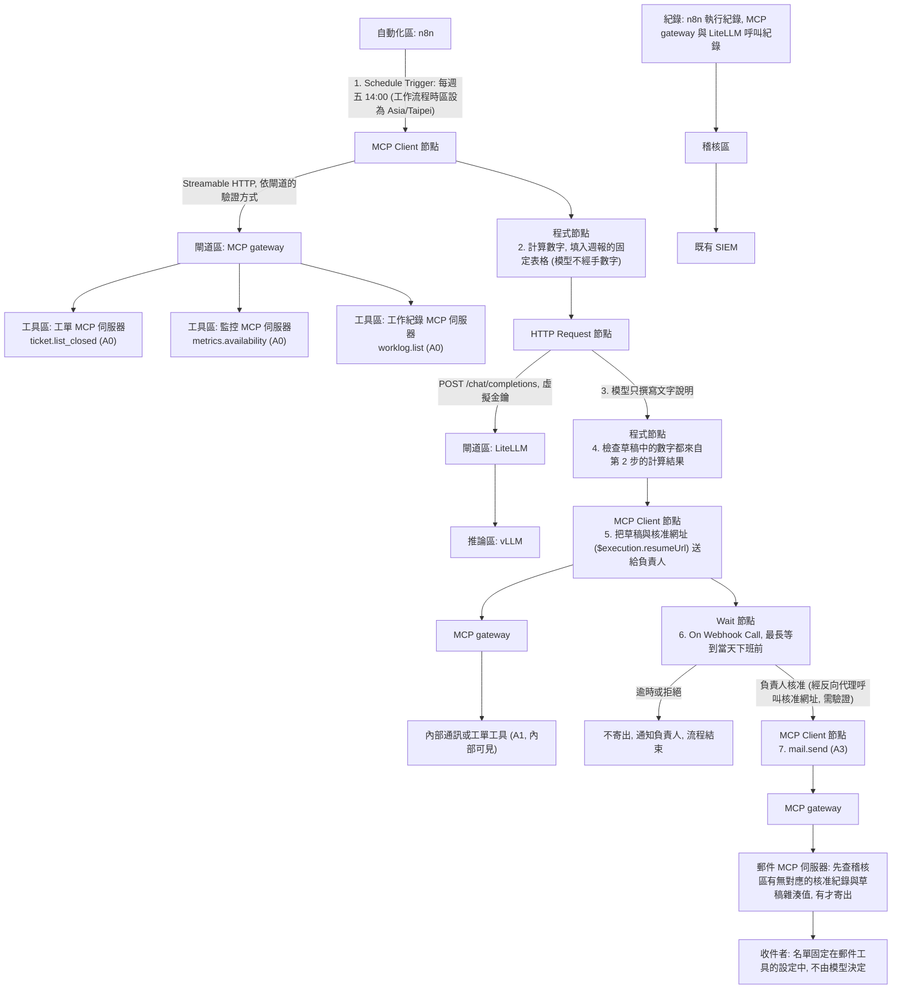

# E4 每週報告自動化

::: info 本章屬性
- 等級: ○ 依情境
- 狀態: 可閱讀
- 資料基準日: 2026-10-27
- 實機驗證: 未進行 (n8n 與 LiteLLM 設定依官方文件整理)
:::

**結論**: 每週報告是規則固定的流程, 適合交給 n8n (流程自動化平台) 排程執行, 不需要代理自己決定步驟. n8n 經 MCP gateway (所有工具呼叫的單一出入口) 呼叫唯讀工具取得工作紀錄與指標, 由程式計算數字, 再經 LiteLLM (模型閘道) 請模型撰寫文字說明; 草稿送給負責人確認, 確認後才寄出. 對外發信屬 A3 (不可回復), 一律人工核准, 而且郵件工具寄出前會再查一次核准紀錄, 不只靠 n8n 流程本身.

**對象**: 企業. **需要的模組**: M0 至 M6, M9 (另需 M7 的工具閘道; 不需要程式碼沙箱).

::: tip 本頁常見名詞
| 詞 | 意思 |
|---|---|
| n8n | 以拖拉方塊組出自動化流程的工具; 每個方塊稱為節點 (node), 負責一個步驟 |
| 排程 (schedule) 與 cron | 排程讓流程在固定時間自動執行; cron 是描述「每週幾, 幾點」的寫法 |
| Webhook | 一個專用網址, 有人呼叫這個網址時, 流程就收到通知並繼續往下走 |
| MCP gateway | 所有工具呼叫的單一出入口, 決定哪個程式能用哪些工具 (見 [M7](/build/m7-tools-sandbox)) |
| 虛擬金鑰 | 模型閘道 LiteLLM 發給每個程式的通行證, 可以限定能用的模型與用量 |
| 權杖 (token) | 程式向其他系統證明身分用的一串字元, 作用類似通行證 |
| Bearer, Basic Auth, JWT | 三種在請求中證明身分的方式: Bearer 是在標頭附上一串權杖; Basic Auth 是附上帳號與密碼; JWT 是由簽發者簽章, 內含身分資訊的權杖 |
| Streamable HTTP | MCP 規格定義的一種連線方式, 讓客戶端經一般的 HTTP 連線呼叫遠端的 MCP 伺服器 |
| 雜湊值 (hash) | 由檔案內容算出的一串固定長度字元; 內容只要改一個字, 雜湊值就會不同, 可以用來確認核准的就是這份草稿 |

完整詞彙見[術語對照](/ref/glossary).
:::

## 情境

一個 IT 維運團隊每週五要交週報給主管, 每月另交一份服務報告給外部客戶. 內容大致固定: 本週結案工單數, 尚未結案的重大事件, 系統可用率, 下週計畫. 承辦人每次要登入工單系統, 監控平台與工作紀錄表, 手動複製數字, 再寫成文字, 每次約需半天, 而且偶爾抄錯數字.

本範例把「收集數字」與「寫成文字」交給自動流程, 承辦人只負責檢查草稿與按下核准. 治理設計要回答三個問題: 數字對不對, 寄給誰, 以及誰同意寄出.

這條流程可以想成一條固定的報表生產線: 會計先把數字算好填進表格, 文書人員只負責寫文字說明, 不能改表格; 主管看過簽核後, 才交給收發室寄出, 而收件名單由收發室保管, 文書人員改不了.

## 需要的模組

| 模組 | 里程碑 | 在本範例的用途 |
|---|---|---|
| [M0 基礎環境](/build/m0-foundation) | 里程碑 1 | 自動化區, 閘道區, 工具區, 推論區, 稽核區 VM |
| [M1 推論伺服器](/build/m1-inference) | 里程碑 1 | vLLM 執行撰寫草稿的對話模型 |
| [M2 使用者介面與反向代理](/build/m2-ui-proxy) | 里程碑 1 | n8n 的核准網址經反向代理提供; 反向代理只轉送 n8n 的 Webhook 路徑, 只限內網 |
| [M3 模型入庫與存放](/build/m3-model-intake) | 里程碑 2 | 模型經入庫檢查 |
| [M4 檢索 (RAG)](/build/m4-retrieval) | 里程碑 2 | 可選: 參考過去的週報格式 |
| [M5 模型閘道與身分驗證](/build/m5-gateway-identity) | 里程碑 2 | n8n 專用的 LiteLLM 虛擬金鑰, 限制可用模型與用量 |
| [M6 可觀測, 稽核與評估](/build/m6-observability) | 里程碑 2 | 每次執行與每次工具呼叫的紀錄; 歷史週報當測試資料 |
| [M7 工具與沙箱](/build/m7-tools-sandbox) (只用 MCP gateway) | 里程碑 3 | 工單, 監控, 郵件的 MCP 伺服器都經工具閘道呼叫 |
| [M9 流程自動化](/build/m9-automation) | 里程碑 3 | n8n 排程, 彙整, 等待核准 |

M9 的前置模組包含 M7: n8n 依本手冊的架構只經 LiteLLM 與 MCP gateway 對外, 本身不保存外部系統的金鑰.

## 流程

n8n 每週五下午自動啟動, 經工具閘道從工單, 監控與工作紀錄系統取得資料; 程式先算好數字, 模型只寫文字說明, 程式再確認草稿裡的數字都來自計算結果. 草稿連同核准網址送給負責人, 流程停下來等待; 負責人核准後才寄出, 拒絕或逾時就不寄. 下圖的編號對應這七個步驟.



## 設定要點

以下依 n8n 與 LiteLLM 官方文件整理, 未實機驗證.

### 排程與時區

- Schedule Trigger 節點可用 Weeks 設定 (每隔幾週, 星期幾, 幾點幾分), 也可用 cron 運算式, 例如 n8n 文件中的 `0 12 * * 1` 代表每週一中午. n8n 文件列出的欄位依序為 (秒), 分, 時, 日, 月, 星期 (Sun-Sat), 其中秒可以省略; 本例的週五 14:00 可寫成 `0 14 * * 5` (來源: n8n 文件 Schedule Trigger).
- n8n 文件說明, 排程依工作流程的時區設定; 沒有設定時用執行個體的時區, 而自架版預設為 America/New York. 因此要在工作流程設定中把時區改為 Asia/Taipei, 否則會在台灣時間的半夜執行.
- 官方文件提醒, 使用 Schedule 觸發的工作流程要儲存並發布 (publish) 才會依排程執行.

### 取資料: MCP Client 節點

- n8n 的 MCP Client 節點設定伺服器傳輸方式與 MCP 端點網址, 支援 Bearer, Header, 多組 Header 與 OAuth2 驗證, 工具清單會自動從 MCP 伺服器取得 (n8n 文件). 端點網址指向 MCP gateway, 使用 n8n 專用的權杖. 驗證方式依所選的閘道而定: 以 LiteLLM 兼任時, 用標頭帶 `x-litellm-api-key` (見 [M9](/build/m9-automation) 的 MCP Client 節點設定表); 使用其他閘道時, 依該閘道的文件設定.
- n8n 這把權杖在 MCP gateway 只開放唯讀工具, 第 5 步送核准通知用的內部通訊或工單工具 (A1), 以及 `mail.send`; 工單系統, 監控平台與郵件伺服器的帳密只存在工具區的 MCP 伺服器, n8n 看不到.

### 寫草稿: 經 LiteLLM

- 用 HTTP Request 節點呼叫 LiteLLM 的 `/chat/completions`, 以 `Authorization: Bearer <n8n 專用虛擬金鑰>` 驗證 (LiteLLM 虛擬金鑰文件的呼叫方式). 金鑰以 `/key/generate` 建立時, 用 `models` 限定只能使用撰寫週報的模型, 並以 `metadata` 標明用途.
- n8n 的 OpenAI 憑證有 Base URL 欄位 (預設 `https://api.openai.com/v1`, 欄位說明為覆寫 API 的預設網址), 也可加自訂標頭 (來源: n8n 原始碼 `packages/nodes-base/credentials/OpenAiApi.credentials.ts`, 2026-10-26 版), 因此也能指向 LiteLLM. 本頁仍用 HTTP Request 節點, 讓請求內容與驗證標頭在流程中一目了然 (推論, 信心: 中).
- 這把金鑰存在 n8n 的憑證中. 它是內部閘道的虛擬金鑰, 不是外部系統的金鑰; 外洩時在 LiteLLM 停用即可, 不影響其他應用.

提示範本 (數字由程式填好, 模型只寫說明):

```
以下是本週維運資料, 表格中的數字已由系統計算, 不得修改, 不得自行計算新的數字.
請用繁體中文撰寫週報的文字段落:
1. 本週重點 (3 至 5 點, 每點一句).
2. 未結案重大事件的現況說明, 只根據事件清單中的描述.
3. 下週計畫, 只根據工作紀錄中標為「下週」的事項.
資料中沒有的內容寫「本週無資料」, 不要推測原因.

指標表:
{{metrics_table}}

事件清單:
{{incidents}}

工作紀錄:
{{worklog}}
```

範本中以兩層大括號標示的位置, 由 n8n 的運算式填入前一步的結果.

### 數字檢查

草稿回來後, 以程式節點擷取草稿中的所有數字, 逐一確認出現在第 2 步的計算結果中; 有任何不在清單中的數字, 草稿標記為「需檢查」並在通知中註明 (推論, 信心: 中). 這一步不能證明文字說明正確, 但能擋下模型自行算出或編出的數字.

### 人工核准與寄出

- n8n 的 Wait 節點支援四種恢復方式: 經過一段時間, 指定時間, 收到 Webhook 呼叫, 表單送出. 本範例用「On Webhook Call」. 每次執行都會產生唯一的恢復網址 `$execution.resumeUrl`, 可放進通知中; 恢復網址可以要求 Basic Auth, Header Auth 或 JWT 驗證 (n8n 文件). 設定驗證, 不使用 None.
- 開啟「Limit Wait Time」, 上限設在當天下班前, 讓週報仍能在週五交出. 官方文件說明, 逾時後流程會自動恢復, 因此逾時後的分支必須是「不寄出, 通知負責人」, 不能直接接寄信節點; 逾時後由承辦人檢查草稿, 手動寄出.
- 寄信屬 A3. 核准狀態不只存在 n8n: 負責人核准時, 核准紀錄 (核准者, 時間, 草稿雜湊值) 同時寫入稽核區. 查核准紀錄不是 MCP gateway 本身的功能: M7.2 節的工具閘道依身分與工具名稱授權, 不會去查外部紀錄. 因此這項檢查寫在郵件 MCP 伺服器裡 (或放在它前面的一個自建檢查元件): 收到 `mail.send` 時, 先以草稿雜湊值查稽核區有無對應的核准紀錄, 沒有就拒絕. 這樣即使 n8n 流程遭竄改, 也無法未經核准寄信 (推論, 信心: 中).
- 收件者名單固定在郵件 MCP 伺服器的設定 (例如內部主管群組, 客戶的指定窗口), `mail.send` 不接受模型或 n8n 傳入的任意收件者.

## 驗收方式

**1. 歷史資料重跑.** 以過去 4 週的資料執行流程 (不寄出), 和當時人工寫的週報比較:

- 指標表的數字與人工版完全一致 (由程式計算, 應為 100%).
- 文字說明沒有出現資料中沒有的事件或原因; 由承辦人逐週評分是否可直接使用, 或需修改幾處.

**2. 核准路徑測試.**

| 測試 | 預期結果 |
|---|---|
| 負責人核准 | 寄出一封信, 收件者與設定名單一致 |
| 負責人拒絕 | 不寄出, 執行紀錄標為拒絕 |
| 等待逾時 | 不寄出, 負責人收到逾時通知 |
| 不帶驗證資訊呼叫恢復網址 | n8n 拒絕, 流程維持等待 |
| 在 n8n 直接呼叫 `mail.send` (跳過核准) | 郵件 MCP 伺服器查無核准紀錄而拒絕, 留下紀錄 (推論) |

**3. 網路邊界.** 依 M9.4 節的要點, 從 n8n 的 VM 直接連工單系統, 監控平台與郵件伺服器都應失敗, 只能經閘道區.

**4. 用量與時區.** 虛擬金鑰超過設定用量時, LiteLLM 拒絕請求, n8n 收到錯誤並通知負責人; 排程實際在台灣時間週五 14:00 觸發.

## 風險與限制

| 風險 | 影響 | 因應方式 |
|---|---|---|
| 數字錯誤 | 主管或客戶依錯誤的指標做決定 | 數字由程式計算並固定在表格; 程式檢查草稿中的數字 |
| 模型捏造事件或原因 | 週報內容與事實不符 | 提示範本限定只根據資料; 負責人核准前逐段閱讀 |
| 寄錯對象 | 內部資訊外流給客戶或無關人員 | 收件者名單固定在郵件工具設定; 對外發信一律人工核准 |
| 核准流於形式 | 負責人沒看就按核准 | 通知中列出「需檢查」的標記與本週與上週的差異; 定期抽查已寄出的週報 |
| n8n 平台漏洞 | 2026 年已有實際利用紀錄的漏洞 (見 M9.1 節) | 獨立 VM, 只能連閘道區; 鎖定版本並追蹤公告; n8n 不保存外部系統金鑰 |
| 恢復網址外洩 | 他人可能代為核准 | 恢復網址要求驗證; 核准網址只限內網經反向代理存取 |
| 報告含人員績效資訊 | 工作紀錄可能涉及個人表現 | 週報只呈現團隊層級的彙總; 執行紀錄設定保存期限 |
| 授權 | n8n 採 Sustainable Use License, 非 OSI 開源 (見 M9.1 節) | 依授權只做內部使用; 對外提供服務前先確認授權條款 |

需要人工確認的步驟: 每一份草稿寄出前的核准; 所有對外發信.

## 參考來源

- [n8n GitHub 儲存庫](https://github.com/n8n-io/n8n): OpenAI 憑證定義 `packages/nodes-base/credentials/OpenAiApi.credentials.ts` 的 Base URL 與自訂標頭欄位 (2026-10-27 以 git 讀取)

- [n8n 文件: Schedule Trigger node](https://docs.n8n.io/integrations/builtin/core-nodes/n8n-nodes-base.scheduletrigger/)
- [n8n 文件: Wait node](https://docs.n8n.io/integrations/builtin/core-nodes/n8n-nodes-base.wait/)
- [n8n 文件: MCP Client node](https://docs.n8n.io/integrations/builtin/core-nodes/n8n-nodes-langchain.mcpclient/)
- [n8n 文件: OpenAI credentials](https://docs.n8n.io/integrations/builtin/credentials/openai/)
- [LiteLLM 文件: Virtual Keys](https://docs.litellm.ai/docs/proxy/virtual_keys)
- 站內: [M9 流程自動化](/build/m9-automation), [M7 工具與沙箱](/build/m7-tools-sandbox), [E2 資安告警分流](/examples/e2-alert-triage)
- 文中的類比 (報表生產線, 收發室): 整理者所寫, 無外部來源, 不應當作技術定義引用.
