# P2 程式撰寫助理

::: info 本章屬性
- 等級: ○ 依情境
- 狀態: 可閱讀
- 資料基準日: 2026-10-27
- 實機驗證: 未進行 (編輯器整合步驟依 Ollama 與 VS Code 官方文件整理; 待確認: 64K 上下文在各硬體等級的實際記憶體用量)
:::

**結論**: 只做「解釋, 撰寫, 檢查程式碼」時, 里程碑 1 (M0 至 M2) 就夠: 在 Open WebUI (M2 安裝的瀏覽器對話介面) 貼上程式碼即可, 程式碼不離開本機. 想在編輯器裡使用時, 可以用 Ollama (M1 的推論伺服器) 官方提供的 VS Code (程式編輯器) 擴充套件或終端機的程式代理, 但這類工具建議上下文至少 64K, 對顯示記憶體的要求明顯較高. 要讓模型在主機上執行程式碼, 就必須加上 M7 的沙箱, 不能直接在自己的電腦上執行. Open WebUI 預設提供的程式碼執行功能是在瀏覽器內以 Pyodide 執行, 不在主機上, 不需要時可以關閉 (見設定要點).

**對象**: 個人. **需要的模組**: M1, M2 (需要執行程式時加 M7).

::: tip 本頁常見名詞
| 詞 | 意思 |
|---|---|
| 上下文長度 (context length) | 模型一次能處理的文字量上限, 包含貼進去的程式碼與模型的回答; 64K 指 6 萬多個 token |
| 擴充套件 (extension) | 安裝在 VS Code 上, 為編輯器加功能的外掛程式 |
| 程式代理 (coding agent) | 不只回答問題, 還能自己讀寫檔案, 執行指令的程式 |
| 沙箱 (sandbox) | 與自己的電腦隔開的執行環境, 裡面發生的事不影響外面 |
| OpenAI 相容 API | 許多工具共用的一種請求格式; 推論伺服器支援這種格式, 工具就能直接接上 |
| git diff | 列出檔案修改前後差異的指令, 用來逐行檢查改了什麼 |
| KV cache | 模型處理長內容時暫存在記憶體中的中間結果, 上下文越長占用越多 (見 [K2](/know/k2-quantization)) |

完整詞彙見[術語對照](/ref/glossary).
:::

## 情境

讀者是會寫一些程式的人: 開發者, 學生, 或需要寫 PowerShell, Python, Bash 腳本的 IT 與資安人員. 原本遇到問題時會查官方文件, 搜尋論壇, 或使用雲端的程式助理. 痛點在於公司的程式碼, 設定檔與日誌片段常含有內部主機名稱, 帳號或金鑰, 不一定適合貼到外部服務.

本範例分成三種用法, 由簡單到進階:

| 用法 | 做什麼 | 需要的模組 | 適合 |
|---|---|---|---|
| A. 在對話介面貼上程式碼 | 請模型解釋, 撰寫或檢查一段程式碼, 讀者自己複製回編輯器 | M1, M2 | 所有讀者, 沒有工程背景也能用 |
| B. 編輯器內的對話 | 在 VS Code 的對話面板選用本機模型, 直接參照開啟中的檔案 | M1 (加編輯器擴充套件) | 每天寫程式的讀者 |
| C. 程式代理 | 模型可以讀寫專案檔案, 並執行指令 | M1, 加 M7 的沙箱 | 熟悉容器與權限設定的讀者 |

用法 A 就像請一位同事看自己貼過去的程式碼, 對方看不到其他檔案, 也不會動手改. 用法 C 則是把鍵盤交給對方, 所以要先準備一個隔離的工作環境.

## 需要的模組

| 模組 | 里程碑 | 在本範例的用途 |
|---|---|---|
| [M0 基礎環境](/build/m0-foundation) | 里程碑 1 | 單機加 Docker 即可 |
| [M1 推論伺服器](/build/m1-inference) | 里程碑 1 | 以 Ollama 執行程式專用或通用模型, 只綁 127.0.0.1:11434 |
| [M2 使用者介面與反向代理](/build/m2-ui-proxy) | 里程碑 1 | 用法 A 的對話介面 |
| [M7 工具與沙箱](/build/m7-tools-sandbox) (M7.3 節) | 里程碑 3 的模組 | 只有用法 C, 或要讓模型執行程式碼時才需要 |

## 流程

三種用法的差別在於模型能碰到什麼. 用法 A 只看得到讀者貼上的文字; 用法 B 看得到編輯器中開啟的檔案, 但改不改由讀者決定; 用法 C 能自己改檔案, 執行指令, 所以放在隔離的沙箱裡, 改完由讀者檢查差異後才合併. 下圖依序畫出三種用法的資料走向.

```mermaid
flowchart TD
  subgraph SA["用法 A: 對話介面"]
    A1["讀者"] -->|"貼上程式碼"| A2["瀏覽器 http://127.0.0.1:3000"]
    A2 --> A3["Open WebUI"]
    A3 --> A4["Ollama 127.0.0.1:11434 對話模型"]
    A3 -->|"說明或修改建議"| A5["讀者"]
    A5 --> A6["自己檢查後, 手動貼回編輯器"]
  end
  subgraph SB["用法 B: 編輯器內的對話"]
    B1["VS Code 對話面板"] -->|"Ollama 擴充套件, 預設連 http://127.0.0.1:11434"| B2["Ollama 對話模型"]
    B2 -->|"回答與程式碼建議"| B3["讀者"]
    B3 --> B4["決定是否套用到檔案"]
  end
  subgraph SC["用法 C: 程式代理 (需要 M7)"]
    C1["讀者交辦任務"] --> C2["程式代理"]
    C2 -->|"OpenAI 相容 API"| C3["Ollama"]
    C2 -->|"程式代理執行指令, 修改檔案"| C4["沙箱容器: Docker + gVisor, 無網路, 只掛載專案副本"]
    C4 --> C5["讀者檢查差異 (git diff)"]
    C5 --> C6["確認後才合併回正式專案"]
  end
```



## 設定要點

以下依官方文件整理, 未實機驗證.

**用法 A: Open WebUI**

- 介面設定沿用 M2. 建立一個專用模型 (Workspace > Models), 在系統提示寫下固定要求. 系統提示是每次對話開始前自動交給模型的說明, 讀者不必每次重打. 例如:

```
讀者會貼上程式碼或錯誤訊息. 請用繁體中文回答, 依下列順序:
1. 用兩三句話說明這段程式碼在做什麼.
2. 列出可能的錯誤或風險 (含安全問題, 例如寫死的密碼, 未檢查的輸入).
3. 提出修改後的程式碼, 並說明改了哪裡.
不確定的地方直接說不確定, 不要編造不存在的函式或參數.
```

- Open WebUI 的程式碼執行與程式碼直譯器預設都啟用 (`ENABLE_CODE_EXECUTION`, `ENABLE_CODE_INTERPRETER` 預設為 True), 預設引擎為在瀏覽器內執行的 Pyodide; 官方文件已把 Pyodide 與伺服器端的 Jupyter 引擎標為舊版. 若不需要在介面中執行程式碼, 可以把這兩個設定關閉 (屬 `ConfigVar`, 第一次啟動後改在管理介面調整); 需要時改依 M7 的做法.

**用法 B: VS Code 加 Ollama 擴充套件**

- Ollama 官方文件的步驟: 從 VS Code Marketplace 安裝 Ollama 擴充套件, 開啟 Chat, 在輸入框下方的模型選單選 **Ollama** 區段的模型. 擴充套件預設從 `http://127.0.0.1:11434` 讀取模型清單; 本機模型不需要登入.
- 官方文件要求 VS Code 1.127 以上, 並建議把 Ollama 的上下文長度設為至少 64K, 設定後重新載入 VS Code 視窗.
- VS Code 官方部落格說明, 自備模型 (BYOK) 可以在不登入 GitHub, 沒有 Copilot 方案的情況下使用; 但語意搜尋, 行內建議與依賴嵌入的功能仍需要 GitHub 帳號或 Copilot. 換句話說, 這條路線提供的是對話功能, 不是自動補全. VS Code 的 Language models 文件另說明, 自備的本機模型可以完全離線使用, 依賴 GitHub Copilot 服務的功能 (例如語意搜尋) 離線時無法使用. 因此要確保程式碼不送往外部服務, 可以在不登入 GitHub 的離線環境使用本機模型 (推論, 信心: 中).
- VS Code 的遙測以 `telemetry.telemetryLevel` 設定, 可設為 `off`; 官方文件說明這個設定不管擴充套件, 每個擴充套件的遙測要各自查文件.
- 其他編輯器擴充套件也能接 Ollama. 選用前先確認維護狀態: 例如 Continue (可接本機模型的 VS Code 擴充套件) 的 GitHub 儲存庫已標示「不再積極維護, 唯讀」, 不適合新導入.

**用法 C: 程式代理**

- Ollama 官方文件列出 OpenCode 等終端機程式代理的整合方式, 例如以 `ollama launch opencode` 啟動; 官方同樣註明 OpenCode 需要 64K 以上的上下文.
- 程式代理會執行指令與修改檔案, 因此依 M7.3 節放進沙箱. 沙箱可以想成一間只放專案影本的工作室: 代理在裡面怎麼改都不會碰到原件. 具體做法是 Docker 加 gVisor (開源的應用程式核心, 在容器裡的程式與主機作業系統之間多加一層隔離; 以 `runsc` 這個容器執行環境接上 Docker) (`--runtime runsc`), `--network none`, `--read-only`, 非 root 使用者, `--cap-drop ALL`, 記憶體, CPU 與行程數上限, 每次用新容器. 只掛載專案的副本, 不掛載家目錄, SSH 金鑰或雲端憑證所在的資料夾.
- 64K 上下文的 KV cache 會占用大量記憶體 (見 K2.3 節). 硬體等級 A 至 C 的讀者, 用法 A 通常比較實際 (推論, 信心: 中).

## 驗收方式

用自己常寫的語言準備 20 題測試, 存進 M6.1 節的測試集:

| 類型 | 題數 | 範例 | 通過標準 |
|---|---|---|---|
| 解釋 | 5 | 貼一段既有的腳本, 請模型說明用途 | 說明與實際行為一致 |
| 撰寫 | 5 | 「寫一個 Python 函式, 讀取 CSV 並依第二欄加總」 | 讀者在沙箱或自己的測試環境執行, 結果正確 |
| 找錯 | 5 | 貼一段刻意放入錯誤的程式碼 (例如迴圈邊界錯一格) | 指出正確的錯誤位置 |
| 安全檢查 | 3 | 貼一段含寫死密碼與 SQL 字串拼接的程式碼 | 兩個問題都有指出 |
| 不知道就說不知道 | 2 | 詢問一個虛構套件的用法 | 表示不確定, 不編造 API |

另外檢查兩件事: 以 `ss -tlnp` (Linux) 或 `lsof -i -P` (macOS) 確認 Ollama 只聽 127.0.0.1; 用法 C 則依 M7.5 節的要點, 確認沙箱內無法連線外部網路, 也無法寫入唯讀目錄.

## 風險與限制

| 風險 | 影響 | 因應方式 |
|---|---|---|
| 模型產生看似正確但有錯的程式碼 | 錯誤進入正式環境, 或引入安全漏洞 | 一律經過讀者檢查與測試才合併; 重要程式碼搭配既有的程式碼審查流程 |
| 模型編造不存在的套件名稱 | 讀者照著安裝時, 可能裝到同名的惡意套件 | 安裝前到官方套件庫確認名稱, 發行者與下載量 |
| 程式碼中的機密 | 貼進介面的金鑰會留在對話紀錄與備份中 | 貼上前先把金鑰與密碼換成佔位符; 定期清理對話紀錄 |
| 程式代理執行具破壞力的指令 | 刪除檔案或修改系統設定 | 只在沙箱內執行, 只掛載專案副本; 合併前檢查 git diff |
| 專案內的惡意設定檔 | 開啟來路不明的專案時, 編輯器或代理可能自動載入其中的 MCP 設定 (見 M7.1 節) | 關閉編輯器的自動信任; 只開啟可信來源的專案 |
| 擴充套件的遙測或雲端功能 | 部分功能可能連到外部服務 | 關閉遙測; 只使用本機模型; 不確定時以防火牆觀察連線 |

需要人工確認的步驟: 模型寫的程式碼在合併前由讀者檢查; 程式代理對檔案的修改在合併前逐一確認.

## 參考來源

- [VS Code 文件: Language models](https://code.visualstudio.com/docs/copilot/language-models) (自備模型不需登入 GitHub, 本機模型可離線使用, 語意搜尋等功能需要 GitHub 帳號)

- [Ollama 文件: Integrations](https://docs.ollama.com/integrations)
- [Ollama 文件: VS Code](https://docs.ollama.com/integrations/vscode)
- [Ollama 文件: OpenCode](https://docs.ollama.com/integrations/opencode)
- [VS Code 部落格: Use your own language model key in VS Code (2026-06-18)](https://code.visualstudio.com/blogs/2026/06/18/byok-vscode)
- [VS Code 文件: Telemetry](https://code.visualstudio.com/docs/configure/telemetry)
- [Continue GitHub 儲存庫 (維護狀態說明)](https://github.com/continuedev/continue)
- [Open WebUI 文件: Environment Variable Configuration (CODE_EXECUTION_ENGINE)](https://docs.openwebui.com/reference/env-configuration)
- 站內: [M7 工具與沙箱](/build/m7-tools-sandbox), [K2 量化與記憶體需求估算](/know/k2-quantization)
- [gVisor 文件: What is gVisor? (應用程式核心, 沙箱與 runsc)](https://gvisor.dev/docs)
- 文中的類比 (請同事看程式碼, 把鍵盤交給對方, 只放影本的工作室): 整理者所寫, 無外部來源, 不應當作技術定義引用.
