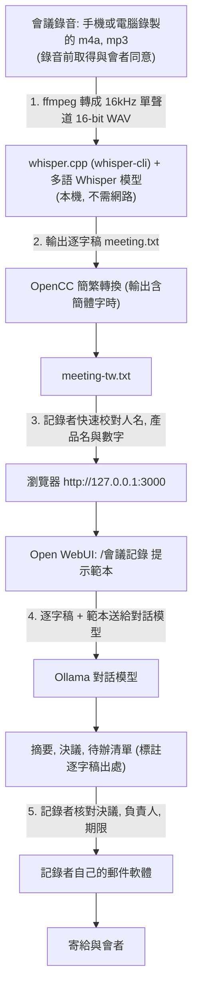

# P3 會議記錄摘要

::: info 本章屬性
- 等級: ○ 依情境
- 狀態: 可閱讀
- 資料基準日: 2026-10-27
- 實機驗證: 未進行 (whisper.cpp 與 OpenCC 指令依官方 README 整理; 需實機確認: Whisper 對台灣華語, 中英夾雜與專有名詞的辨識準確度)
:::

**結論**: 里程碑 1 (M0 至 M2) 加上一個可地端執行的語音轉文字程式, 就能把會議錄音整理成摘要, 決議與待辦清單. 本頁以 whisper.cpp 搭配 OpenAI Whisper 模型為例: Whisper 是把語音辨識成文字的模型, whisper.cpp 是在一般電腦上執行這個模型的程式 (兩者皆為 MIT 授權), 錄音與逐字稿都不離開本機. 模型產生的摘要一律由記錄者核對後才寄給與會者, 尤其是決議, 負責人與期限.

**對象**: 個人. **需要的模組**: M1, M2.

::: tip 本頁常見名詞
| 詞 | 意思 |
|---|---|
| 語音轉文字 (speech-to-text) | 把錄音轉成文字的程式; 本頁用 Whisper 模型 |
| whisper.cpp | 用 C/C++ 重新實作的 Whisper 執行程式, 可在一般電腦上離線轉錄 |
| ffmpeg | 常用的影音格式轉換工具 |
| 終端機 (terminal) | 以文字輸入指令操作電腦的視窗; 本頁的 `bash` 區塊都在這裡執行 |
| OpenCC | 開源的簡繁轉換工具, 可同時替換兩岸不同的常用詞 |
| 提示範本 (prompt template) | 事先寫好的固定指示, 使用時只要填入逐字稿等內容 |
| 上下文長度 (context length) | 模型一次能處理的文字量上限; 逐字稿太長會超出 |

完整詞彙見[術語對照](/ref/glossary).
:::

## 情境

讀者是常需要寫會議記錄的人: 專案經理, 秘書, 或每週主持例會的主管. 原本的做法是邊開會邊打字, 或會後重聽錄音整理, 一小時的會議常要花上一小時以上整理. 雲端的會議轉錄服務能省下這段時間, 但內部會議常討論人事, 報價或客戶資料, 不一定適合上傳.

本範例分成兩段: 先把錄音轉成逐字稿, 再請模型從逐字稿整理出重點. 可以想成先請速記員打字, 再請助理整理成會議記錄; 最後由讀者這位主席確認內容無誤.

## 需要的模組

| 模組 | 里程碑 | 在本範例的用途 |
|---|---|---|
| [M0 基礎環境](/build/m0-foundation) | 里程碑 1 | 單機即可; 錄音檔與逐字稿的保存與刪除規則 |
| [M1 推論伺服器](/build/m1-inference) | 里程碑 1 | 以 Ollama (載入模型並提供 API 的推論伺服器) 執行對話模型, 負責整理摘要 |
| [M2 使用者介面與反向代理](/build/m2-ui-proxy) | 里程碑 1 | 在 Open WebUI (瀏覽器上的對話介面) 使用固定的會議記錄提示範本 |
| 語音轉文字程式 (不屬於任何模組) | - | 例如 whisper.cpp, 在本機把錄音轉成文字檔 |

## 流程

錄音先轉成逐字稿, 必要時轉成台灣用字, 記錄者校對專有名詞後, 再交給對話模型依固定格式整理; 最後由記錄者核對並自己寄出. 下圖由上而下對應這五個步驟.



所有步驟都在讀者的電腦上完成; 寄送由讀者自己操作, 模型不經手寄信.

## 設定要點

以下指令依 whisper.cpp, OpenAI Whisper 與 OpenCC 的官方 README 整理, 未實機驗證.

**1. 選擇語音轉文字模型.** whisper.cpp 是 Whisper 的 C/C++ 實作, 採 MIT 授權, 支援 Apple Silicon (Metal), NVIDIA (CUDA), AMD (ROCm), Vulkan 與純 CPU. OpenAI Whisper 的 README 說明程式碼與模型權重都以 MIT 授權釋出. 選模型時注意兩點:

- 名稱有 `.en` 的是純英文模型, 中文會議要選多語模型 (例如 `small`, `medium`, `large-v3-turbo`).
- whisper.cpp README 列出的大致需求: `small` 磁碟 466MiB, 記憶體約 852MB; `medium` 1.5GiB, 約 2.1GB; `large` 2.9GiB, 約 3.9GB. `large-v3-turbo` 的模型檔為 1.5GiB. OpenAI 說明 turbo 是 large-v3 的加速版本, 準確度略降.

**2. 轉換與轉錄.** 下列指令在終端機依序執行三件事: 下載轉錄模型, 把錄音轉成 whisper-cli 能讀的格式, 再輸出逐字稿.

```bash
# 下載模型 (在 whisper.cpp 目錄中執行)
sh ./models/download-ggml-model.sh large-v3-turbo

# whisper-cli 目前只接受 16-bit WAV, 先用 ffmpeg 轉檔
ffmpeg -i meeting.m4a -ar 16000 -ac 1 -c:a pcm_s16le meeting.wav

# 指定中文, 輸出文字檔 meeting.txt
./build/bin/whisper-cli -m models/ggml-large-v3-turbo.bin \
  -f meeting.wav -l zh -otxt -of meeting
```

whisper-cli 的 `-l` 預設為 `en`, 中文會議務必指定 `zh` (或 `auto` 自動偵測). 另有 `--prompt` 可提供初始提示, 例如放入常出現的人名與產品名; 效果因錄音而異, 請自行比較 (推論).

**3. 轉成台灣用字.** 若逐字稿出現簡體字, 可用簡繁轉換工具 OpenCC (Apache 2.0) 的 `s2twp` 設定轉成台灣正體並替換台灣常用詞彙:

```bash
opencc -c s2twp.json -i meeting.txt -o meeting-tw.txt
```

**4. 建立會議記錄提示範本.** 在 Open WebUI 的 **Workspace > Prompts** 建立範本, Command 設為 `/會議記錄` 這類好記的名稱 (避開內建指令名稱). 官方文件支援在範本中以兩層大括號定義輸入欄位, 寫法為「變數名稱 | 類型:required」, 類型包含 text, textarea, date 等, 使用範本時會跳出表單 (寫法見下方範例):

```
以下是會議「{{title | text:required}}」的逐字稿, 會議日期為 {{meeting_date | date:required}}.
請用繁體中文整理成會議記錄, 格式如下:

一, 會議摘要 (5 點以內)
二, 決議事項 (每點標出逐字稿中的原句)
三, 待辦清單 (表格: 事項, 負責人, 期限; 逐字稿沒說清楚的欄位填「未確認」)
四, 待釐清問題

規則: 只根據逐字稿整理, 不要推測沒有說出口的決定; 人名與數字照逐字稿原文.

逐字稿:
{{transcript | textarea:required}}
```

**5. 長逐字稿分段處理.** Open WebUI 官方疑難排解頁指出, Ollama 在顯示記憶體小於 24GiB 時預設上下文只有 4096 token. 一小時會議的逐字稿通常超過這個長度 (推論). 做法有兩種: 依 M1.8 節調高上下文長度; 或把逐字稿依議程切成幾段, 每段先各自整理, 最後再請模型合併 (推論, 信心: 中).

**6. 可選: 介面內建的語音轉文字.** Open WebUI 內建本機 Whisper (以另一套 Whisper 執行程式 faster_whisper 執行, `WHISPER_MODEL` 預設為 `base`, 可用 `WHISPER_LANGUAGE` 指定語言), 適合用麥克風口述. 官方 STT 設定文件列出音訊上傳端點預設接受的副檔名 (mp3, wav, m4a, webm, ogg, flac, mp4, mpga, mpeg), 但沒有說明檔案大小上限與介面上的操作方式 (2026-10-27 查詢). 長時間的會議錄音, 本頁以 whisper.cpp 處理, 轉錄過程可以分段檢查 (推論, 信心: 中).

## 驗收方式

找 3 場已經有人工會議記錄的過往會議 (例如 30 分鐘, 60 分鐘, 中英夾雜各一場), 依下列步驟比對:

1. **逐字稿抽查**: 每場隨機抽 3 段, 每段約 1 分鐘, 對照錄音逐字核對, 記下人名, 數字與專有名詞的錯誤數. 錯誤集中在特定名詞時, 試著加上 `--prompt` 或換較大的模型.
2. **決議與待辦比對**: 以人工記錄為標準, 計算模型整理的決議與待辦有幾項漏列, 幾項多出 (人工記錄沒有的事項). 多出的事項要特別檢查是不是模型推測出來的.
3. **負責人與期限**: 逐項核對待辦清單的負責人與期限; 逐字稿沒有明講的欄位, 應該標為「未確認」, 而不是填入猜測值.
4. **出處檢查**: 決議事項附的原句, 都能在逐字稿中找到.
5. **處理時間**: 記錄轉錄與整理各花多少時間, 作為之後換硬體或換模型的比較基準.

把這 3 場的逐字稿與比對結果保存為測試資料 (見 M6.1 節), 之後換模型時重跑.

## 風險與限制

| 風險 | 影響 | 因應方式 |
|---|---|---|
| 錄音與逐字稿含敏感內容 | 檔案留在電腦, 備份與 Open WebUI 的對話紀錄中 | 錄音前取得與會者同意並依公司規定處理; 會議記錄寄出後刪除錄音與中間檔, 定期清理對話紀錄 |
| 轉錄錯誤 | 人名, 數字, 中英夾雜的術語特別容易錯, 錯誤會延續到摘要 | 校對專有名詞與數字; 重要會議以錄音為準 |
| 模型漏列或捏造決議 | 與會者依錯誤的會議記錄行動 | 提示範本要求附原句; 記錄者逐項核對後才寄出 |
| 模型猜測待辦的負責人或期限 | 責任歸屬錯誤 | 範本要求未明說者填「未確認」; 寄出前由主席確認 |
| 上下文不足導致後半段遺漏 | 會議後段的決議沒有出現在摘要中 | 調高上下文長度或分段整理; 驗收時特別檢查最後 10 分鐘的內容 |
| 說話者無法區分 | 逐字稿看不出誰說了什麼, 影響負責人判斷 | whisper.cpp 的說話者區分功能 (tinydiarize) 標為實驗功能; 必要時由記錄者補上說話者 |

需要人工確認的步驟: 轉錄後校對專有名詞與數字; 寄出前核對決議, 負責人與期限.

## 參考來源

- [Open WebUI 文件: Speech-to-Text 設定](https://docs.openwebui.com/features/chat-conversations/audio/speech-to-text/stt-config.txt) (Allowed Extensions 的預設副檔名)

- [whisper.cpp GitHub 儲存庫 (README)](https://github.com/ggml-org/whisper.cpp)
- [whisper.cpp: whisper-cli 參數說明 (examples/cli/README.md)](https://raw.githubusercontent.com/ggml-org/whisper.cpp/master/examples/cli/README.md)
- [whisper.cpp: 模型下載說明 (models/README.md)](https://raw.githubusercontent.com/ggml-org/whisper.cpp/master/models/README.md)
- [OpenAI Whisper README (模型大小與授權)](https://raw.githubusercontent.com/openai/whisper/main/README.md)
- [OpenCC README (s2twp 設定與授權)](https://raw.githubusercontent.com/BYVoid/OpenCC/master/README.md)
- [Open WebUI 文件: Prompts](https://docs.openwebui.com/features/workspace/prompts)
- [Open WebUI 文件: Speech-to-Text](https://docs.openwebui.com/features/chat-conversations/audio/speech-to-text/openai-stt-integration)
- [Open WebUI 文件: Environment Variable Configuration (WHISPER_MODEL)](https://docs.openwebui.com/reference/env-configuration)
- [Open WebUI 文件: RAG 疑難排解 (Ollama 預設上下文)](https://docs.openwebui.com/troubleshooting/rag)
- 站內: [M1 推論伺服器](/build/m1-inference)
- 文中的類比 (速記員與助理): 整理者所寫, 無外部來源, 不應當作技術定義引用.
