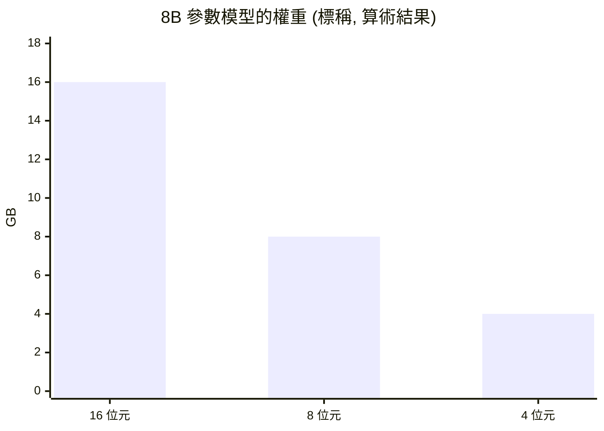
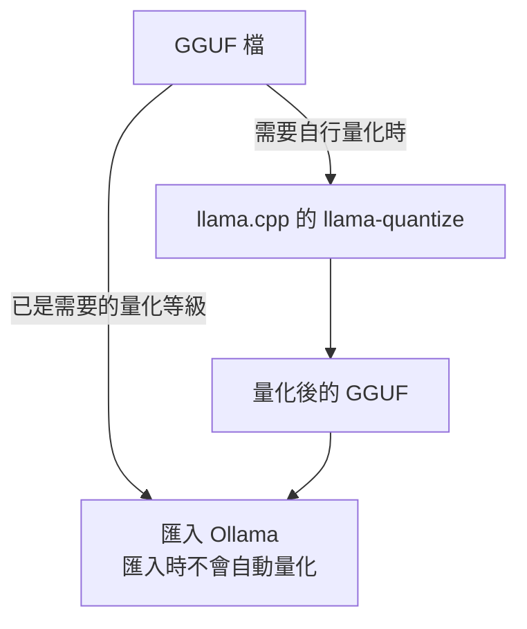
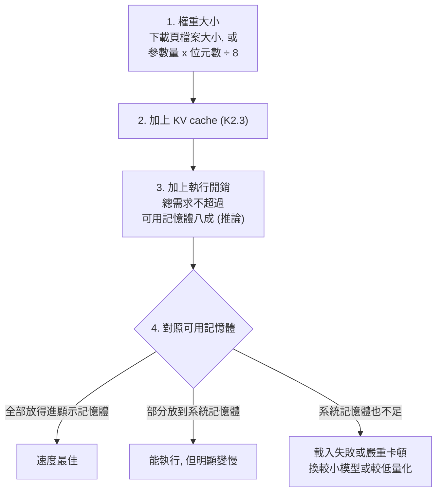
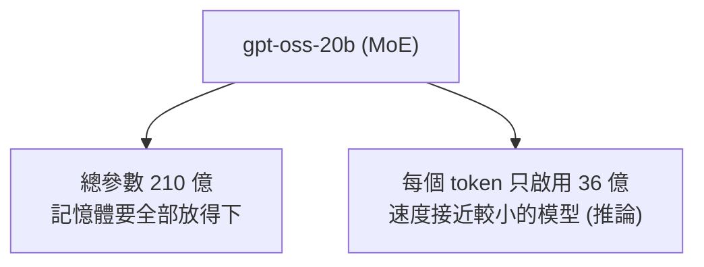
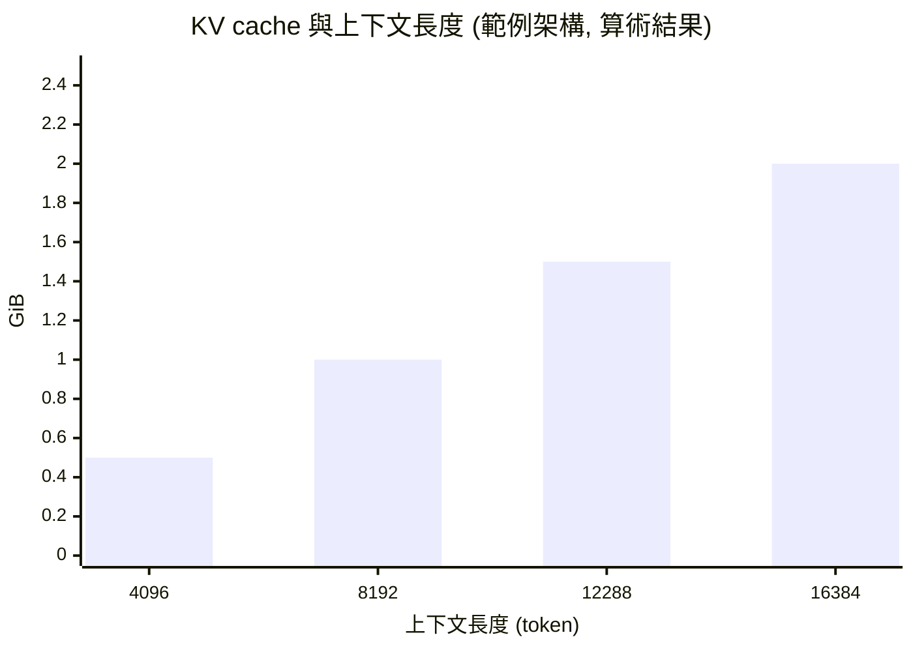
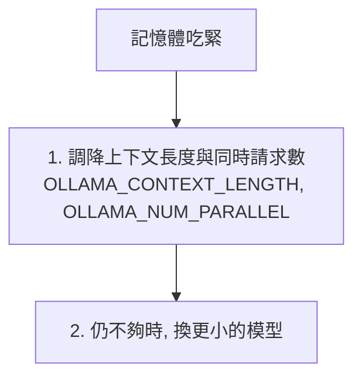

# K2 量化與記憶體需求估算

::: info 本章屬性
- 等級: ● 必要
- 實機驗證: 未進行 (本章沒有要執行的指令; 模型放不下顯示記憶體時實際變慢的幅度, 需在自己的機器上量測)
:::

**結論**: 模型需要的記憶體約等於「權重大小 + 上下文暫存 (KV cache) + 執行開銷」, 三項都能事先估算. 權重大小是「參數量 x 每個參數的位元數 ÷ 8」; 實際下載前, 以模型頁面標示的檔案大小為準 (信心: 高, 屬算術, 開銷比例屬推論).

::: tip 本章常見名詞
| 詞 | 意思 |
|---|---|
| 位元 (bit) 與位元組 (byte) | 位元是電腦記錄資料的最小單位; 8 個位元合成 1 個位元組 |
| 精度 | 每個數字用多少位元存放; 位元越多, 數字越精細 |
| 量化 (quantization) | 把權重改用較少的位元存放, 讓檔案變小 |
| 顯示記憶體 | 顯示卡專用的記憶體, 模型放在這裡時跑得最快 |
| 統一記憶體 | Apple Silicon 等機種讓 CPU 與 GPU 共用同一池記憶體的設計 |
| KV cache | 模型處理對話時暫存的中間結果, 對話越長占用越大 |
| 混合專家模型 (MoE) | 模型內有多組「專家」, 每次只啟用其中幾組 |

完整詞彙見[術語對照](/ref/glossary).
:::

## K2.1 量化: 用較低精度換取較小的記憶體占用

量化可以想成把一張高解析度照片另存成較小的 JPEG: 檔案小很多, 一般情況下看起來差不多, 但放大檢查細節時, 會發現少了一些資訊. 存得越小, 細節損失越明顯.

量化 (quantization) 是把權重從 16 位元降到 8, 6, 5 或 4 位元等較低精度的做法. 位元數越低, 檔案與記憶體占用越小, 速度通常也更快, 但品質損失越大 (信心: 高).

| 精度 | 每個參數約占 | 8B 參數模型的權重 (標稱) |
|---|---|---|
| 16 位元 | 2 位元組 | 約 16GB |
| 8 位元 | 1 位元組 | 約 8GB |
| 4 位元 | 0.5 位元組 | 約 4GB |

上表為算術結果 (80 億參數 x 位元組數), 用來示範估算, 非特定模型的實測值. 實際的 4 位元格式因為還存放縮放係數等資料, 檔案通常略大於標稱值 (推論, 信心: 中). 例如 llama.cpp (開源的推論引擎, 也附有量化工具) 的文件對 Llama-3.1-8B 列出的 Q4_K_M 約為每個權重 4.89 位元, Q8_0 約為 8.50 位元 (來源: llama.cpp quantize README). 請以下載頁顯示的檔案大小為準.

下圖是上表的權重大小比較:

**品質損失怎麼判斷**: 損失程度因模型與任務而異, 公開評測多半只涵蓋特定基準, 不能代表自己的任務. llama.cpp 的 quantize README 只列出各量化等級的每權重位元數, 檔案大小與速度, 沒有列出品質指標 (2026-10-27 查詢). 較可靠的做法是對同一個模型的兩個量化等級, 各跑一次 [M6](/build/m6-observability)的測試集, 再選擇「品質夠用的最小檔案」(信心: 中).

### 檔案格式

同一個模型可以用不同的檔案格式包裝, 就像同一份文件可以存成 Word 檔或 PDF 檔. 格式決定哪些推論引擎讀得了, 也影響載入時的安全風險.

| 格式 | 說明 |
|---|---|
| GGUF | 供 GGML 系列推論引擎使用的單一檔案格式, 內含中繼資料與張量, 規格涵蓋 Q4_0, Q8_0, Q4_K 等量化型別; 量化版本常以此發布 (來源: GGUF 規格文件, Hugging Face Transformers 文件) |
| safetensors | 權重常見的發布格式, Hugging Face 文件稱其為相對於 pickle 的安全儲存格式; pickle 載入時可能執行任意程式碼 (來源: Hugging Face safetensors 文件, Hugging Face Pickle scanning 文件; 見 [M1.5 節](/build/m1-inference)) |

Ollama (M1 介紹的推論伺服器) 匯入 GGUF 時不會自動量化; 若要自行量化, 須先用 llama.cpp 的 `llama-quantize` 等工具處理 (來源: Ollama 文件 Import).

下圖是匯入 Ollama 前是否需要先量化的判斷:

## K2.2 估算步驟

估算記憶體可以想成搬家前先量家具: 權重是一定要搬的大型家具, KV cache 是隨對話越堆越多的紙箱, 執行開銷則是要留給人走動的走道. 三樣加起來放得進房間, 才搬得進去.

1. **取得權重大小**: 優先看模型下載頁的檔案大小. 沒有時用「參數量 x 每個參數位元數 ÷ 8」估算.
2. **加上 KV cache**: 見 K2.3 節.
3. **加上執行開銷**: 推論引擎本身, 作業系統與介面都需要記憶體. 開銷沒有公開標準, 建議保守規劃, 例如讓總需求不超過可用記憶體的八成 (信心: 低, 屬推論).
4. **對照可用記憶體**: 獨立顯示卡看顯示記憶體; Apple Silicon 看統一記憶體, 但作業系統與其他程式共用同一池.

| 情況 | 結果 |
|---|---|
| 全部放得進顯示記憶體 | 速度最佳 |
| 放不下, 部分放到系統記憶體 | 能執行, 但速度明顯變慢 (信心: 高) |
| 連系統記憶體也不足 | 載入失敗或系統嚴重卡頓; 請換較小的模型或較低的量化 |

官方文件沒有提供變慢幅度的數字: Ollama 的 FAQ 只說明 `ollama ps` 的 PROCESSOR 欄會顯示模型在 CPU 與 GPU 之間的分配比例, 例如「48%/52% CPU/GPU」表示模型有一部分載入系統記憶體 (2026-10-27 查詢). 實際變慢多少依硬體而異; 可先用 `ollama ps` 確認模型是否完整載入 GPU, 再依[基準分數頁](/ref/benchmarks)的實測方法比較.

下圖是估算的四個步驟與三種結果:

**混合專家模型 (MoE)**: 每次推論只啟用一部分參數. 可以想成一間有很多專科醫師的診所: 每位病人只看其中幾位醫師, 看診速度接近小診所, 但每位醫師都需要自己的診間, 所以空間仍要以全部醫師計算. 例如 gpt-oss-20b 總參數 210 億, 每個 token 啟用 36 億 (來源: 該模型的 Hugging Face 模型卡). 記憶體要放下全部權重, 速度則接近較小的模型 (信心: 中, 速度部分屬推論). 估算記憶體時請用總參數.

下圖以 gpt-oss-20b 說明總參數與啟用參數的差別:

## K2.3 上下文長度與 KV cache

KV cache 可以想成模型邊讀邊做的筆記: 已經讀過的內容先記下重點, 寫下一個 token 時直接翻筆記, 不必從頭重讀. 對話越長, 筆記越厚, 占用的記憶體也越多.

模型在對話過程中, 會把已處理的內容暫存為 KV cache. 上下文越長, 占用越大, 且與長度成正比.

**估算公式** (信心: 高, 屬算術): PagedAttention 論文以 OPT-13B 為例, 每個 token 的 KV cache 為「2 (key 與 value) x 5120 (隱藏維度) x 40 (層數) x 2 (FP16 的位元組數)」, 約 800KB. 採用分組查詢注意力 (GQA) 的模型, key 與 value 的頭數少於查詢的頭數, 因此把隱藏維度換成「KV 頭數 x 每頭維度」(來源: PagedAttention 論文第 3 節; GQA 論文摘要; 換算為整理者推導). 再乘上上下文長度, 就是一段對話的用量:

KV cache 位元組數 ≈ 2 x 層數 x KV 頭數 x 每頭維度 x 上下文長度 x 每個元素的位元組數

「每個元素的位元組數」在 FP16 為 2. vLLM 可用 `--kv-cache-dtype fp8` 把 KV cache 存成 FP8 (8 位元, 即 1 位元組), 官方文件說明這樣能明顯減少 KV cache 的記憶體用量, 讓記憶體放得下更多 token (來源: vLLM 文件 Quantized KV Cache). 其他推論引擎若採用不同的壓縮格式, 每個元素的位元組數也會跟著改變.

**範例** (假設架構, 非特定模型): 32 層, 8 個 KV 頭, 每頭 128 維, 上下文 8,192, 16 位元 (2 位元組):

2 x 32 x 8 x 128 x 8,192 x 2 = 1,073,741,824 位元組, 約 1GiB.

依上面的範例架構計算, KV cache 隨上下文長度等比例增加 (算術結果, 4,096 至 16,384 token 依同一公式換算):

實際模型的層數與頭數, 請從模型卡或設定檔取得.

### Ollama 的相關設定

- 預設上下文依顯示記憶體而定: 小於 24GiB 為 4k, 24 至 48GiB 為 32k, 48GiB 以上為 256k; 可用環境變數 `OLLAMA_CONTEXT_LENGTH` 調整 (來源: Ollama 文件 Context length).
- 同時處理的請求數 `OLLAMA_NUM_PARALLEL` 預設為 1; 所需記憶體會隨 `OLLAMA_NUM_PARALLEL` x `OLLAMA_CONTEXT_LENGTH` 增加 (來源: Ollama FAQ).

因此記憶體吃緊時, 優先調降上下文長度與同時請求數, 再考慮換更小的模型. 設定方式見 [M1.8 節](/build/m1-inference).

下圖是記憶體吃緊時的調整順序:

## 參考來源

- [llama.cpp: quantize README (各量化等級的每權重位元數)](https://github.com/ggml-org/llama.cpp/blob/master/tools/quantize/README.md)
- [GGUF 規格文件 (ggml-org/ggml)](https://github.com/ggml-org/ggml/blob/master/docs/gguf.md)
- [Hugging Face Transformers 文件: GGUF](https://huggingface.co/docs/transformers/main/en/gguf)
- [Hugging Face 文件: safetensors](https://huggingface.co/docs/safetensors/index)
- [Hugging Face 文件: Pickle scanning](https://huggingface.co/docs/hub/security-pickle)
- [Hugging Face 模型卡: openai/gpt-oss-20b (總參數與啟用參數)](https://huggingface.co/openai/gpt-oss-20b)
- [Kwon 等人, Efficient Memory Management for Large Language Model Serving with PagedAttention (arXiv 2309.06180), 第 3 節 KV cache 大小計算](https://arxiv.org/pdf/2309.06180)
- [Ainslie 等人, GQA: Training Generalized Multi-Query Transformer Models from Multi-Head Checkpoints (arXiv 2305.13245)](https://arxiv.org/abs/2305.13245)
- [Sebastian Raschka: KV cache calculations (二手來源, 公式形式與上列論文一致)](https://sebastianraschka.com/llm-architecture-gallery/kv-cache-calculations)
- [Apple WWDC20: Explore the new system architecture of Apple silicon Macs (統一記憶體架構, CPU 與 GPU 使用同一份記憶體)](https://developer.apple.com/videos/play/wwdc2020/10686?time=115)
- [Ollama 文件: Context length (預設上下文與 `OLLAMA_CONTEXT_LENGTH`)](https://docs.ollama.com/context-length)
- [Ollama 文件: FAQ (`OLLAMA_NUM_PARALLEL` 預設值與記憶體隨之增加)](https://docs.ollama.com/faq)
- [Ollama 文件: Import (匯入 GGUF 不會自動量化)](https://docs.ollama.com/import)
- [Ollama GitHub: FAQ (`ollama ps` 的 PROCESSOR 欄, CPU 與 GPU 的分配比例)](https://github.com/ollama/ollama/blob/main/docs/faq.md)
- [vLLM 文件: Quantized KV Cache (FP8 KV cache 減少記憶體用量)](https://docs.vllm.ai/en/stable/features/quantization/quantized_kvcache/)
- 文中的類比 (照片另存 JPEG, 搬家量家具, 專科診所, 讀書筆記): 整理者所寫, 無外部來源, 不應當作技術定義引用.

整理者推導 (算術, 無外部來源): K2.1 表格的各精度權重大小 (參數量 x 位元組數), K2.3 的 KV cache 範例 (32 層, 8 個 KV 頭, 每頭 128 維, 上下文 8,192, 16 位元, 結果 1,073,741,824 位元組). 整理者建議 (推論): 以兩個量化等級各跑一次測試集再選擇, 以及保守規劃時讓總需求不超過可用記憶體的八成.
