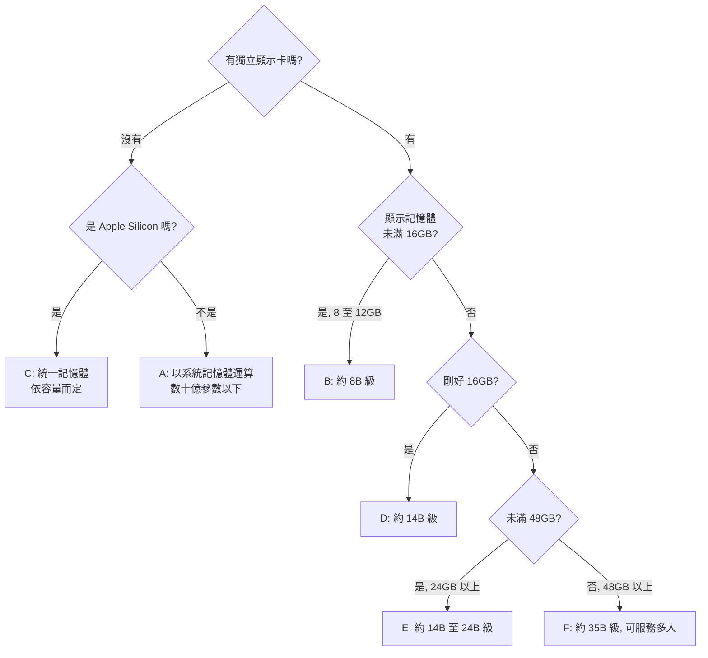
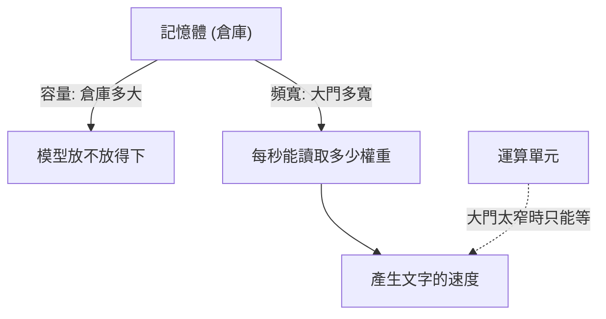
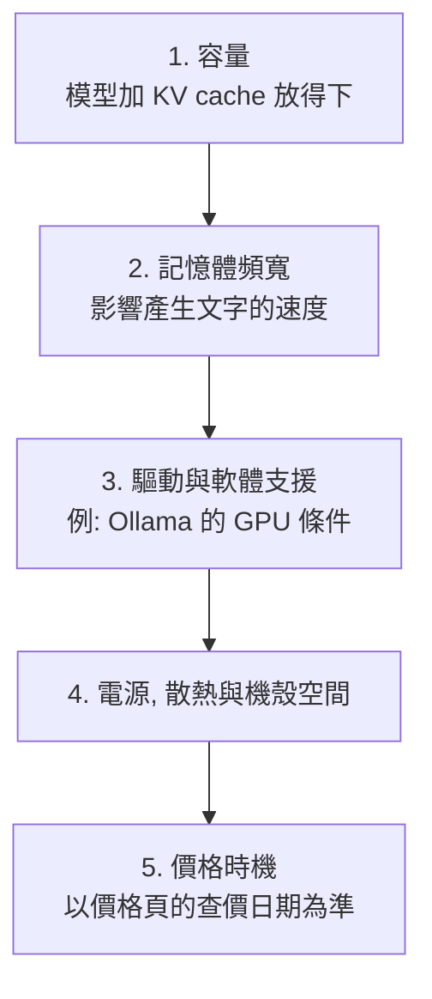
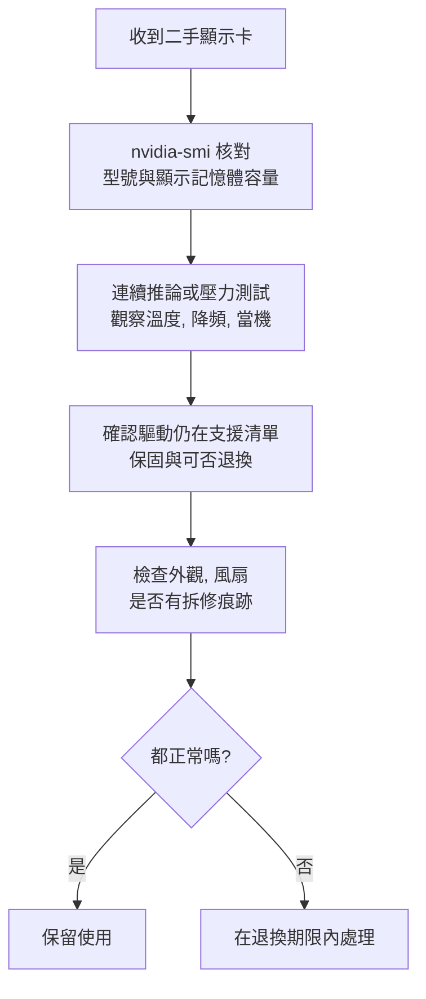
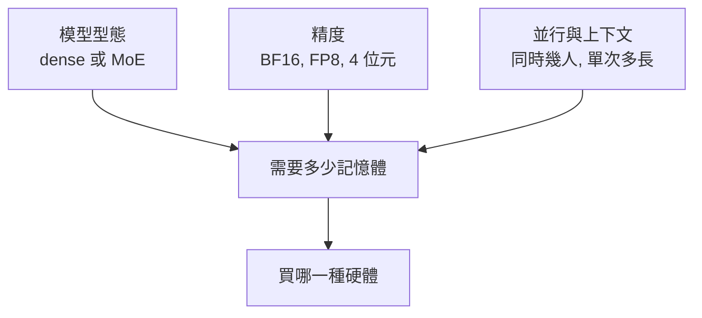
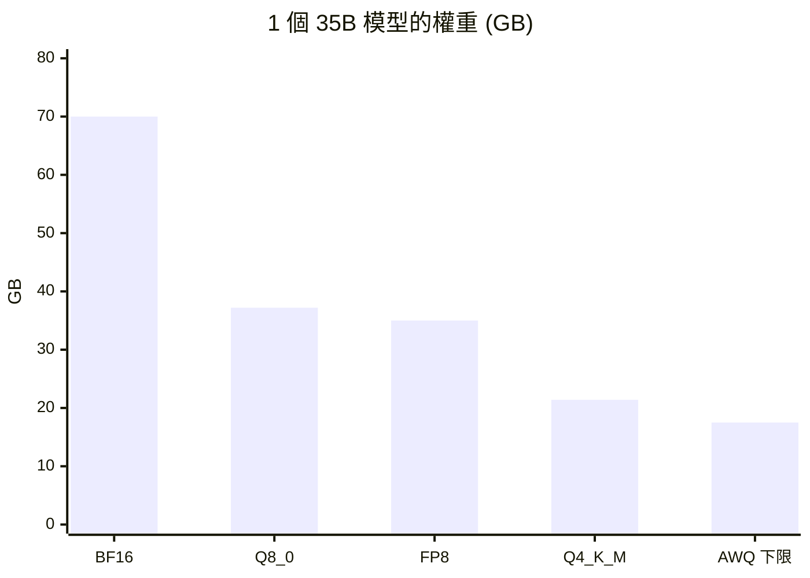
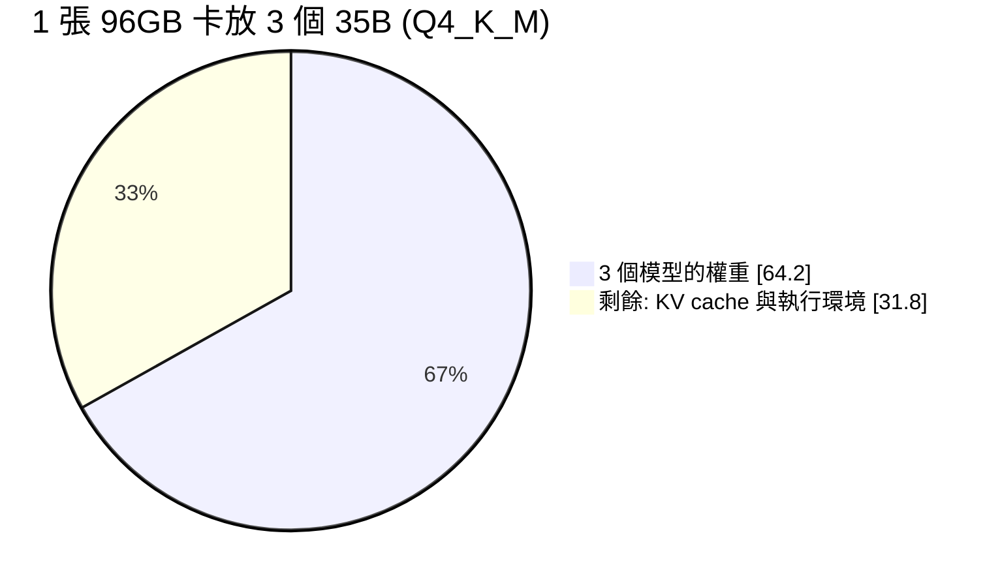
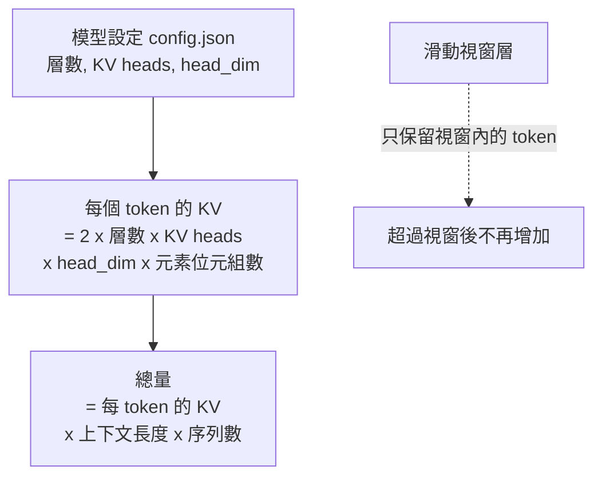
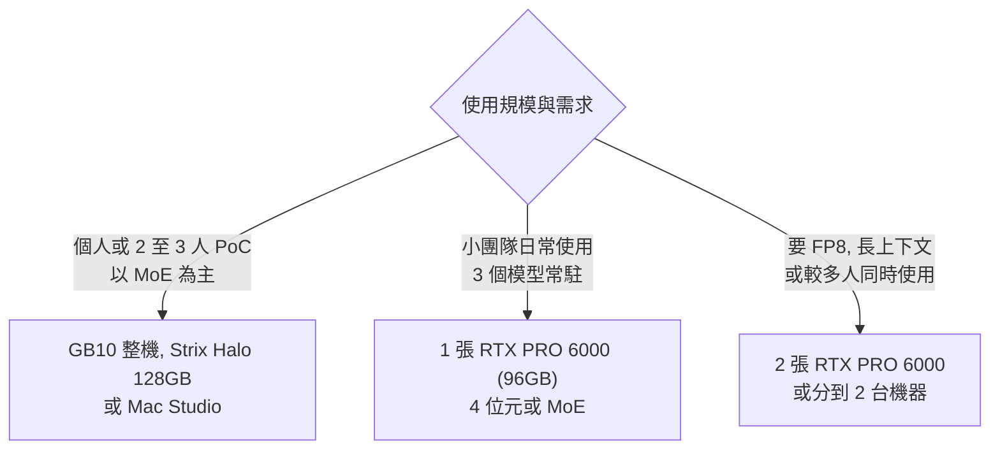
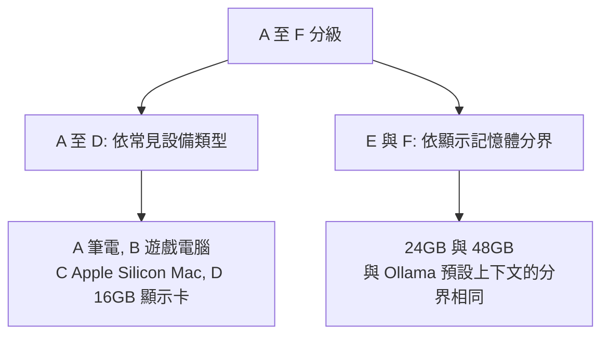

# K3 硬體選購

::: info 本章屬性
- 等級: ● 必要
- 狀態: 可閱讀
- 資料基準日: 2026-10-27
- 實機驗證: 未進行 (二手顯示卡驗收的 nvidia-smi 檢查依官方說明整理; 需實機確認: K3.4 各配置的多人並行表現, 以及推論引擎實際配置 Gemma 4 完整注意力層的方式)
:::

**結論**: 預算有限時, 先買「更大的顯示記憶體 (或統一記憶體)」, 再考慮運算速度. 記憶體決定能不能跑, 運算速度只決定跑得多快 (信心: 高).

::: tip 本章常見名詞
| 詞 | 意思 |
|---|---|
| 顯示記憶體 (VRAM) | 顯示卡專用的記憶體, 決定一張卡放得下多大的模型 |
| 統一記憶體 | CPU 與 GPU 共用同一池記憶體的設計, 見於 Apple Silicon, NVIDIA GB10, AMD Strix Halo 等機種 |
| 記憶體頻寬 | 記憶體每秒能傳送多少資料, 影響產生文字的速度 |
| 驅動程式 | 讓作業系統與軟體能使用顯示卡的程式 |
| 密集模型 (dense) 與 MoE | 密集模型每次都用上全部參數; MoE 每次只啟用一部分 (見 [K2](/know/k2-quantization)) |
| BF16, FP8 | 兩種存放數字的格式, 分別為 16 位元與 8 位元 |
| KV cache | 模型處理對話時暫存的中間結果, 說明見 K2 |
| 並行 | 同時處理多個請求或多位使用者 |
| 預填 (prefill) 與解碼 (decode) | 模型回答分兩段: 預填是一次讀完整段輸入, 解碼是逐個產生輸出的 token; 解碼速度主要受記憶體頻寬限制 |
| CUDA 執行環境 | NVIDIA 顯示卡執行運算所需的程式庫, 推論引擎透過它使用 GPU |
| Vulkan 後端 | 以跨廠牌的 Vulkan 繪圖與運算介面使用 GPU 的執行方式, 常用於 AMD 等非 NVIDIA 硬體 |
| OEM | 採用同一套晶片, 再以自家品牌組裝販售整機的廠商 |
| TGP 與 Max-Q | TGP 是顯示卡的總耗電設計值; Max-Q 是同款晶片的低功耗版本, 耗電與發熱較低, 效能也略低 |
| toolbox | 社群整理的容器化執行環境, 預先裝好特定硬體所需的推論軟體 |
| llm-compressor | vLLM 專案提供的模型壓縮與校準工具, 可產生 FP8 等量化版本並計算縮放係數 |
| sleep mode | vLLM 讓閒置模型釋放顯示記憶體, 需要時再喚醒的功能 |

完整詞彙見[術語對照](/ref/glossary).
:::

## K3.1 等級 A 至 F 的能力邊界

本手冊把硬體依記憶體多寡分成 A 至 F 六個等級. 記憶體越大, 放得下的模型越大, 等級也越高; 讀者先找出自己的電腦屬於哪一級, 就能知道大致可以跑多大的模型, 以及該從哪一種組合開始.

下圖依兩個問題找出自己的等級: 有沒有獨立顯示卡, 以及顯示記憶體多大; 各等級的落點為下表的推論.

下表依 [K2](/know/k2-quantization)的公式, 以 4 位元量化中常用的 GGUF Q4_K_M (每參數約 4.8944 位元, 見 K3.4 節) 估算權重: 14B 約 8.6GB, 30B 約 18.4GB, 35B 約 21.4GB, 70B 約 42.8GB (計算值). 權重之外還有 KV cache 與執行開銷, 因此以 K2 的「總需求不超過可用記憶體八成」保守規劃. 結果為推論 (信心: 中), 未實測; 實際能否執行, 還取決於上下文長度與同時使用人數.

| 等級 | 記憶體條件 | 較可能的落點 (4 位元量化, 推論) | 建議架構 |
|---|---|---|---|
| A | 無獨立顯示卡, 以系統記憶體運算 | 數十億參數以下的小模型, 速度較慢 | [最小組合](/build/overview) |
| B | 8 至 12GB 顯示記憶體 | 約 8B 級模型餘裕較大; 約 14B 級須壓低上下文 | 8GB 用最小組合; 12GB 可用標準組合 |
| C | Apple Silicon, 統一記憶體 | 依記憶體容量而定, 16GB 與 32GB 以上差異大 | 16GB 用最小組合; 32GB 以上可用標準組合 |
| D | 16GB 顯示記憶體 | 約 14B 級餘裕較大; 約 30B 以上通常放不下 | 標準組合 |
| E | 24GB 以上, 未滿 48GB 顯示記憶體 (單卡或多卡合計) | 約 14B 至 24B 級餘裕較大, 並能同時載入嵌入模型; 約 30B 級在 24GB 時已接近八成上限, 上下文須壓低; 約 70B 級放不下 | 標準組合 |
| F | 48GB 以上顯示記憶體 (例如 K3.4 節的 96GB 單卡, 或多卡) | 48GB 時約 35B 級餘裕較大, 可同時常駐 1 個並服務多人; 約 70B 級 (約 42.8GB) 須 64GB 以上; 同時常駐 3 個約 35B 級須 K3.4 節的 96GB 等級 | 進階組合 (須有人每週維運) |

## K3.2 記憶體優先的選購順序

記憶體容量與頻寬可以想成一座倉庫: 容量是倉庫有多大, 決定貨 (模型) 放不放得下; 頻寬是倉庫大門每秒能進出多少貨. 模型每產生一段文字, 都要從記憶體讀取大量權重, 大門太窄時, 運算單元再快也只能排隊等貨.

下圖把倉庫的比喻畫出來: 容量和頻寬分別影響不同的事.

1. **容量**: 先確認想跑的模型加 KV cache 放得進去 (K2).
2. **記憶體頻寬**: 產生文字的速度常受記憶體頻寬限制, 而非純運算能力 (信心: 中, 屬一般經驗).
3. **驅動與軟體支援**: Ollama (M1 介紹的推論伺服器) 的 NVIDIA 支援要求運算能力 (compute capability) 5.0 以上, 驅動版本 550 以上; 運算能力 5.0 至 6.2 的舊卡須驅動 570 以上 (來源: Ollama 文件 GPU). AMD 與 Apple 的支援見 [M1.4 節](/build/m1-inference).
4. **電源, 散熱與機殼空間**: 高階顯示卡對電源供應器與機殼有要求, 購買前核對規格書 (信心: 高, 屬一般經驗).
5. **價格時機**: DRAM 與 GPU 價格波動大, 以[價格頁](/ref/hardware-prices)的查價日期為準, 不憑舊資料決定.

選購時依下列順序逐項確認, 前一項不成立就不必往下比:

升級既有電腦與另購整機之間, 差異主要在顯示記憶體能否增加. 若現有機器的主機板, 電源與機殼都能容納較大的顯示卡, 升級通常較省 (信心: 低, 屬推論).

## K3.3 台灣通路與二手風險

價格與通路資訊放在[硬體價格頁](/ref/hardware-prices), 每筆附來源與查價日期.

二手顯示卡較便宜, 但外觀看不出過去的使用強度, 也可能遇到規格與標示不符的情況. 以下清單的目的, 是在退換期限內盡量把問題找出來. `nvidia-smi` 是 NVIDIA 驅動附帶的命令列工具, 可以列出顯示卡型號, 記憶體容量, 溫度與使用率.

購買二手顯示卡時, 建議逐項檢查 (信心: 中, 屬一般經驗):

下圖是收到二手卡後, 在退換期限內依序檢查的流程:

- [ ] 收到後立即用 `nvidia-smi` 確認型號與顯示記憶體容量與賣方標示相符.
- [ ] 連續跑一段時間的推論或壓力測試, 觀察溫度與是否降頻或當機.
- [ ] 確認保固剩餘期間與可否退換.
- [ ] 確認驅動仍在支援清單內 (見上述 Ollama GPU 支援條件).
- [ ] 外觀與風扇狀況, 是否有拆修痕跡.
- [ ] 避免來源不明且價格明顯低於市場的商品.

## K3.4 範例: 同時常駐 3 個 30B 至 35B 級模型

**結論**: 單機要同時常駐 3 個約 35B 的模型, 目前最穩的選擇是 1 張 96GB 的 NVIDIA RTX PRO 6000 搭配 4 位元量化, 或 2 張同款卡搭配 FP8. 統一記憶體機種 (NVIDIA GB10 系列, AMD Strix Halo, Apple Mac Studio) 容量夠, 但記憶體頻寬較低, 較適合同時使用人數少的情境; 多人同時使用時, 頻寬與推論軟體的成熟度比容量更常成為瓶頸 (信心: 中, 屬推論). 預算區間見[硬體價格頁](/ref/hardware-prices), 硬體價格頁引用 TrendForce 2026-09-30 的報導, 2026 年第 4 季 DRAM 合約價持續上漲, 價格頁所列的多款 GPU 與整機在官方通路標示缺貨, 採購前請以當月報價為準.

這個範例對應[架構地圖](/start/map)的情境: LiteLLM (模型閘道, 見 M5) 同時接雲端模型與地端模型, 地端常駐 3 個約 35B 的模型, 推論伺服器的做法見 [M1.11 節](/build/m1-inference), 路由與備援見 [M5.5 節](/build/m5-gateway-identity).

### 先決定三件事

挑硬體之前, 要先決定要跑什麼樣的模型, 用什麼精度, 以及同時給多少人用. 這三件事決定需要多少記憶體, 記憶體的需求再決定買哪一種硬體.

| 決定 | 選項 | 對硬體的影響 |
|---|---|---|
| 模型型態 | 密集 (dense) 或 MoE (混合專家) | MoE 每個 token 只讀取啟用的參數 (例如總參數 30B 左右, 啟用 3B 至 4B), 對頻寬的需求低很多; 但權重仍須全部放進記憶體, 容量以總參數計 |
| 精度 | BF16, FP8, 4 位元 | 每降一級, 權重約減半; 4 位元的品質損失依模型與任務而異, 上線前須用自己的測試集比較 (M6) |
| 並行與上下文 | 同時多少人, 單次多長 | 決定 KV cache 大小, 常是容量的第二大項 |

### 約 30B 至 35B 級的候選模型

下表只列官方模型卡可核對的資料 (2026-10-26 擷取); 實際選型應考慮授權, 語言能力與任務表現, 並以自己的測試集驗證.

| 模型 | 型態 | 總參數 / 啟用參數 | 授權 | 備註 |
|---|---|---|---|---|
| google/gemma-4-31B-it | 密集 | 30.7B | Apache-2.0 | 60 層, 上下文 262,144 |
| Gemma 4 26B A4B (同一張模型卡所列變體) | MoE | 25.2B / 3.8B | Apache-2.0 | 128 個專家, 每 token 啟用 8 個加 1 個共享專家 |
| mistralai/Magistral-Small-2509 | 模型卡未載明 | 24B | Apache 2.0 | 低於 30B 範圍, 供對照; 上下文 128k |
| openai/gpt-oss-20b | MoE | 21B / 3.6B | Apache 2.0 | 低於 30B 範圍, 供對照; MoE 權重為 MXFP4, 模型卡稱可在 16GB 記憶體執行 |

資料來源: 各模型的 Hugging Face 官方模型卡 (見本章參考來源). 授權欄只是摘要, 對外提供服務前請讀授權全文並對照[授權紅旗](/decide/license-flags).

### 權重需要多少記憶體

公式: 權重 (GB) = 參數量 x 每個參數的位元數 / 8 / 10^9. 下表以 35B 為上限估算 (實際的 30B 至 32B 級模型約再小一成); GGUF 的 Q4_K_M 與 Q8_0 約為每參數 4.8944 與 8.5008 位元 (來源: llama.cpp 量化說明, 該數字以 Llama-3.1-8B 量測, 套用到其他模型為近似).

| 精度 | 算式 | 1 個 35B | 3 個 35B |
|---|---|---|---|
| BF16 / FP16 | 35 x 16 / 8 | 70GB | 210GB |
| FP8 / INT8 | 35 x 8 / 8 | 35GB | 105GB |
| GGUF Q8_0 | 35 x 8.5008 / 8 | 37.2GB | 111.6GB |
| GGUF Q4_K_M | 35 x 4.8944 / 8 | 21.4GB | 64.2GB |
| AWQ / GPTQ 4 位元 | 35 x 4 / 8 (理論下限) | 17.5GB, 另加縮放與零點資料 | 52.5GB |

下圖比較同一個 35B 模型在不同精度下的權重大小 (取自上表, AWQ 與 GPTQ 為未含開銷的下限):

AWQ 與 GPTQ 的實際額外開銷, 以及 FP8 的縮放係數開銷, 本輪查無官方數字, 上表為未含開銷的下限. 以單張 96GB 的卡檢視: 3 個 FP8 共 105GB, 放不下; 3 個 Q4_K_M 共 64.2GB, 剩約 31.8GB, 還要再扣 CUDA 執行環境與啟用記憶體 (推算, 信心: 中).

以單張 96GB 的卡放 3 個 Q4_K_M 為例, 記憶體的分配如下:

### KV cache 需要多少記憶體

KV cache 是模型邊讀邊做的筆記 (見 [K2.3 節](/know/k2-quantization)), 大小隨上下文長度與同時處理的對話數增加. 這一段用到兩個架構名詞: 分組查詢注意力 (GQA) 讓多個查詢共用同一組 KV heads, 筆記因此變薄; 滑動視窗層只保留最近固定數量 token 的筆記, 像只留最近幾頁, 超過範圍的就丟掉, 所以不會無限增加.

公式 (來源: PagedAttention 論文對 KV cache 大小的計算, 並依分組查詢注意力 GQA 的定義, 把隱藏維度換成 KV heads 與 head_dim 的乘積; 換算為整理者推導): 每個 token 的 KV 位元組數 = 2 x 層數 x KV heads x head_dim x 每個元素的位元組數; 總量 = 該值 x 上下文長度 x 同時處理的序列數.

下圖把公式拆成兩步; 滑動視窗層的部分超過視窗後不再增加:

下表以官方 `config.json` 的欄位計算 FP16 的 KV cache; 同一表也示範混合注意力架構, 只有完整注意力層的 KV 會隨上下文長度成長.

| 模型 (config.json) | 欄位 | 算式 | 每個 token | 每 1K token |
|---|---|---|---|---|
| Mistral-Small-3.2-24B-Instruct-2506 | 40 層, 8 KV heads, head_dim 128 | 2 x 40 x 8 x 128 x 2 | 160 KiB | 160 MiB |
| gemma-4-31B-it, 完整注意力層 | 10 層 (共 60 層, 其餘 50 層為滑動視窗), 全域 KV heads 4, 全域 head_dim 512 | 2 x 10 x 4 x 512 x 2 | 80 KiB | 80 MiB |
| gemma-4-31B-it, 滑動視窗層 | 50 層, KV heads 16, head_dim 256, 視窗 1,024 token | 2 x 50 x 16 x 256 x 2 | 800 KiB, 但超過視窗後不再增加 | 每條序列固定約 800 MiB |

Gemma 4 的 `global_head_dim` 與 `num_global_key_value_heads` 兩個欄位, 依 Hugging Face Transformers 的 Gemma 4 設定程式, 只套用在完整注意力層: 這些層的每頭維度改用 `global_head_dim`, KV 頭數改用 `num_global_key_value_heads` (來源: Transformers configuration_gemma4.py, 2026-10-27 主分支). 其他推論引擎是否採相同配置, 官方文件未說明, 實際用量以啟動後的記憶體為準. 以 Mistral 的數字示範容量: 4 條序列各 32K token, 共 131,072 token, FP16 約 20GiB; 若 vLLM (多人同時使用時採用的推論伺服器, 見 M1) 的 KV cache 改用 FP8 (`--kv-cache-dtype fp8`), 每個元素 1 位元組, 約減半為 10GiB. vLLM 文件說明, 預設 FP8 在沒有校準時縮放係數為 1.0, 建議用 llm-compressor 校準, 並未提供準確度數字 (來源: vLLM 文件 Quantized KV Cache).

### 硬體選項與適合度

下表會出現幾個多卡相關的名詞. MIG (Multi-Instance GPU) 能把一張卡切成數個彼此隔離的小卡; 張量平行 (tensor parallelism) 是把一個模型拆到多張卡上一起計算; NVLink 與 P2P 是卡與卡之間直接傳資料的通道, 沒有時只能經過主機板的 PCIe 匯流排, 速度較慢.

下表比較能同時容納 3 個 35B 級模型的配置. 價格見[硬體價格頁](/ref/hardware-prices); 適合度為整理者依規格的推論, 不是實測.

| 配置 | 記憶體與頻寬 | 3 個 35B 級的放法 | 多人並行 | 主要限制 |
|---|---|---|---|---|
| 1 張 RTX PRO 6000 Blackwell | 96GB GDDR7, 1,792GB/s, Workstation 版 600W, Max-Q 版 300W | 3 個 4 位元可放入, 餘約 32GB 給 KV cache; 3 個 FP8 放不下 | 高 (信心: 中) | 價格高且缺貨; 支援 MIG 最多 4 個實例 (NVIDIA 官方頁面, 每個實例的記憶體大小查無) |
| 2 張 RTX PRO 6000 Blackwell | 共 192GB | 3 個 FP8 (105GB) 可放入, 餘約 87GB 給 KV cache | 高 | 電源與機箱要求更高; 兩卡間的通訊走 PCIe, 張量平行的效率須實測 |
| 2 張 RTX PRO 5000 72GB | 共 144GB, 單卡 1,344GB/s, 300W | 3 個 FP8 可放入, 餘約 39GB | 中 | 72GB 版本的價格查無 |
| NVIDIA GB10 整機 (DGX Spark 與各家 OEM) | 128GB 統一記憶體, 273GB/s | 3 個 MoE 的 4 位元可放入; 密集模型不適合 | 中 (MoE) 至低 (密集) | 頻寬低: 第三方評測 (LMSYS, 轉引自 issoh) 的 70B 密集 FP8 解碼僅約 2.7 tokens/s; 無 MIG |
| AMD Ryzen AI Max+ 395 (Strix Halo) 128GB | 統一記憶體, 理論 256GB/s, 實測約 212 至 215GB/s | 3 個 MoE 的 4 位元可放入 | 低至中 | vLLM 支援靠社群維護的 toolbox, 盡力支援; Vulkan 後端在提示超過約 4,000 token 時明顯變慢 |
| Apple Mac Studio M5 Ultra 256GB 或 512GB | 統一記憶體, 約 1.2TB/s | 容量充裕 | 中 (推論, Ultra 的並行基準查無) | vllm-metal 的並行服務於 2026-09 才推出, 其基準只測到 M5 Pro 且最大 64GB |
| 3 張 RTX 5090 32GB | 共 96GB, 單卡 TGP 575W | 每個模型一張卡, 4 位元可放入, 但 KV 空間小 | 低 | 無 NVLink, GeForce 50 系列的 GPU 之間 P2P 不支援 (NVIDIA 論壇代表), 三卡共約 1,725W |
| 二手 RTX 3090 / 4090 (24GB) | 單卡 24GB | 需 3 張以上, 且 24GB 放不下 35B 的 FP8 | 低 | 功耗與機箱成本高; 4090 的 48GB 改版卡來源不明, 保固與可靠度無保障, 不建議 |

資料來源: NVIDIA 與 Apple 官方規格頁, 第三方評測與媒體 (見本章參考來源). 此表的適合度評級屬整理者推論.

### 依情境的建議

| 情境 | 建議配置 | 理由 (推論, 信心: 中) |
|---|---|---|
| 個人或 2 至 3 人的 PoC, 以 MoE 為主 | GB10 整機, Strix Halo 128GB, 或 Mac Studio | 容量夠, 預算較低; 同時使用人數少時, 頻寬限制較不明顯 |
| 小團隊日常使用, 3 個模型常駐 | 1 張 RTX PRO 6000 (96GB), 4 位元量化或 MoE | 單機即可常駐, 頻寬高, vLLM 支援最完整 |
| 要 FP8 品質, 或長上下文, 或較多人同時使用 | 2 張 RTX PRO 6000, 或把 3 個模型分到 2 台機器 | 容量與 KV 空間充裕; 分機可避免同時預填互相拖慢 |

上表的選擇可以畫成下面的流程 (推論, 信心: 中):

三個模型分在不同機器時, LiteLLM 依 `model_name` 分流 (M5.5 節), 單機故障時只影響其中一個模型. 主機其他零組件 (CPU, 主機板, 系統記憶體, 電源, 機箱, 儲存) 不在本節估算內; 使用 vLLM 的 sleep mode Level 1 時, CPU 記憶體須容納被移出的權重 (來源: vLLM 文件 Sleep Mode).

## 分級依據

A 至 F 是整理者為本手冊設計的分級, 不是業界標準 (推論). A 至 D 對應常見的設備類型: A 無獨立顯示卡的筆電; B 8 至 12GB 顯示記憶體的遊戲電腦; C Apple Silicon Mac; D 16GB 顯示卡. E 與 F 以顯示記憶體 24GB 與 48GB 為分界, 和 Ollama 依顯示記憶體設定預設上下文長度的分界相同 (小於 24GiB, 24 至 48GiB, 48GiB 以上; 來源: Ollama 文件 Context length), 方便讀者對照同一組數字. 各等級的預算區間見[價格頁](/ref/hardware-prices).

下圖整理分級的兩種依據:

## 參考來源

模型卡與設定 (官方):

- [google/gemma-4-31B-it](https://huggingface.co/google/gemma-4-31B-it) 與其 [config.json](https://huggingface.co/google/gemma-4-31B-it/raw/main/config.json)
- [Hugging Face Transformers: configuration_gemma4.py (完整注意力層改用 global_head_dim 與 num_global_key_value_heads)](https://github.com/huggingface/transformers/blob/main/src/transformers/models/gemma4/configuration_gemma4.py)
- [mistralai/Magistral-Small-2509](https://huggingface.co/mistralai/Magistral-Small-2509)
- [mistralai/Mistral-Small-3.2-24B-Instruct-2506 config.json](https://huggingface.co/mistralai/Mistral-Small-3.2-24B-Instruct-2506/raw/main/config.json)
- [openai/gpt-oss-20b](https://huggingface.co/openai/gpt-oss-20b)

軟體文件 (官方):

- [vLLM 文件: Quantized KV Cache](https://docs.vllm.ai/en/latest/features/quantization/quantized_kvcache/)
- [vLLM 文件: Sleep Mode](https://docs.vllm.ai/features/sleep_mode.html)
- [llama.cpp: quantize README](https://github.com/ggml-org/llama.cpp/blob/master/tools/quantize/README.md)
- [llama.cpp: multi-GPU](https://github.com/ggml-org/llama.cpp/blob/master/docs/multi-gpu.md)
- [Ollama 文件: GPU support](https://docs.ollama.com/gpu)
- [PagedAttention 論文 (arXiv 2309.06180)](https://arxiv.org/pdf/2309.06180)
- [GQA 論文 (arXiv 2305.13245)](https://arxiv.org/abs/2305.13245)

硬體規格 (廠商官方):

- [NVIDIA: RTX PRO 6000 Blackwell 家族](https://www.nvidia.com/en-us/products/workstations/professional-desktop-gpus/rtx-pro-6000-family/)
- [NVIDIA: RTX PRO 6000 Blackwell 工作站](https://www.nvidia.com/en-us/products/workstations/professional-desktop-gpus/rtx-pro-6000/)
- [NVIDIA: RTX PRO 5000 Blackwell](https://www.nvidia.com/en-us/products/workstations/professional-desktop-gpus/rtx-pro-5000/)
- [NVIDIA: GeForce RTX 5090](https://www.nvidia.com/en-us/geforce/graphics-cards/50-series/rtx-5090/)
- [Apple: Mac Studio 技術規格](https://www.apple.com/tw/mac-studio/specs/)
- [NVIDIA 開發者論壇: P2P issue using two RTX 5090 GPUs](https://forums.developer.nvidia.com/t/p2p-issue-using-two-rtx-5090-gpus/326776) (廠商代表回覆, 非正式規格文件)

第三方評測與媒體 (二手來源):

- [issoh: DGX Spark 與 GB10 機種評測](https://www.issoh.co.jp/tech/details/9498/) (轉引 LMSYS 的解碼速度)
- [starryhope: Strix Halo local LLM inference 2026](https://www.starryhope.com/minipcs/strix-halo-local-llm-inference-2026/)
- [kyuz0: amd-strix-halo-vllm-toolboxes](https://github.com/kyuz0/amd-strix-halo-vllm-toolboxes)
- [vLLM 部落格: vllm-metal v0.28.0](https://vllm.ai/blog/2026-09-22-vllm-metal-v0-28-0)
- [InsiderLLM: multi-GPU local AI](https://insiderllm.com/guides/multi-gpu-local-ai/)
- [HotHardware: GeForce RTX 4090 48GB 改版卡](https://hothardware.com/news/geforce-rtx-4090-48gb-vram-mod)

- [Ollama 文件: Context length (依顯示記憶體分級的預設上下文長度)](https://docs.ollama.com/context-length)

文中的類比 (倉庫的容量與大門, 只留最近幾頁的筆記): 整理者所寫, 無外部來源, 不應當作技術定義引用.

等級定義 (A 至 F) 與前三節的選購原則屬整理者的設計與判斷 (推論); E, F 的 24GB 與 48GB 分界參照 Ollama 文件 Context length 的顯示記憶體分級, 各等級的模型落點依 K2 公式估算; 價格來源見[硬體價格頁](/ref/hardware-prices).
