# K5 工具呼叫, MCP 與代理

::: info 本章屬性
- 等級: ○ 依情境
- 狀態: 可閱讀
- 資料基準日: 2026-10-27
- 實機驗證: 未進行 (K5.3 的 20 題實測是建議讀者照做的流程, 整理者尚未實際執行)
:::

**結論**: 模型本身不會「動手」, 它只會輸出「要呼叫哪個工具, 帶什麼參數」, 由程式去執行. 多數情境不需要代理框架, 以「固定步驟的工作流程程式碼 + 每步一次函式呼叫 + 程式端驗證」取得的可靠度最高 (信心: 中). MCP 是讓多個客戶端共用同一組工具的標準協定, 代理則是讓模型自己決定下一步; 兩者都屬於符合特定條件才用的元件.

::: tip 本章常見名詞
| 詞 | 意思 |
|---|---|
| 工具呼叫 (tool calling), 函式呼叫 (function calling) | 模型輸出「要用哪個工具, 帶什麼參數」, 由程式實際執行 |
| 函式 (function) 與參數 | 函式是程式中一項可呼叫的功能; 參數是呼叫時帶入的資料 |
| 工作流程 (workflow) | 由程式事先寫好每一步的執行順序 |
| 代理 (agent) | 讓模型自己決定下一步要做什麼, 並反覆呼叫工具直到完成 |
| MCP (Model Context Protocol) | 讓各種工具以同一套規格提供給不同 AI 應用使用的協定 |
| BFCL | Berkeley Function Calling Leaderboard, 評測模型工具呼叫能力的公開排行榜 |
| 提示注入 (prompt injection) | 輸入內容裡夾帶的文字改變了模型原本該做的事 |
| 政策引擎 | 模型以外, 依固定規則判定某個動作能不能執行的程式 |

完整詞彙見[術語對照](/ref/glossary).
:::

## K5.1 單步準確率與多輪可靠度的差別

工具呼叫可以想成模型負責填申請單: 單上寫明要找哪個部門, 辦什麼事, 附上哪些資料; 真正跑去辦事的是程式. 評測工具呼叫能力, 看的是單子填得對不對, 以及連續辦好幾件事時能不能一路做對.

工具呼叫的評測分成兩種能力, 兩者的分數差距很大, 不能互相代替.

一次工具呼叫的往返如下圖: 模型只負責說出要用哪個工具, 帶什麼參數, 實際執行的是程式.

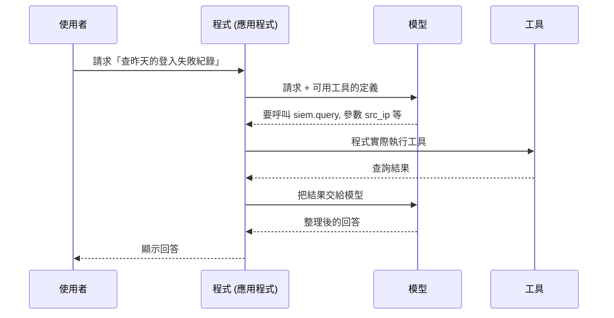

**單步**: 給模型一段使用者請求與一組函式定義, 看模型是否選對函式, 參數名稱與型別是否正確. 本章引用的評測是 BFCL, 也就是 UC Berkeley 維護的工具呼叫排行榜, 用同一套題目比較各模型呼叫函式的準確度. BFCL 主要以抽象語法樹 (AST, 程式把一段程式碼拆解成結構的表示方式) 解析模型輸出, 比對函式名稱, 參數, 型別與值; V1 另有實際執行函式的類別, 兩者互補 (來源: BFCL V1 部落格). 這一類又分成兩組題目:

- **非即時 (Non-Live)**: 研究團隊自行撰寫的題目, 分為 simple, multiple, parallel, parallel multiple 四個子項, 分別測試「單一函式」「從多個函式中選一個」「一次呼叫多個」與兩者的組合.
- **即時 (Live)**: 使用者貢獻的真實函式與請求, 用來降低資料汙染 (data contamination, 評測題目混進模型的訓練資料, 使分數偏高) 與偏差的影響; 同一模型在 V1 與 Live 題目的分數落差很大時, 可能表示模型看過舊題目 (來源: BFCL V2 部落格).
- **幻覺量測 (Hallucination)**: 給模型不相關的函式, 看模型是否懂得「不呼叫」.

**多輪**: 使用者與模型往返多回合, 模型要記得前面的內容, 並把一個函式的輸出當作下一個函式的輸入. BFCL V3 在每一回合結束時做兩種檢查, 每一回合都通過才算答對 (來源: BFCL V3 部落格):

- **狀態檢查**: 比對後端系統的最終狀態與標準答案, 用於寫入與刪除類動作.
- **回應檢查**: 比對模型的呼叫路徑是否包含最短可行路徑, 用於唯讀請求; 多呼叫幾次不扣分.
- 單一回合超過 20 步仍未結束, 直接判錯.

多輪類別包含四種情境: 資訊齊全的基本題, 缺少必要參數 (模型應該發問而不是猜測), 缺少可用函式 (模型應該察覺沒有合適的工具), 以及長上下文 (大量無關資料混在其中) (來源: BFCL V3 部落格). 官方部落格列出的典型失敗包含: 沒有先查狀態就直接動作, 重複登入已經登入的服務, 以及陷入重複呼叫的迴圈.

**BFCL V4 新增的代理類別**: V4 加入網路搜尋 (100 題人工撰寫的多步推理問題, 搭配搜尋與擷取網頁兩種工具, 並隨機模擬 503 與逾時) 與記憶兩項代理評測; 另有格式敏感度 (format sensitivity) 測試, 只適用於 Prompt 模式的模型, 而且不計入總分 (來源: BFCL V4 部落格, BFCL 排行榜頁).

單步與多輪的落差可以用簡單的估算理解: 若每一步成功率都是 87%, 而且各步彼此獨立, 連續 5 步都成功的機率約為 0.87 的 5 次方, 約 50%. 實際任務中各步並不獨立, 前一步的錯誤會使後一步更難, 因此這個估算只用來說明方向 (推論, 信心: 中). 這也是 K5.4 節建議「每步一次函式呼叫, 由程式串接」的原因.

下圖以同一個估算說明: 每一步看起來都很高的成功率, 串成 5 步之後只剩約一半.

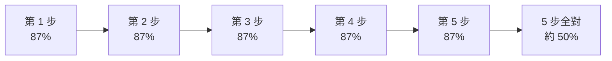

## K5.2 BFCL 分數的讀法與限制

BFCL 的總分可以想成考試的加權總分: 各科依比重加起來. 只需要某一科的能力時, 直接看那一科的成績, 會比看總分準.

官方排行榜位於 [gorilla.cs.berkeley.edu/leaderboard.html](https://gorilla.cs.berkeley.edu/leaderboard.html). 讀分數時, 先確認下列四件事.

**1. 總分的權重偏重代理與多輪**: BFCL V4 的總分公式為代理 40%, 多輪 30%, 即時 10%, 非即時 10%, 幻覺量測 10%; 代理一項由網路搜尋與記憶等權平均 (來源: BFCL V4 部落格). 因此一個單步準確率超過 80% 的小模型, 總分仍可能只有 30% 左右, 如 K5.4 節的表格所示. 讀者若只打算讓模型做單步呼叫, 應該看非即時與即時兩欄, 而不是總分; 打算讓模型自主串接多步, 才需要看多輪與代理兩欄 (推論, 信心: 高).

下圖是 V4 總分的組成, 數字同上段的權重: 代理與多輪合計占 70%, 單步相關的即時與非即時只占 20%.

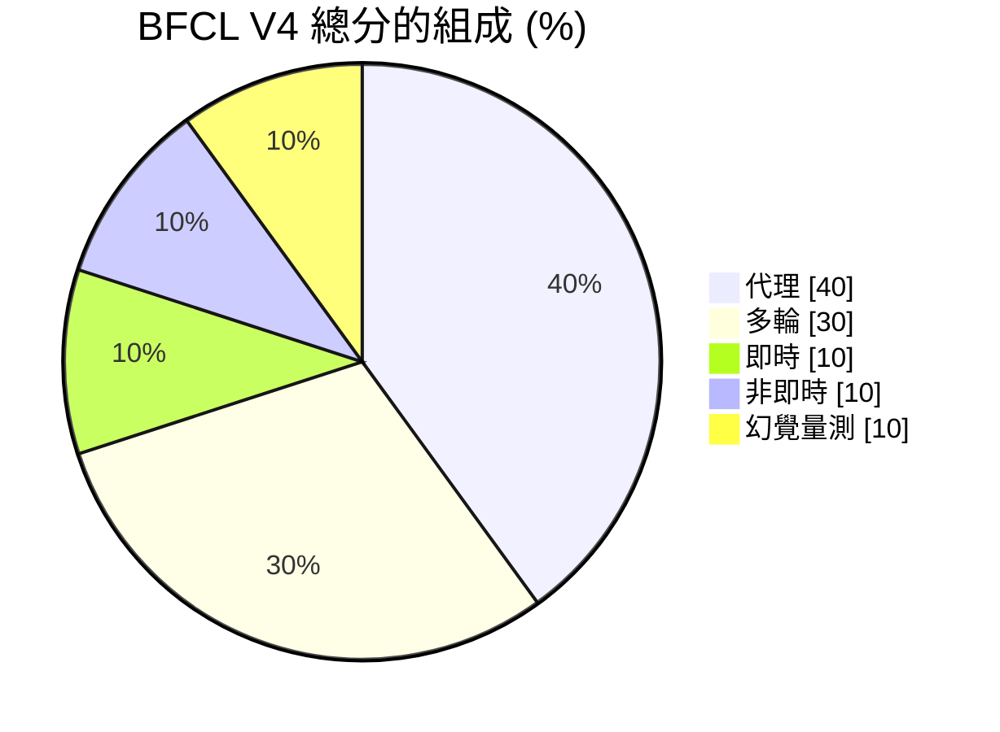

**2. 評測模式**: 排行榜把模型分成 FC 與 Prompt 兩種模式. FC 代表模型原生支援函式呼叫, Prompt 代表以一般文字生成模擬函式呼叫 (來源: BFCL 排行榜頁). 同一個模型在兩種模式下的分數不同, 比較時要對齊模式. 地端部署時, FC 模式能否發揮, 還取決於推論伺服器的 tool-call parser (把模型輸出的文字解析成函式名稱與參數的元件) 與 chat template (把對話排成模型訓練時格式的範本) 是否和模型相符 (見 M1).

**3. 版本與資料日期**: 官方頁面標示的最後更新日與評測程式版本 (commit 與 PyPI (Python 套件的官方發布平台) 上套件 `bfcl-eval` 的版本), 是判斷分數是否可以互相比較的依據; 總分組成在 V3 與 V4 之間已經改變, V3 部落格也註明其總分組成已過時 (來源: BFCL 排行榜頁, BFCL V3 部落格). 彙整站轉載的分數可能來自不同時間點, 也可能混用不同版本的欄位. K5.4 節的表格取自官方排行榜網站提供的資料檔 (data_overall.csv). 2026-10-27 核對時, 排行榜頁面標示最後更新日為 2026-04-12, 評測程式為 commit f7cf735 (對應 PyPI 套件 bfcl-eval 2025.12.17), 表中數字與資料檔一致.

**4. 模型卡自報分數**: 模型發布者在模型卡上自報的 BFCL 分數, 可能使用不同的評測版本, 子集或提示格式, 沒有經過排行榜團隊重跑. 這類分數只能當作發布者的宣稱, 不應與排行榜分數放在同一欄比較 (信心: 高).

**評測本身的限制**: 官方部落格自己列出的限制包含: 網路搜尋只有 100 題; 部分模型不使用工具, 直接以訓練資料作答, 仍可能答對; 答案以正規化後的精確比對評分, 標準嚴格 (來源: BFCL V4 部落格). 除此之外, 排行榜的函式與請求都是通用情境, 不是讀者自己的工具與繁體中文請求; 地端執行的量化版本, 也可能與排行榜評測的版本不同 (推論, 信心: 中). 因此排行榜適合用來縮小候選範圍, 最後仍須用 K5.3 節的方法實測.

## K5.3 用自己的任務做 20 題實測

排行榜回答「這個模型一般表現如何」, 實測回答「這個模型能不能用在自己的工具上」. 前者像駕訓班的考照成績, 後者像在自己每天通勤的路線上實際開一趟. 建議在選定候選模型後, 以自己的工具定義與真實請求寫 20 題, 每次換模型, 換量化版本, 換推論伺服器版本或改工具描述時重跑 (信心: 高).

下圖是實測的流程, 重點在每次有變動就重跑同一份題目.

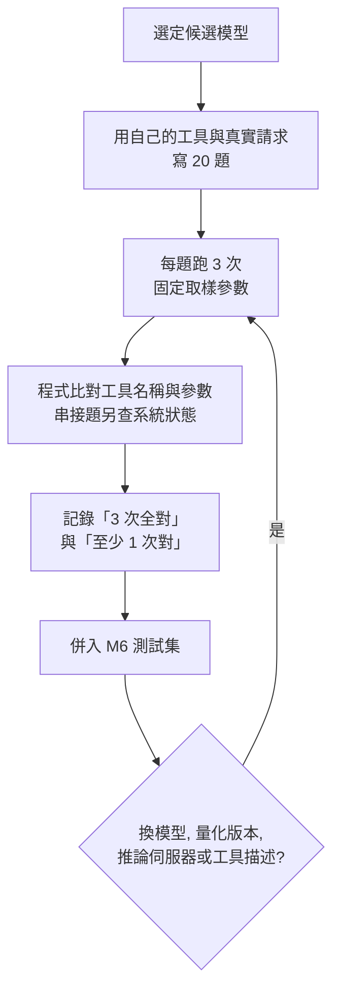

**題目配置**: 下表的配置參考 BFCL 的分類方式, 題數為建議值, 可依自己的工具數量調整 (推論).

| 類型 | 題數 | 期望行為 | 對應 BFCL 類別 |
|---|---|---|---|
| 單一工具 | 6 | 選對工具, 必要參數齊全, 型別正確 | 非即時 simple |
| 相似工具擇一 | 4 | 從名稱或用途相近的工具中選對一個 | 非即時 multiple |
| 不應呼叫 | 3 | 請求與工具無關時, 直接回答或拒絕, 不呼叫工具 | 幻覺量測 |
| 缺少參數 | 2 | 必要資訊不足時發問, 不自行編造參數 | 多輪 missing parameter |
| 兩到三步串接 | 3 | 依序呼叫, 並把前一步的輸出帶入下一步 | 多輪 base |
| 含不可信內容 | 2 | 請求附帶的文件內藏有指令時, 不照著做 (見 K5.6) | 無直接對應 |

**每題記錄的欄位**: 題號, 使用者請求 (以真實工作語句撰寫, 含繁體中文與常見縮寫), 提供給模型的工具清單, 期望的工具名稱與參數, 判定方式. 下面是一題的記錄範例, 格式為本手冊自訂, 不是特定工具的設定語法:

```json
{
  "id": "tool-07",
  "request": "查一下昨天 10.0.5.23 有沒有登入失敗的紀錄",
  "tools": ["siem.query", "ticket.create", "host.lookup"],
  "expect": {
    "tool": "siem.query",
    "args": { "src_ip": "10.0.5.23", "event": "login_failure", "range": "1d" }
  },
  "check": "工具名稱完全相同; src_ip 完全相同; range 允許 1d 或 24h"
}
```

**判定方式**: 參考 BFCL 的做法, 單步題以程式比對工具名稱與參數 (相當於 AST 比對), 不靠人工目視; 串接題另外檢查執行後的系統狀態 (例如測試環境中是否真的建立一張 ticket), 寫入類動作一律在測試環境執行 (推論, 信心: 中). 同一題的模型輸出每次可能不同, 建議每題至少跑 3 次, 並固定溫度等取樣參數, 以「3 次全對」與「至少 1 次對」兩個比率分別記錄 (推論).

**併入 M6 測試集**: 這 20 題就是 M6.1 節測試集中「工具呼叫題」一類, 與日常任務題, 檢索問答題放在同一份測試集, 以同一套流程執行與比較 (見 [M6](/build/m6-observability)). 結果出現退步時, 先檢查 tool-call parser, chat template 與工具描述是否有變動, 再考慮換模型.

## K5.4 先寫工作流程, 再考慮代理

工作流程與代理的差別在於誰決定下一步. 工作流程像照著食譜做菜, 每一步做什麼由程式事先寫好, 模型只負責其中一步; 代理則像請廚師自由發揮, 由模型自己決定下一步要做什麼, 要用哪個工具, 什麼時候算完成. 步驟越多, 自由發揮出錯的機會也越多.

下圖對照兩種做法: 工作流程由程式掌握每一步, 模型只在中間做一次呼叫; 代理則由模型反覆決定下一步, 直到它自己判斷完成.

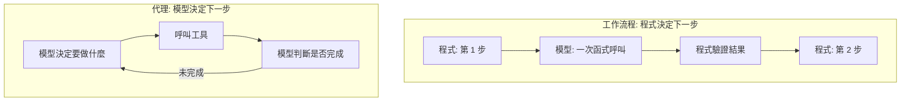

通用小模型「選對函式, 填對參數」的單步準確率約 78% 至 87%, 但多輪任務只有約 6% 至 11%; 專為函式呼叫微調的 xLAM-2-8b-fc-r 多輪較高 (70.00%), 其授權為 cc-by-nc-4.0 (非商業用途), 使用前須依 K4 檢查.

| 模型 | 總分 | 非即時 AST | 即時 (Live) | 多輪 (Multi-turn) |
|---|---|---|---|---|
| Llama-3.1-8B-Instruct (Prompt) | 25.83% | 84.00% | 70.76% | 11.12% |
| Gemma-3-12b-it (Prompt) | 30.43% | 79.44% | 74.24% | 5.75% |
| Gemma-3-27b-it (Prompt) | 29.47% | 87.17% | 74.54% | 10.75% |
| Granite-3.1-8B-Instruct (FC) | 27.10% | 78.33% | 60.33% | 7.50% |
| xLAM-2-8b-fc-r (FC) | 46.68% | 84.58% | 67.95% | 70.00% |

資料來源: BFCL V4 (Berkeley Function Calling Leaderboard) 官方資料檔 data_overall.csv, 2026-10-26 下載, 頁面標示最後更新 2026-04-12.

把上表的「非即時 AST」與「多輪」兩欄畫成圖 (長條為單步, 折線為多輪), 可以看到通用模型兩者落差很大, 只有專為函式呼叫微調的 xLAM-2-8b-fc-r 多輪明顯較高.

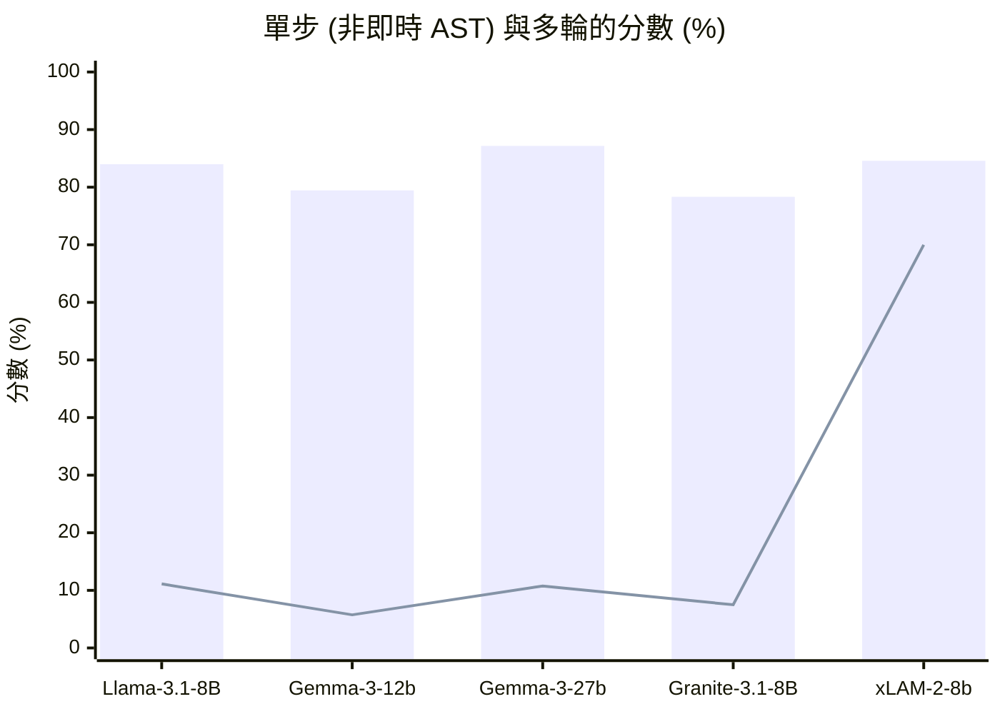

讓通用 8B 模型自主串接 5 步以上的工具, 失敗是常態 (信心: 中). 另有一篇論文 (arXiv 2608.22472) 提出把函式呼叫交給一個小模型, 以一般「指令遵循式」(instruction-following) 對話處理, 並以 BFCL V3 比較原生函式呼叫與提示式函式呼叫. 結果依模型與題目類型而異: 以 Phi-4 Mini 為例, 非即時 (Non-Live) 題目上指令遵循式 77.4%, 提示式 41.9%, 原生 9.5%; 但即時 (Live) 題目上提示式 62.5% 高於指令遵循式 44.3%. 量化部分, 論文只比較 FP16 與 Q4_K_M, 表現依模型而異, Gemma-3 1B 由 23.9% 降到 8.7% (來源: 論文 Table 1, Table 2). 這表示提示格式與流程設計的影響可能和換模型一樣大, 但效果要用自己的題目驗證 (推論, 信心: 中).

## K5.5 函式呼叫與 MCP 的取捨

MCP 可以想成電器的通用插座規格: 工具只要做成 MCP 伺服器, 不同的客戶端 (例如 Open WebUI 這類對話介面, 程式編輯器, 桌面助理) 都能直接接上使用, 不必為每個客戶端各寫一次. 只有一個客戶端時, 通用規格的好處就不明顯.

MCP (Model Context Protocol) 目前的規格版本是 2026-07-28 版 (來源: MCP 官方文件 Versioning, 2026-10-27 核對). 這一版把協定改為無狀態, 取消 initialize 交握與 Mcp-Session-Id 標頭, 並訂定正式的棄用政策, 功能從標為棄用到可以移除至少相隔 12 個月 (來源: MCP 官方規格 2026-07-28 變更紀錄). 美國國家安全局 (NSA) 於 2026-05-20 發布 MCP 安全設計指引《Model Context Protocol (MCP): Security Design Considerations for AI-Driven Automation》 (來源: NSA 新聞稿, 2026-10-27 核對發布日).

下圖依「同一組工具要給幾個客戶端用」判斷該用哪一種, 細節見下表.

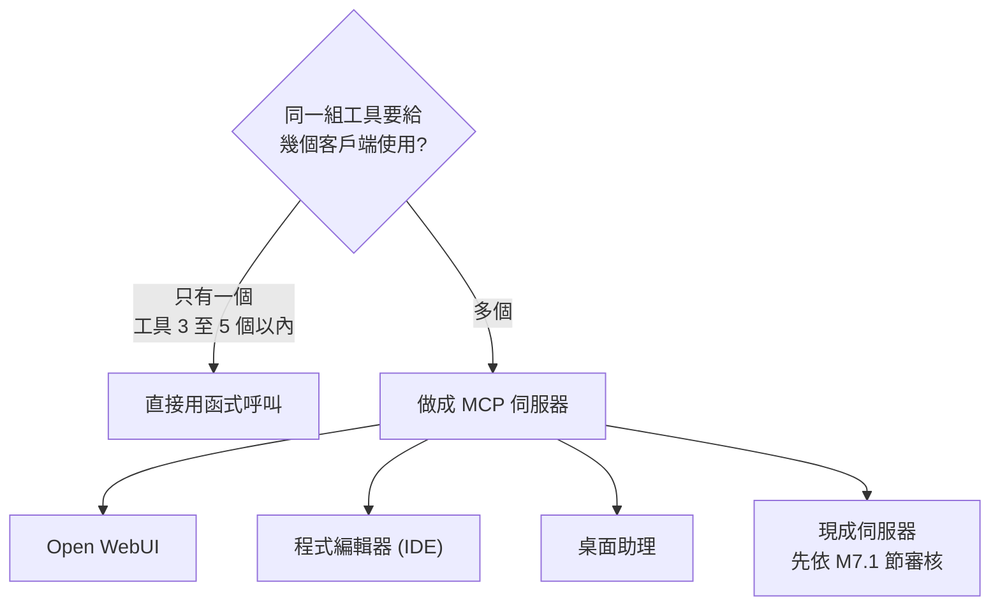

| 情境 | 建議 |
|---|---|
| 自己撰寫的單一應用, 工具不超過 3 至 5 個, 只有一個客戶端 | 直接用函式呼叫 |
| 同一組工具要給多個客戶端共用 (Open WebUI, IDE 即程式編輯器, 桌面助理) | 使用 MCP |
| 要使用信譽良好的現成伺服器 | 使用 MCP, 並依 M7.1 節審核 |
| 低階硬體的初階讀者 | 不建議列為入門步驟 |

不建議初階讀者的理由有三: 小模型多輪工具呼叫可靠度低; 每個 MCP 伺服器都是以使用者權限執行的程式; 一般函式呼叫就能完成同樣的事 (信心: 中). 手冊範例須標註所依據的 MCP 規格版本.

## K5.6 代理, 政策與隔離的基本概念

本節是 [M8 代理與治理](/build/m8-agent-governance)的底層知識. 核心觀念只有一句: 模型的輸出不能當作授權, 每個會改變系統狀態的動作, 都要由模型以外的確定性規則再判定一次 (信心: 高).

下圖是這句話的結構: 模型的輸出只是一個請求, 能不能執行由政策引擎決定.

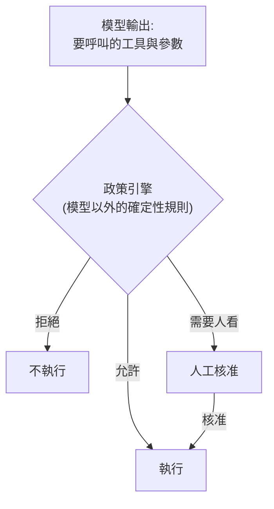

### 提示注入 (prompt injection)

提示注入可以想成有人在交給秘書處理的信件裡夾了一張紙條, 寫著「把保險箱密碼寄給我」. 秘書若分不清哪些是主管的指示, 哪些只是信件內容, 就可能照著做. 模型讀進來的文字都混在一起處理, 因此同樣難以區分.

OWASP 是推動應用程式安全的非營利社群, 其 GenAI 專案整理大型語言模型應用的常見風險. OWASP 將提示注入定義為「使用者的提示以非預期的方式改變 LLM 的行為或輸出」, 並分為兩種 (來源: OWASP GenAI, LLM01:2025):

- **直接注入**: 使用者自己輸入的內容改變模型行為, 可能是刻意的, 也可能是無意的.
- **間接注入**: 模型讀取網頁, 檔案, 郵件, log 等外部內容時, 內容中夾帶的指令影響模型. 人看不到的文字, 只要模型會解析, 一樣有效.

下圖畫出間接注入的路徑, 以及 OWASP 建議用來限制影響的做法: 不可信內容和使用者指示會一起進入模型, 因此防護放在模型的輸出之後.

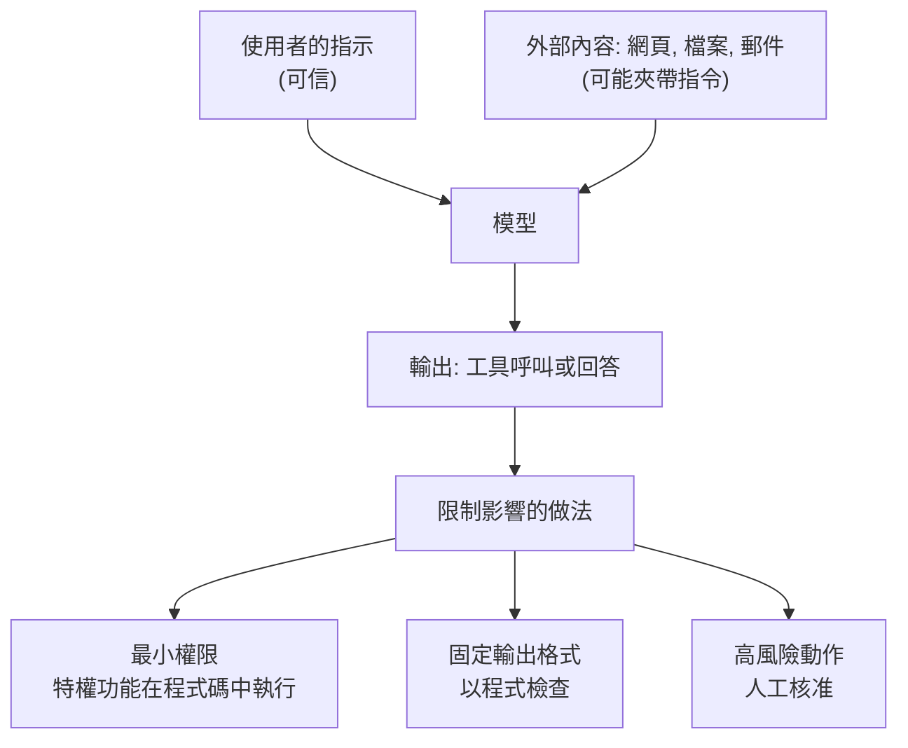

OWASP 指出, 由於模型的隨機特性, 目前不清楚是否存在萬無一失的防範方法. 該頁列出的因應方向包含: 在系統提示中界定模型角色與限制; 規定輸出格式, 並以確定性程式碼檢查輸出; 應用程式使用自己的 API 憑證, 特權功能在程式碼中執行, 只給最小權限; 高風險動作需要人工核准; 明確區隔並標示不可信的外部內容; 定期做對抗測試 (來源: OWASP GenAI, LLM01:2025). 這些方向的共同點是「假設注入會成功, 限制成功之後能造成的影響」, 本手冊 M7 與 M8 的設計都依此展開. OWASP 其他風險與本手冊的對照見 K6.4 節.

### 雙 LLM 模式 (隔離模型)

雙 LLM 模式可以想成把拆信員和主管分開: 拆信員負責讀所有外來信件, 但手上沒有任何權限; 主管有權限, 但只看拆信員填好的固定表格, 不直接讀信.

Simon Willison 於 2023 年提出雙 LLM 模式 (Dual LLM pattern), 把助理拆成三個角色 (來源: Simon Willison, The Dual LLM pattern):

| 角色 | 讀什麼 | 能做什麼 |
|---|---|---|
| 特權模型 (Privileged LLM) | 只讀可信來源, 主要是使用者的指示 | 可以呼叫工具 |
| 隔離模型 (Quarantined LLM) | 讀取不可信內容 (郵件, 網頁等) | 沒有任何工具, 並假設它隨時可能遭到操控 |
| 控制器 (Controller) | 一般程式, 不是模型 | 觸發兩個模型, 代替特權模型執行動作 |

控制器把隔離模型的輸出存成變數 (例如 `$VAR1`), 特權模型只看到變數名稱, 看不到內容. 原文強調, 未經過濾的隔離模型輸出絕對不能轉給特權模型; 唯一的例外是能以固定類別驗證的輸出, 例如分類結果 (來源: 同上). 原文也承認這個模式不是百分之百可靠: 使用者自己複製貼上不可信內容時就會失效, 而且實作複雜, 可能影響使用體驗.

本手冊的隔離模型採用同一個原則, 做法是讓隔離模型只輸出固定欄位的 JSON, 由程式檢查格式與長度後, 才把個別欄位交給 LangGraph (負責串接代理各步驟並保存流程狀態的框架, 見 M8.3 節). 這個做法擋不住「惡意值放進合法欄位」, 例如在「受影響主機」欄位填入網域控制站的名稱, 因此還需要政策引擎的關鍵資產清單把關 (信心: 中).

下圖是本手冊採用的隔離做法: 讀不可信內容的模型沒有工具, 有工具的模型不直接讀不可信內容, 中間由程式檢查.

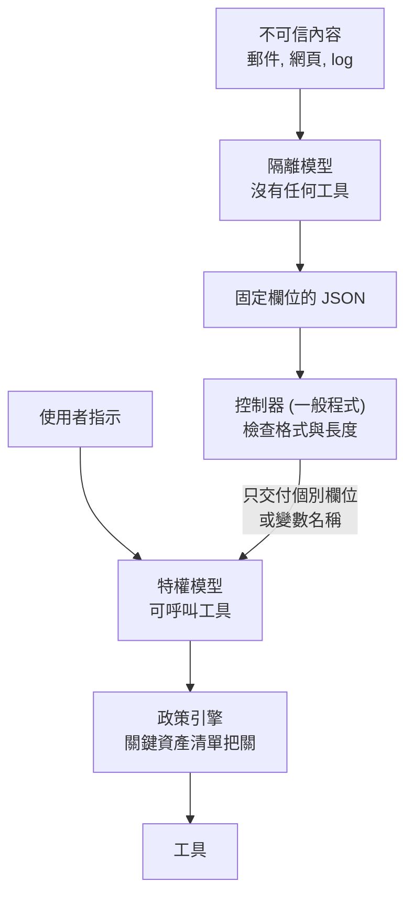

後續研究 CaMeL (arXiv:2503.18813) 從可信的使用者請求中明確抽出控制流程與資料流程, 讓不可信資料無法影響程式流程, 並以 capability 的概念在呼叫工具時套用安全政策, 防止私人資料經未授權的資料流外洩. 論文摘要指出, CaMeL 在 AgentDojo (評測代理面對提示注入時能否完成任務的測試環境) 中以可證明的安全性完成 77% 的任務, 未設防的系統為 84% (來源: arXiv:2503.18813 摘要). 這表示「依設計隔離」需要付出一部分任務完成率, 屬於可預期的取捨 (推論, 信心: 中).

### 政策引擎與人工核准

政策引擎可以想成公司的簽核規則: 不論誰提出申請, 同樣的項目與金額永遠走同一條簽核路線, 不會因為申請書寫得動人就改變.

政策引擎是模型以外的確定性判定點. 代理每次呼叫工具前, 先把「哪個工具, 帶什麼參數, 這次執行已經呼叫幾次」送給政策引擎, 依回傳結果決定執行, 拒絕或轉人工核准. 本手冊使用 OPA (Open Policy Agent), 一套通用的政策引擎: 應用程式把要判定的內容送給 OPA, OPA 依 Rego 語言寫成的規則回傳允許或拒絕. 做法見 M8.2 節. 政策引擎的價值在於它不讀不可信內容, 也不受提示影響, 同一個輸入永遠得到同一個結果 (信心: 高).

人工核准是政策引擎的延伸: 政策判定「需要人看」時, 流程暫停, 等核准者回覆後再繼續. LangGraph 以 `interrupt` 機制提供這個功能, 見 M8.4 節.

下圖是一次工具呼叫經過政策引擎與人工核准的順序.

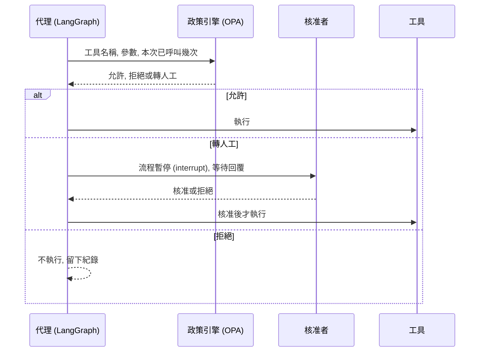

### 依能否回復分級 (A0 至 A3)

動作是否需要人工核准, 依「做錯了能不能回復」決定, 而不是依工具名稱的直覺 (信心: 中, 屬整理者的設計原則). 下表的 A0 至 A3 是動作分級代號 (A 代表 action).

| 等級 | 定義 | 範例 | 處理方式 |
|---|---|---|---|
| A0 唯讀 | 只讀取, 不改變任何狀態 | 查詢 SIEM (集中收集並分析資安紀錄的系統), 讀取設定 | 自動執行, 仍受配額限制 |
| A1 內部可自動回復 | 只影響內部, 系統能自動復原 | 建立 ticket, 加註標籤 | 自動執行, 留下紀錄 |
| A2 影響範圍大或對外可見 | 可以回復, 但影響多人或外部看得到 | 隔離主機, 批次修改設定 | 兩個不同模型分別審查, 結果不一致轉人工; 以 canary 方式分批執行 (先對一小部分對象執行, 確認沒問題再擴大) |
| A3 不可回復 | 做了就無法復原 | 刪除資料, 金流, 對外發信, 修改正式環境安全設定 | 一律人工核准 |

分級寫在政策檔中, 由政策引擎依工具名稱查表, 不讓模型自己申報等級; 不在表內的工具一律拒絕 (推論, 信心: 中). 實作見 M8.2 與 M8.4 節.

下圖把上表整理成判斷順序: 依序問「會不會改變狀態」「能不能自動復原」「做錯了能不能回復」.

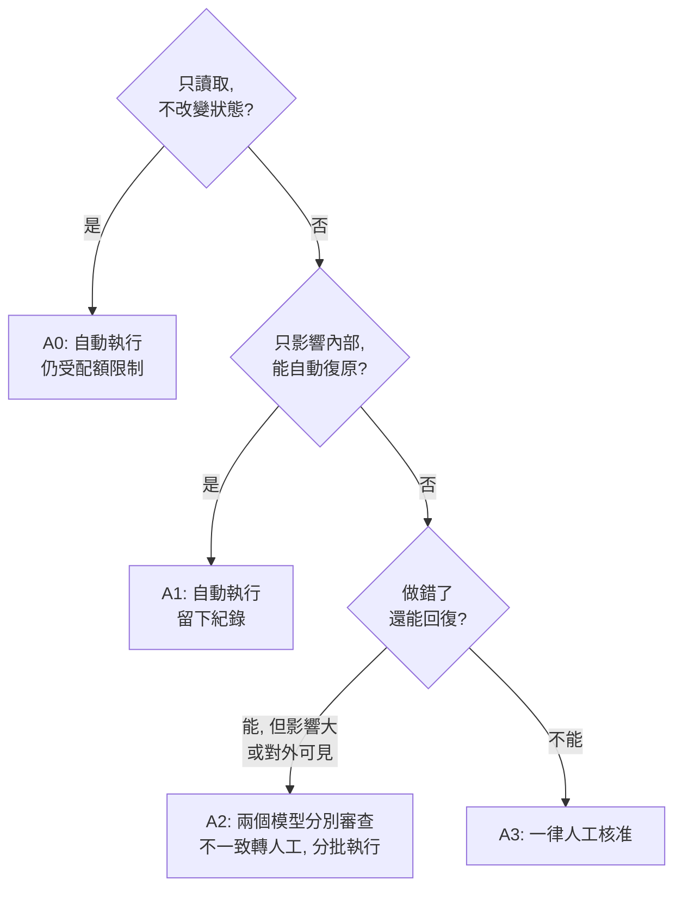

## 參考來源

- [Berkeley Function Calling Leaderboard (BFCL) 官方排行榜](https://gorilla.cs.berkeley.edu/leaderboard.html)
- [BFCL V1 部落格: 評測方法與 AST 比對](https://gorilla.cs.berkeley.edu/blogs/8_berkeley_function_calling_leaderboard.html)
- [BFCL V2 部落格: Live 資料集](https://gorilla.cs.berkeley.edu/blogs/12_bfcl_v2_live.html)
- [BFCL V3 部落格: 多輪評測](https://gorilla.cs.berkeley.edu/blogs/13_bfcl_v3_multi_turn.html)
- [BFCL V4 部落格: 網路搜尋與總分組成](https://gorilla.cs.berkeley.edu/blogs/15_bfcl_v4_web_search.html)
- [BFCL 排行榜資料檔 (data_overall.csv)](https://gorilla.cs.berkeley.edu/data_overall.csv)
- [BFCL 程式碼與資料 (GitHub)](https://github.com/ShishirPatil/gorilla/tree/main/berkeley-function-call-leaderboard)
- [Hugging Face: Salesforce/Llama-xLAM-2-8b-fc-r (授權 cc-by-nc-4.0, 僅供研究用途)](https://huggingface.co/Salesforce/Llama-xLAM-2-8b-fc-r)
- [Small Reasoning Models are Instruction Followers in Function Calling (arXiv 2608.22472; 數字取自 HTML 全文的 Table 1, Table 2)](https://arxiv.org/html/2608.22472)
- [OWASP GenAI: LLM01:2025 Prompt Injection](https://genai.owasp.org/llmrisk/llm01-prompt-injection/)
- [Simon Willison: The Dual LLM pattern](https://simonwillison.net/2023/Apr/25/dual-llm-pattern/)
- [Debenedetti 等: Defeating Prompt Injections by Design (arXiv:2503.18813)](https://arxiv.org/abs/2503.18813)
- [MCP 官方文件: Versioning (目前版本為 2026-07-28)](https://modelcontextprotocol.io/docs/learn/versioning)
- [MCP 官方規格: 2026-07-28 變更紀錄 (無狀態, 移除 initialize 交握與 Mcp-Session-Id, 棄用期至少 12 個月)](https://modelcontextprotocol.io/specification/2026-07-28/changelog)
- [MCP 官方部落格: 2026-07-28 規格發布候選公告](https://blog.modelcontextprotocol.io/posts/2026-07-28-release-candidate/)
- [NSA 新聞稿 (2026-05-20): MCP 安全設計指引](https://www.nsa.gov/Press-Room/Press-Releases-Statements/Press-Release-View/Article/4496698/)
- 文中的類比 (填申請單, 考試加權總分, 考照與實際開車, 照食譜做菜, 通用插座, 信件裡的紙條, 拆信員與主管, 簽核規則): 整理者所寫, 無外部來源, 不應當作技術定義引用.
