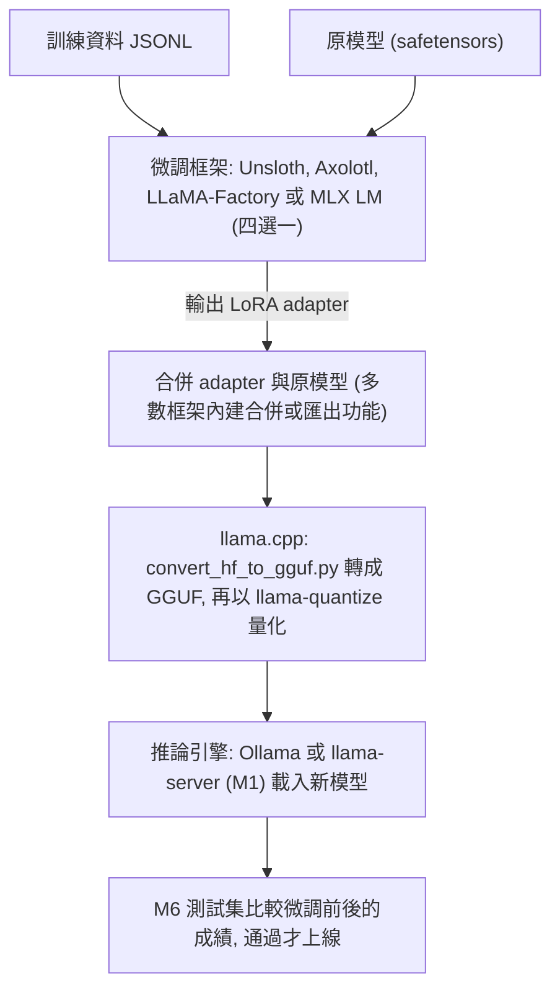

# T2 微調實作與部署

::: info 本章屬性
- 等級: ○ 依情境
- 實機驗證: 未進行 (指令依官方文件整理; 需實機確認: 各框架實際的顯示記憶體用量與訓練時間, 以及轉檔後的模型能否正常載入)
:::

**結論**: 一張消費級顯示卡就能用 QLoRA 微調 8B 等級的模型, Unsloth 官方標示的最低顯示記憶體約 6GB. 微調的完整流程是: 準備資料, 用微調框架訓練出 LoRA 參數, 合併回原模型, 以 llama.cpp 轉成 GGUF 並量化, 再交給 Ollama 或 llama-server 提供服務. 上線前用 [M6](/build/m6-observability) 的同一份測試集比較微調前後的成績, 並保留原模型, 結果不如預期時可以立即切回.

::: tip 本章常見名詞
| 詞 | 意思 |
|---|---|
| LoRA | 凍結原模型, 只訓練一小組附加的低秩矩陣的微調方法 |
| QLoRA | 先把原模型量化成 4 位元, 再在上面做 LoRA, 進一步減少顯示記憶體 |
| adapter | LoRA 訓練出來的那一小組附加參數, 可以單獨存檔, 也可以合併回原模型 |
| 合併 (merge) | 把 adapter 的參數加回原模型, 得到一個完整的新模型檔 |
| 微調框架 | 負責讀取資料, 執行訓練迴圈並輸出 adapter 的軟體, 例如 Unsloth, Axolotl |
| GGUF | llama.cpp 與 Ollama 使用的模型檔格式, 見 [K1](/know/k1-basics) |
| 量化 | 把模型的數字存得粗一點以縮小檔案, 見 [K2](/know/k2-quantization) |

完整詞彙見[術語對照](/ref/glossary).
:::

## T2.1 LoRA 與 QLoRA 原理

微調不一定要改動模型的全部參數. 可以想成在原本的教科書上貼便利貼補充, 而不是重印整本書: 書本內容 (原模型) 保持不變, 新學到的東西寫在便利貼 (附加參數) 上, 閱讀時兩者一起看.

LoRA (Low-Rank Adaptation, 低秩適配) 凍結預訓練模型的權重, 在 Transformer 架構的每一層加入可訓練的低秩分解矩陣, 訓練時只更新這些矩陣. 論文以 GPT-3 175B 為例, 與用 Adam 全參數微調相比, 可訓練參數減少約 1 萬倍, 顯示記憶體需求約降為三分之一; 而且與 adapter 層的做法不同, LoRA 不會增加推論延遲 (來源: Hu 等人, LoRA 論文, 2021). 「低秩」可以理解為用兩個細長的小矩陣相乘, 去近似一個大矩陣的變化量, 所以要訓練的數字少很多.

QLoRA 進一步把凍結的原模型量化成 4 位元, 梯度穿過這個 4 位元模型, 只更新 LoRA 的參數. 論文提出三項技術: 4 位元 NormalFloat (NF4) 資料型別, 把量化常數再量化一次的雙重量化, 以及處理記憶體尖峰的分頁最佳化器; 作者表示, 這些技術讓單張 48GB 顯示卡就能微調 65B 參數的模型, 並保有 16 位元微調的任務表現 (來源: Dettmers 等人, QLoRA 論文, 2023).

這兩種方法讓微調從「需要多張資料中心級顯示卡」降到「一張消費級顯示卡」. 各模型大小的顯示記憶體最低值見 [T1.3](/train/t1-decide).

## T2.2 微調工具: 各自負責什麼

微調流程中有三類工具, 各自負責不同的步驟. 可以想成做菜: 微調框架是主廚, 負責把食材 (資料) 和原料 (原模型) 做成新的料理 (adapter); llama.cpp 是包裝線, 負責把成品轉成店裡用的盒子 (GGUF) 並分裝 (量化); 推論引擎是外場, 負責把成品端給客人 (提供 API).



四個微調框架做的是同一件事, 差別在操作方式與支援的硬體. 讀者只需要選一個:

| 工具 | 在流程中的角色 | 操作方式 | 授權 | 支援平台 (依官方文件) |
|---|---|---|---|---|
| Unsloth | 以節省顯示記憶體為重點的微調框架, 可直接匯出 GGUF | Python 程式 (Core); 另有網頁介面 Studio | Core 為 Apache 2.0; Studio 介面為 AGPL-3.0 | Linux 與 WSL 搭配 NVIDIA 顯示卡; Studio 支援 Windows, macOS; AMD 與 Intel 另有指南 |
| Axolotl | 以 YAML 設定檔驅動的微調框架, 同一份設定可重複執行 | 命令列加 YAML 設定檔 | Apache 2.0 | NVIDIA 顯示卡 (bf16 與 Flash Attention 需 Ampere 以上) 或 AMD 顯示卡 |
| LLaMA-Factory | 提供網頁介面的微調框架, 可不寫程式完成訓練與匯出 | 命令列或網頁介面 | Apache 2.0 | Linux, Windows 搭配 CUDA; 另支援 Ascend NPU 與 AMD ROCm |
| MLX LM | Apple 晶片專用的文字生成與微調套件 | 命令列 | MIT | Apple silicon 的 Mac |

**Unsloth** 負責流程中的訓練步驟, 主打以較少的顯示記憶體完成微調. 官方文件列出支援 LoRA, QLoRA, 全參數微調與強化學習等方法, 並可匯出 GGUF 等格式 (來源: Unsloth GitHub 儲存庫). NVIDIA 顯示卡需 CUDA 運算能力 7.0 以上 (例如 RTX 20 系列, T4, A100); 只有 CPU 時不能訓練 (來源: Unsloth 文件 Unsloth Requirements). 程式套件 (Core) 的授權為 Apache 2.0, 但選配的網頁介面 Studio 採 AGPL-3.0; 若打算把 Studio 改作後提供給他人使用, 先依 [K4](/know/k4-licenses) 檢查 AGPL 的義務 (來源: Unsloth GitHub 儲存庫 License 一節). 安裝程式套件的方式如下 (來源: Unsloth 文件 pip install; 未實機驗證):

```bash
pip install unsloth
```

**Axolotl** 同樣負責訓練步驟, 特色是把模型, 資料與訓練參數全部寫在一份 YAML 設定檔中, 前處理, 訓練, 評估, 量化都沿用同一份設定, 方便留存與重做. 支援全參數微調, LoRA, QLoRA 與多種偏好訓練方法; 需要 Python 3.12 以上與 PyTorch 2.13.0 以上 (來源: PyPI axolotl 0.21.0 頁面, 2026-10-16 發布). 安裝與執行範例如下 (來源同上; 未實機驗證):

```bash
pip install axolotl
axolotl train <設定檔.yml>
```

**LLaMA-Factory** 負責訓練與匯出, 特色是網頁介面: 官方文件表示可透過 WebUI 零程式碼微調, 介面分為訓練, 評估與預測, 對話, 匯出四個部分, 匯出時可指定量化等級 (來源: LLaMA-Factory 文件 WebUI). 支援全參數, 凍結部分層, LoRA 與 QLoRA 等方法 (來源: LLaMA-Factory GitHub README). 安裝與啟動網頁介面的方式如下 (來源: LLaMA-Factory 文件 Installation 與 WebUI; 未實機驗證):

```bash
git clone --depth 1 https://github.com/hiyouga/LlamaFactory.git
cd LlamaFactory
pip install -e .
llamafactory-cli webui
```

合併 LoRA 參數則用 `llamafactory-cli export <設定檔>` (來源: LLaMA-Factory GitHub README; 未實機驗證).

**MLX LM** 是 Apple 為自家晶片提供的套件, 在 Mac 上同時負責文字生成與微調. 支援 `lora`, `dora` 與 `full` 三種微調方式; 若指定的模型已量化, 訓練時就會使用 QLoRA. 訓練完成後, `mlx_lm.fuse` 可以把 adapter 合併回模型, 加上 `--export-gguf` 可直接輸出 GGUF, 但官方註明此功能只支援 Mistral, Mixtral 與 Llama 架構的 fp16 模型 (來源: MLX LM 文件 LORA.md). 安裝訓練所需的套件如下 (來源: MLX LM 文件; 未實機驗證):

```bash
pip install "mlx-lm[train]"
```

**如何選擇** (推論, 信心: 中):

- 使用 Mac: 選 MLX LM.
- 一張 NVIDIA 顯示卡, 希望用網頁介面操作: 選 LLaMA-Factory, 或 Unsloth Studio (留意 AGPL-3.0).
- 需要把每次訓練的設定完整留存, 讓別人可以重做: 選 Axolotl.
- 顯示記憶體吃緊: 先試 Unsloth.

## T2.3 繁體中文資料集

微調資料最好的來源是自己的業務資料, 因為微調要教的正是自己的格式與規則 (見 [T1](/train/t1-decide)). 公開資料集可以補充語料, 但要先確認兩件事: 授權是否允許預定用途, 以及資料怎麼產生. 可以想成採購食材: 除了看價格 (授權), 也要看產地 (來源), 來路不明的食材不應進廚房.

本輪檢視的公開資料如下 (2026-10-27 查詢):

| 資料 | 發布者 | 授權 | 適合的用途與限制 |
|---|---|---|---|
| FineWeb2 的 `cmn_Hani` 子集 | Hugging Face | ODC-By 1.0 | 網頁文字, 不是問答格式, 適合持續預訓練而非指令微調; 資料卡未區分繁體與簡體; 該子集磁碟大小約 1.48TB, 已做全域去重 |
| 中文維基百科資料庫備份 | Wikimedia 基金會 | GFDL 與 CC BY-SA 4.0 | 百科文字, 同樣不是問答格式; 內容繁簡混雜; CC BY-SA 有相同方式分享的要求 |

CC BY-SA 的相同方式分享條款是否及於以這類資料訓練出的模型, 公開資料查無定論 (2026-10-27 查詢). 打算對外散布以這類資料訓練的模型時, 請先洽法律顧問; 只在內部使用時, 至少保留資料來源與授權紀錄.

指令微調用的繁體中文問答資料集, 公開資料查無同時滿足「授權允許商業使用」與「說明回答由哪個模型或哪些人產生」的資料集 (2026-10-27 查詢 Hugging Face 與網路搜尋, 信心: 低, 搜尋範圍有限). 例如台灣團隊發布的 TaiwanChat 對話資料集標示 CC BY-NC 4.0 (不允許商業用途), 資料卡也沒有說明對話如何產生 (來源: TaiwanChat 資料卡). 因此, 指令微調資料建議由自己的業務資料整理, 或由授權允許的模型產生後經人工逐筆審查. 使用任何公開問答資料集前, 請讀資料卡確認授權 (CC BY-NC 這類授權不允許商業用途) 與產生方式; 若回答是由其他模型產生, 也要檢查該模型的授權是否限制用輸出內容訓練其他模型 (推論, 信心: 中).

實務上較穩妥的做法, 是從內部文件與歷史紀錄整理問答範例, 依 [T1.2](/train/t1-decide) 的清單檢查品質 (推論, 信心: 中).

## T2.4 驗證, 轉檔上線與回退

訓練完成不等於可以上線. 上線前要回答三個問題: 新模型有沒有比較好, 能不能在現有推論引擎上跑, 出問題時能不能馬上換回來. 可以想成新產品上市: 先比對樣品與規格 (驗證), 再包裝上架 (轉檔), 同時保留舊產品的庫存 (回退).

### 用同一份測試集比較

微調前後使用 [M6](/build/m6-observability) 的同一份測試集, 在相同的提示與參數下各跑一次, 比較答對率. 兩點要注意 (推論, 信心: 中):

- 測試題不能出現在訓練資料中, 否則分數會偏高 (資料汙染).
- 除了微調要改善的題目, 也要測一般能力的題目. 微調可能讓模型在新工作上變好, 卻在原本會的事情上變差.

### 轉成 GGUF 並量化

llama.cpp 在這一步負責格式轉換與量化: 它的 `convert_hf_to_gguf.py` 把 Hugging Face 格式 (safetensors) 的模型轉成 GGUF, `llama-quantize` 再把 GGUF 量化成較小的檔案. 官方說明, 模型以 16 位元格式發布時, `--outtype auto` 或省略此參數即可 (來源: llama.cpp 文件 quantize README). 合併後的模型目錄放在本機時, 轉檔與量化的指令如下 (來源同上, 範例中的 `--remote` 參數改為本機目錄; 未實機驗證):

```bash
python convert_hf_to_gguf.py <合併後的模型目錄> --outfile model-bf16.gguf --outtype bf16
./build/bin/llama-quantize model-bf16.gguf model-Q4_K_M.gguf Q4_K_M
```

官方文件提醒, 量化可能帶來準確度損失, 並警告從已量化的檔案再量化一次, 品質會比從 16 位元或 32 位元量化差很多 (來源同上). 因此應保留 16 位元的 GGUF, 每次都從它量化 (推論, 信心: 高).

### 接入推論引擎

**Ollama**: 在 Modelfile 中以 `FROM` 指向 GGUF 檔, 再用 `ollama create` 建立模型. Ollama 匯入 GGUF 時不會量化, 須先用 llama-quantize 完成量化 (來源: Ollama 文件 Importing a model; 未實機驗證):

```bash
# Modelfile 內容: FROM /path/to/model-Q4_K_M.gguf
ollama create <新模型名稱> -f Modelfile
```

**llama-server**: 也可以不合併, 直接載入原模型與 LoRA adapter. llama-server 的 `--lora` 參數指定 adapter 檔案路徑, 多個 adapter 以逗號分隔 (來源: llama.cpp 文件 server README). adapter 須先轉成 GGUF; llama.cpp 儲存庫提供 `convert_lora_to_gguf.py` 腳本 (來源: llama.cpp GitHub 儲存庫檔案列表), 官方模型文件另指向轉換 adapter 的線上工具 GGUF-my-LoRA (來源: llama.cpp 文件 models.md). 依該腳本在 b11889 版的原始碼, 必填參數是 adapter 目錄 (內含 PEFT 的 adapter 設定與權重), 另可用 `--base` 指定基底模型的設定檔目錄 (只需要設定檔, 不需要權重), `--outfile` 指定輸出檔, `--outtype` 指定精度 (f32, f16, bf16, q8_0, auto, 預設 f32) (來源: llama.cpp GitHub 儲存庫 convert_lora_to_gguf.py, 2026-10-27 查閱原始碼).

### 回退

保留原模型與原本的設定, 新模型用不同的名稱建立, 不覆蓋舊模型. 新模型的檔案依 [M3](/build/m3-model-intake) 登記雜湊值與版本, 並在登記表註明訓練資料的版本. 上線後若發現問題, 把 [M5](/build/m5-gateway-identity) 閘道或使用者介面的模型名稱切回原模型即可 (推論, 信心: 中).

## 參考來源

- **LoRA 的做法, 可訓練參數與顯示記憶體的降幅, 無額外推論延遲**: [Hu 等人, LoRA: Low-Rank Adaptation of Large Language Models (arXiv 2106.09685)](https://arxiv.org/abs/2106.09685) (2026-10-27 重新擷取摘要核對)
- **QLoRA 的 NF4, 雙重量化, 分頁最佳化器, 單張 48GB 顯示卡微調 65B 模型**: [Dettmers 等人, QLoRA: Efficient Finetuning of Quantized LLMs (arXiv 2305.14314)](https://arxiv.org/abs/2305.14314) (2026-10-27 重新擷取摘要核對)
- **Unsloth 的支援平台與顯示記憶體**: [Unsloth 文件: Unsloth Requirements](https://www.unsloth.ai/docs/get-started/fine-tuning-for-beginners/unsloth-requirements); **安裝**: [Unsloth 文件: pip install](https://unsloth.ai/docs/get-started/install/pip-install); **授權, 訓練方法, 匯出格式**: [Unsloth GitHub 儲存庫](https://github.com/unslothai/unsloth)
- **Axolotl 的授權, 方法, 需求, 安裝, 版本**: [PyPI: axolotl](https://pypi.org/p/axolotl) (0.21.0, 2026-10-16)
- **LLaMA-Factory 的授權, 方法, 匯出指令**: [LLaMA-Factory GitHub 儲存庫](https://github.com/hiyouga/LlamaFactory); **安裝**: [LLaMA-Factory 文件: Installation](https://llamafactory.readthedocs.io/en/latest/getting_started/installation.html#installation); **網頁介面**: [LLaMA-Factory 文件: WebUI](https://llamafactory.readthedocs.io/en/latest/getting_started/webui.html)
- **MLX LM 的授權與安裝**: [MLX LM GitHub 儲存庫](https://github.com/ml-explore/mlx-lm); **微調方式, 資料格式, 合併與 GGUF 匯出限制**: [MLX LM 文件: LORA.md](https://github.com/ml-explore/mlx-lm/blob/main/mlx_lm/LORA.md)
- **FineWeb2 的授權, cmn_Hani 子集與去重**: [Hugging Face 資料集: HuggingFaceFW/fineweb-2](https://huggingface.co/datasets/HuggingFaceFW/fineweb-2)
- **維基百科資料庫備份的授權**: [Wikimedia dumps: License information (Debian 鏡像站)](https://cdimage.debian.org/mirror/wikimedia.org/dumps/legal.html)
- **TaiwanChat 的授權 (CC BY-NC 4.0)**: [Hugging Face 資料集: yentinglin/TaiwanChat (資料卡)](https://huggingface.co/datasets/yentinglin/TaiwanChat/commits/9492a3c3d566eed6d7cc60a95bce6380349ccbb2/README.md)
- **GGUF 轉檔與量化指令, 量化的品質提醒**: [llama.cpp 文件: quantize README](https://github.com/ggml-org/llama.cpp/blob/master/tools/quantize/README.md); **轉換腳本與 adapter 轉換工具**: [llama.cpp GitHub 儲存庫](https://github.com/ggml-org/llama.cpp), [llama.cpp 文件: models.md](https://github.com/ggml-org/llama.cpp/blob/master/docs/models.md); **llama-server 的 --lora 參數**: [llama.cpp 文件: server README](https://github.com/ggml-org/llama.cpp/blob/master/tools/server/README.md)
- **Ollama 匯入 GGUF 與不在匯入時量化**: [Ollama 文件: Importing a model](https://docs.ollama.com/import)
- **整理者判斷 (推論, 無外部來源)**: 工具選擇建議, 「低秩」的說明方式, 繁體中文指令資料集的查詢結論, 測試集比較的注意事項, 保留 16 位元 GGUF 的做法, 回退方式.
- **文中的類比 (教科書上貼便利貼, 做菜的主廚, 包裝線與外場, 採購食材, 新產品上市)**: 整理者所寫, 無外部來源, 不應當作技術定義引用.
